<p align="center"></p>

<h1 align="center">Looking Glass</h1>

<p align="center"><b>Your Shadowserver reports, replayed as a living picture of your country.</b><br>
Free and open source (AGPL-3.0) · built in Africa, for African CSIRTs · worldwide coverage in the pipeline<br>
<sub>Built by <a href="https://www.linkedin.com/in/iowuraku">Ike Owuraku Amponsah</a>, Cybersecurity Threat Intelligence Analyst</sub></p>

<p align="center">
  <a href="#quick-start">Quick start</a> ·
  <a href="#features">Features</a> ·
  <a href="docs/USE_CASES.md">Use cases</a> ·
  <a href="docs/COMPARISON.md">Comparison</a> ·
  <a href="docs/USER_GUIDE.md">User guide</a> ·
  <a href="docs/GLOSSARY.md">Glossary</a> ·
  <a href="#security">Security</a>
</p>


> [!NOTE]
> **Coverage:** Looking Glass is currently implemented for the **54 African countries** — each with its regions map,
> settings and constituency filters. **Global coverage (every country) is in the pipeline.**

---

## Contents

1. [Why Looking Glass](#why-looking-glass)
2. [Features](#features)
3. [How it works](#how-it-works)
4. [Quick start](#quick-start)
5. [Using it, step by step](#using-it-step-by-step)
6. [Roles](#roles)
7. [Security](#security)
8. [Looking Glass, IntelMQ and Elastic](#looking-glass-intelmq-and-elastic)
9. [Requirements](#requirements)
10. [Documentation](#documentation)
11. [Contributing and reporting problems](#contributing-and-reporting-problems)
12. [Licence and credits](#licence-and-credits)
13. [Author](#author)

---

## Why Looking Glass

The [Shadowserver Foundation](https://www.shadowserver.org/what-we-do/network-reporting/) sends free daily reports to over
**201 national CSIRTs in 176 countries**, in **more than 80 report types**. They are invaluable, and hard to use by
hand: a national CSIRT can receive **well over a hundred report e-mails and tens of thousands of rows a day**, each report with its own
columns, in formats that change over time. A folder of zipped CSV files is not a picture.

Free tools exist — [IntelMQ](https://docs.intelmq.org/) routes and notifies, the [Elastic Stack](https://www.elastic.co/)
searches everything — but **the resources to run them** (servers, storage, skilled staff, time) are scarce for many
teams, especially across Africa. Looking Glass needs **one modest server and a guided installer**, and is useful on day one.

> Looking Glass **complements** IntelMQ and Elastic; it does not replace them. See the
> [honest comparison](docs/COMPARISON.md), with sources.

## Features

<table>
<tr>
<td width="50%"><a href="docs/media/screens/20-comms-map.png">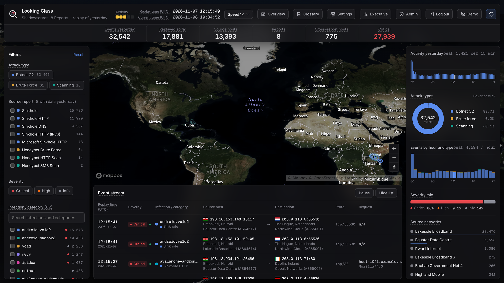</a></td>
<td width="50%"><a href="docs/media/screens/30-services.png">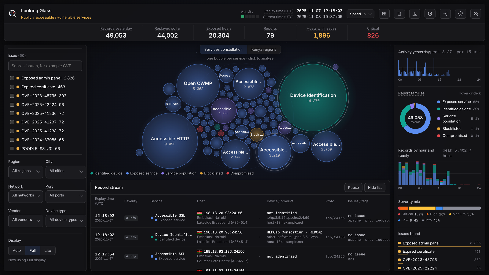</a></td>
</tr>
<tr>
<td><b>Reported network communications.</b> Infected and attacking hosts in your country and the servers they reach
(botnet command and control, sinkholes, honeypots), replayed on a 3D map one day later, with filters, live charts
and an event stream.</td>
<td><b>Publicly accessible / vulnerable services.</b> What anyone on the internet can reach in your constituency —
open databases, remote desktop, vulnerable devices, compromised and blocklisted hosts — by service, region, network
and issue.</td>
</tr>
<tr>
<td><a href="docs/media/screens/21-comms-insight.png">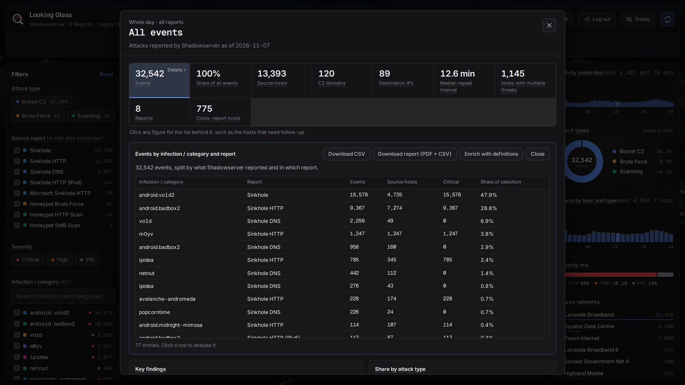</a></td>
<td><a href="docs/media/screens/40-executive-comms.png">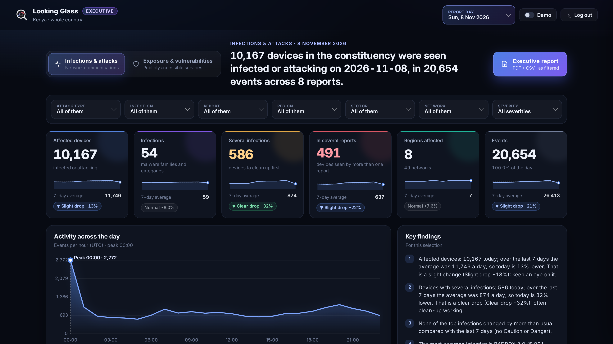</a></td>
</tr>
<tr>
<td><b>One click to analyse.</b> Every figure, bubble, region and row opens an analysis: key findings, breakdowns and
the hosts to follow up first, with CSV and PDF reports.</td>
<td><b>Executive portal.</b> Aggregated figures only — never an address — with a one-click executive report (PDF in
the dashboard's design, plus CSVs).</td>
</tr>
<tr>
<td colspan="2"><a href="docs/media/screens/40-executive-comms-baseline.png">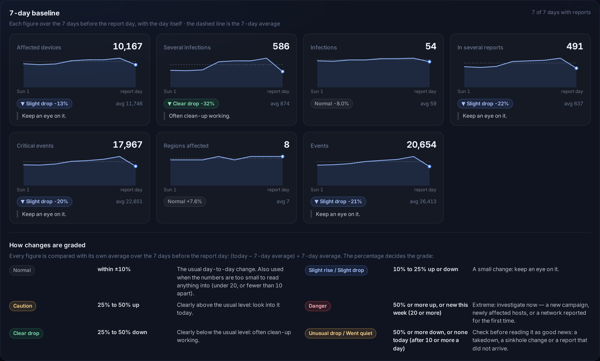</a></td>
</tr>
<tr>
<td colspan="2"><b>7-day baseline.</b> Every figure, infection and issue compared with its own average over the previous 7
days, graded on a stated scale — Normal (within ±10%), Slight rise / drop, Caution, Danger, Clear drop, Unusual drop /
Went quiet — with plain words on what to do. In the key findings and the executive report too.</td>
</tr>
<tr>
<td><a href="docs/media/screens/32-services-insight.png">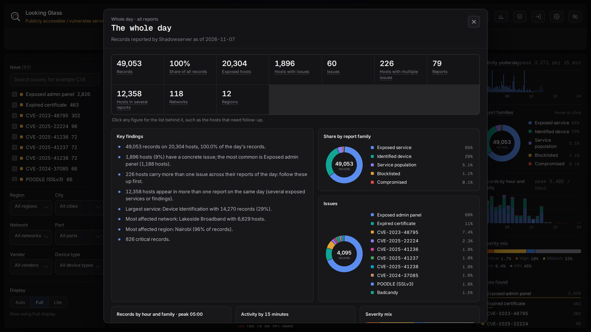</a></td>
<td><a href="docs/media/screens/26-comms-demo.png">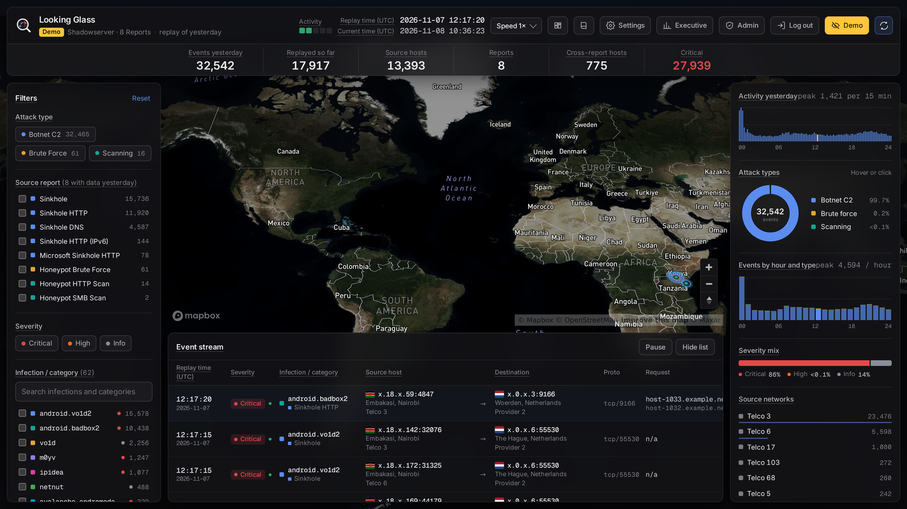</a></td>
</tr>
<tr>
<td><b>Issues and infections explained.</b> CVEs with CISA KEV (actively exploited), CVSS and EPSS; infections with
Malpedia families and threat actors, or definitions with references, and your researchers' notes on new findings.</td>
<td><b>Demo mode and masked views.</b> Network names, AS numbers and addresses concealed on the server, for public
screens, partners and presentations.</td>
</tr>
<tr>
<td colspan="2"><b>Intel for researchers.</b> On the Definitions page, every infection and issue shows what the reports
carry for it — C2 domains, DNS lookups, URLs, user agents, other CVEs, tags, fingerprints — report by report, with the
exact combinations and how many hosts keep repeating them. Looking Glass raises matches between names and reports
("can you look into this?"), and researchers share dated, signed notes that appear on every card and report.</td>
</tr>
</table>

**Also:** all 54 African countries with their regions maps · your constituency only (networks and address ranges) ·
network names and sectors identified automatically · works on TVs, tablets and phones · PDF reports on every list ·
an audit log of everything.

## How it works

```
 Shadowserver report e-mails ──► database/  (pipeline: fetch attachments and links, unzip, sort, load — every 30 min)
                                     │
                                     ▼
                                  MongoDB  (one collection per report type)
                                     │  read-only account
                                     ▼
                                 platform/  (Looking Glass: replay, analysis, reports, accounts)
                                     │  HTTPS
                                     ▼
                     analysts' browsers · wall screens · executives · partners (masked)
```

1. **Collect.** The database pipeline reads the mailbox that receives your Shadowserver reports (Gmail / Google
   Workspace, Microsoft 365 or any IMAP server), saves every attachment and download link, and skips what it already has.
2. **Load.** Each report goes into MongoDB, one collection per report type, without duplicates.
3. **Replay.** Shadowserver sends a day's reports during the next day; Looking Glass replays that day **in full, at
   the same time of day**, so a wall screen always shows a living picture.
4. **Analyse and share.** Analysts drill down and export; executives get aggregates; partners see masked views.

| Folder | What it is | Start here |
|---|---|---|
| [`database/`](database) | the Shadowserver pipeline: installs MongoDB, pulls the report e-mails, loads them | [database/README.md](database/README.md) |
| [`platform/`](platform) | the Looking Glass web platform | [platform/README.md](platform/README.md) |
| [`docs/`](docs) | glossary, comparison and screenshots | [docs/GLOSSARY.md](docs/GLOSSARY.md) |

## Quick start

**You need:** Ubuntu 24.04 or later, Desktop or Server (on the computer itself, in a virtual machine, or Ubuntu on WSL 2 on Windows 10/11) · the mailbox that receives your
Shadowserver reports · a free [Mapbox](https://account.mapbox.com/) token · optionally a [Malpedia](https://malpedia.caad.fkie.fraunhofer.de/) token.
No Shadowserver reports yet? [Sign up your CSIRT](https://www.shadowserver.org/what-we-do/network-reporting/get-reports/) — it is free.

1. **Get the code**
   ```bash
   git clone https://github.com/<your-account>/looking-glass.git
   cd looking-glass
   ```
2. **Run the guided installer**
   ```bash
   ./install.sh
   ```
3. **Answer its questions.** What to install, where MongoDB runs, how to reach the mailbox (with step-by-step help for
   Google, Microsoft or IMAP credentials), how often to fetch and **how many days each run looks back**, your
   country, tokens, who may open the platform, and the port. **Every answer is checked on the spot** — a real mailbox
   login, real token checks, a real MongoDB login, port conflicts.
4. **Let it install.** System packages, MongoDB, Python environments, services and the scheduled fetch; then it runs
   the security test and the platform checks and shows the result.
5. **Open the address it shows** and choose **Let's get started** to create the first administrator with an
   authenticator app. On **Ubuntu Server** (no browser on the machine), create the first administrator through an SSH
   tunnel: `ssh -L 5000:127.0.0.1:5000 user@server`, then open http://localhost:5000 on your own computer (use the
   port you chose in the installer if it is not 5000).

`./install.sh --text` asks the same questions as plain prompts; `./install.sh --answers FILE` installs unattended
(see [`install.answers.example`](install.answers.example)). Manual installation:
[docs/INSTALLATION.md](docs/INSTALLATION.md).

## Using it, step by step

| | |
|---|---|
| 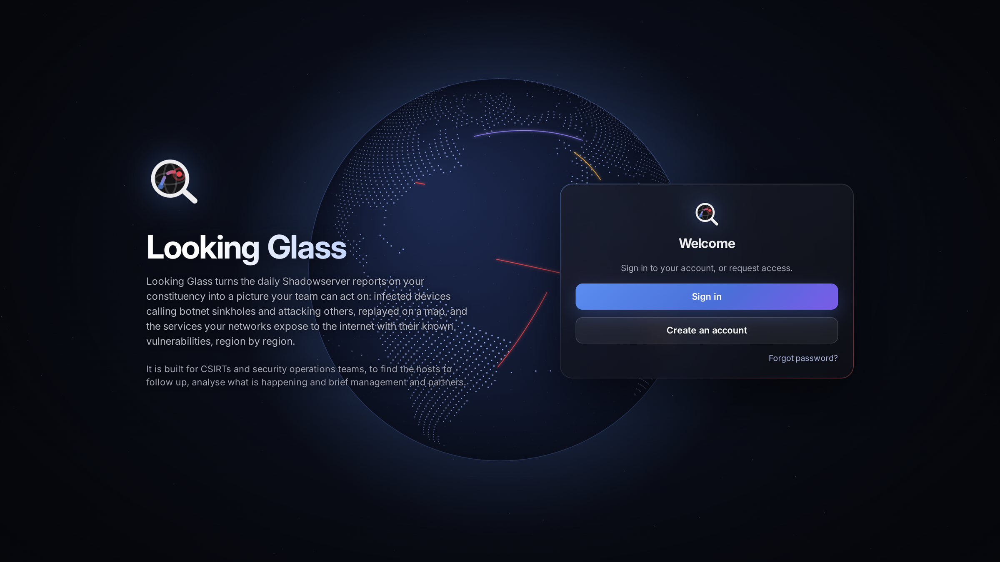 | **1. Sign in** with your password and the 6-digit code from your authenticator app. New accounts wait for an administrator's approval. |
| 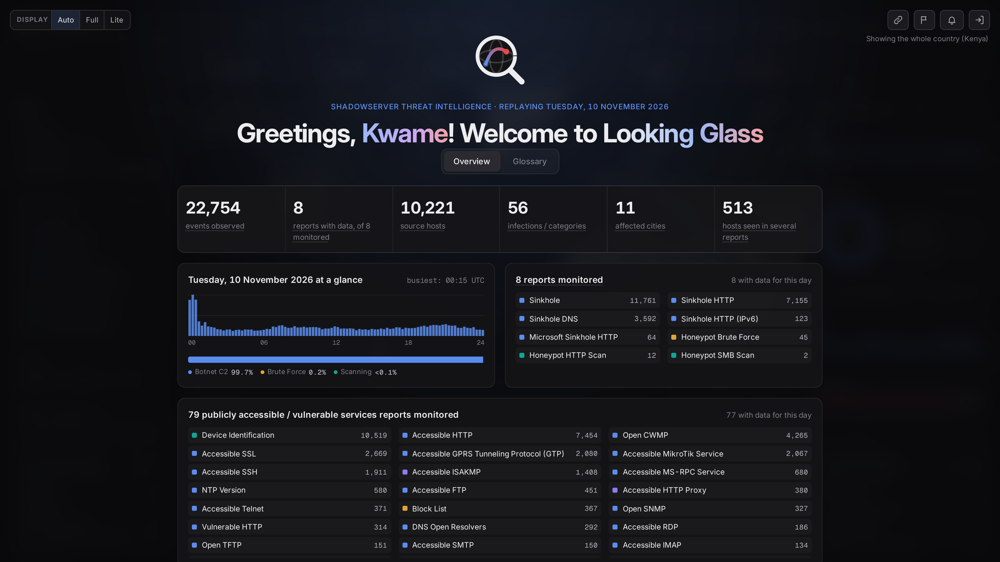 | **2. Read the overview:** yesterday at a glance, every monitored report, and the two platforms. The **Glossary** tab explains every term. |
|  | **3. Explore the network communications map.** Filter on the left, watch the charts on the right, follow events in the stream. |
| 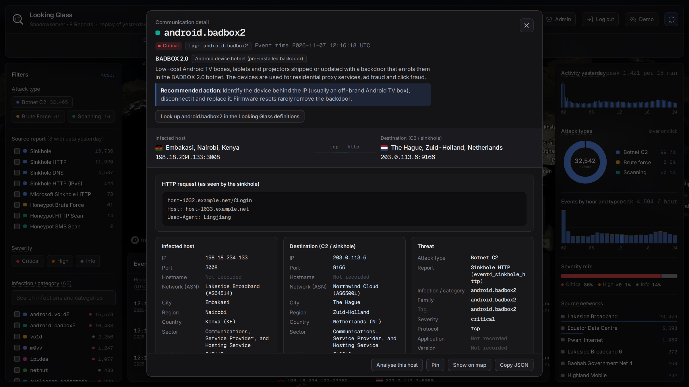 | **4. Open any event** for its source, destination, infection and the raw request, with Malpedia enrichment. |
| 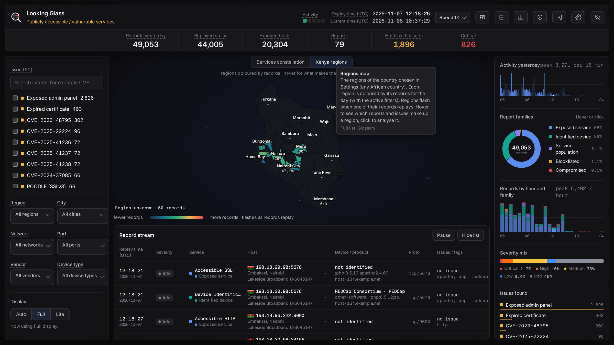 | **5. Switch to the services platform** and its regions view to see exposure by region and city. |
| 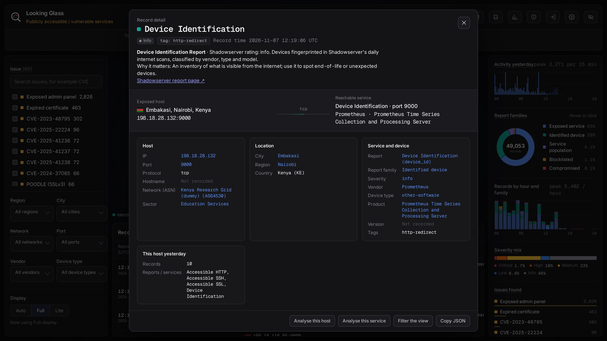 | **6. Follow a host up:** every service, issue and report for it, ready to export. |
| 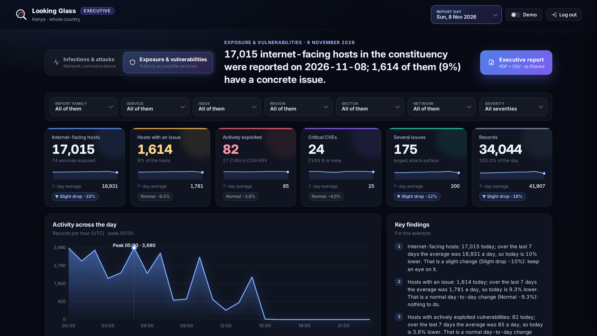 | **7. Share with management:** the Executive portal and its one-click report. |

The complete guide, with every screen and button: [docs/USER_GUIDE.md](docs/USER_GUIDE.md).

## Roles

| Role | Sees | Can |
|---|---|---|
| **External** | both platforms, always masked | view only |
| **Analyst** | everything, unmasked | analyse, export CSV and PDF, Malpedia, Demo mode |
| **Researcher** | only the Definitions page (no addresses) | define malware names and issues with references, study the intel gathered from the reports, share notes, correct network names |
| **Management** | only the Executive portal (aggregates, never addresses) | filter, explain, download executive reports |
| **Admin** | everything | also Settings, the Definitions page, accounts, roles, sessions and the audit log |

Administrators can build custom roles from the permissions. Details: [User guide → Roles](docs/USER_GUIDE.md#roles).

## Security

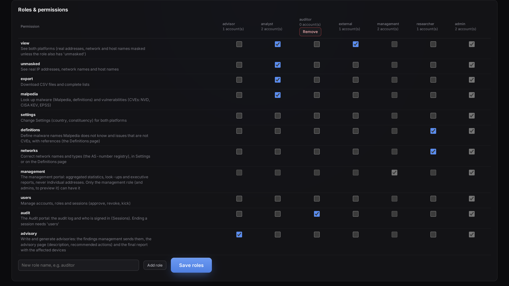

- **Two-factor sign-in for everyone** (authenticator app), strong passwords, lock-out after failed attempts, recovery codes.
- **Sessions** bound to the browser, ended after inactivity; administrators see and end any session.
- **Roles and permissions** enforced on the server; masking is done **on the server**, so hidden values never reach the browser.
- **Executive portal** that cannot return an address (checked by an automated test).
- **Audit log** of sign-ins, failures, settings, accounts, definitions, notes and report downloads, naming people as *Full Name (username)*.
- **Safe exports:** no CSV cell can run as a spreadsheet formula.
- **Hardened web layer:** HTTPS for remote access, a strict content security policy (per-request nonce, no eval),
  CSRF tokens and same-origin checks, HttpOnly / SameSite=Strict / Secure cookies, frames refused, network allow lists.
- **Penetration-tested:** every finding fixed, and [`security_retest.py`](platform/security_testing/security_retest.py)
  checks each protection again on your own installation. See [SECURITY.md](docs/SECURITY.md).
- **No secrets in the code:** credentials live only in `.env` files, which `.gitignore` keeps out of the repository.

Please report security problems **privately** to the maintainers rather than in a public issue.

## Looking Glass, IntelMQ and Elastic

| | IntelMQ | Elastic Stack | **Looking Glass** |
|---|:---:|:---:|:---:|
| Free to use | ✅ | ✅ | ✅ |
| Ready-made views of Shadowserver data | — | ◐ build them | ✅ |
| Useful straight after installing | ◐ configure bots | ◐ build dashboards | ✅ |
| Executive reports and dashboard | — | ◐ build them | ✅ |
| Automatic notification of constituents | ✅ | — | — |
| Many feeds besides Shadowserver | ✅ | ✅ | — |
| Search across any data, at scale | — | ✅ | — |

✅ built in · ◐ partly, or with work · — not its job.
**Use them together:** IntelMQ notifies, Elastic searches, Looking Glass shows. Full comparison with sources:
[docs/COMPARISON.md](docs/COMPARISON.md).

## Requirements

| | |
|---|---|
| Countries | the **54 African countries** today; global coverage is in the pipeline |
| Operating system | **Ubuntu 24.04 or later, Desktop or Server** — on the computer itself, in a virtual machine, or Ubuntu on WSL 2 on Windows 10/11. On Ubuntu Server, create the first administrator through an SSH tunnel (`ssh -L 5000:127.0.0.1:5000 user@server`, then open http://localhost:5000) |
| Memory and disk | about 2 GB RAM for the platform; MongoDB needs space for your reports |
| Network | the mailbox (IMAP, Gmail API or Microsoft Graph), Mapbox for the map tiles; optional Malpedia, RIPEstat, PeeringDB, NVD, CISA KEV and EPSS look-ups |
| Browsers | current Chrome, Edge, Firefox or Safari; TVs and phones supported |

## Documentation

| Topic | Document |
|---|---|
| **Use case scenarios: a needle through the haystack** | [docs/USE_CASES.md](docs/USE_CASES.md) |
| What is new, with dates | [docs/FEATURES.md](docs/FEATURES.md) |
| Screenshots | [docs/media](docs/media) |
| Every term, in plain language | [docs/GLOSSARY.md](docs/GLOSSARY.md) |
| Comparison with IntelMQ and Elastic | [docs/COMPARISON.md](docs/COMPARISON.md) |
| Installing (Windows/WSL and Linux, HTTPS, firewall) | [docs/INSTALLATION.md](docs/INSTALLATION.md) |
| Connecting the mailbox (Gmail, Google Workspace, Microsoft 365, IMAP) | [docs/MAIL_SETUP.md](docs/MAIL_SETUP.md) |
| Using the platforms, step by step | [docs/USER_GUIDE.md](docs/USER_GUIDE.md) |
| Every setting | [docs/CONFIGURATION.md](docs/CONFIGURATION.md) |
| Day-to-day running, backups, checks | [docs/OPERATIONS.md](docs/OPERATIONS.md) |
| How it works inside | [docs/TECHNICAL_REFERENCE.md](docs/TECHNICAL_REFERENCE.md) |
| Security and the penetration test | [docs/SECURITY.md](docs/SECURITY.md) |
| The database pipeline | [database/README.md](database/README.md) |

## Contributing and reporting problems

- **Questions and bugs:** open an issue with what you did, what you expected and what happened (never paste
  addresses from your reports, tokens or passwords).
- **Improvements:** fork, branch, and open a pull request; run `platform/tests/run_all_checks.sh` and
  `platform/security_testing/security_retest.py` first.
- **Security problems:** report privately to the maintainers.

## Licence and credits

Copyright © 2026 Ike Owuraku Amponsah. Looking Glass is free and open source software under the
[GNU Affero General Public License v3.0](LICENSE) (AGPL-3.0).

- **You may** use it for any purpose, study it, modify it and share it, changed or not.
- **If you share it, or a modified version**, you must share the complete source code under the same AGPL-3.0 licence,
  keep the copyright and licence notices, and state what you changed.
- **If you run a modified version as a service** (users reach it over a network), you must offer those users its
  complete source code under AGPL-3.0, too. Nobody can turn Looking Glass into a closed product or a closed hosted
  service.
- It comes with **no warranty** (sections 15–16 of the licence).

The browser libraries are loaded from their own sites and keep their own licences: deck.gl and qrcode-generator (MIT)
and Mapbox GL JS (Mapbox terms of service).

Data and services keep their own terms: region boundaries from [geoBoundaries](https://www.geoboundaries.org/)
(CC BY 4.0 — credit geoBoundaries when you show the maps); Shadowserver reports, Mapbox, RIPEstat, PeeringDB, Malpedia,
NVD, CISA KEV and FIRST EPSS under their providers' terms.

**Credits:** data — the Shadowserver Foundation (your CSIRT's own reports) · region boundaries — geoBoundaries ·
maps — Mapbox · 3D arcs — deck.gl · network names — RIPEstat and PeeringDB · malware look-ups — Malpedia (Fraunhofer FKIE).

## Author

Looking Glass was built by **Ike Owuraku Amponsah**, Cybersecurity Threat Intelligence Analyst.

[LinkedIn: linkedin.com/in/iowuraku](https://www.linkedin.com/in/iowuraku)

<sub>All screenshots use **dummy data**: documentation IP ranges (RFC 5737 / RFC 2544 / RFC 3849),
private AS numbers and fictional network names.</sub>
