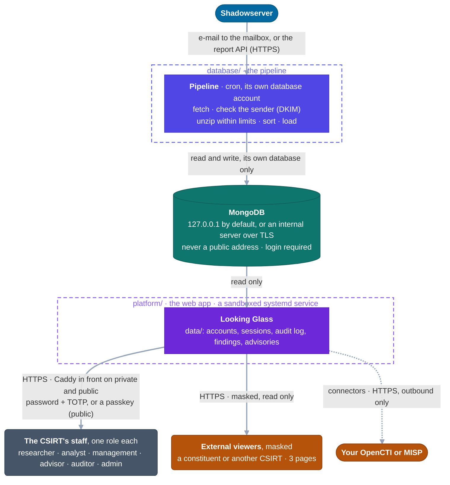

# Architecture and threat model

This page describes how Looking Glass is built and where its trust boundaries are. It names what an attacker would
want, who that attacker might be, and what stops each attack. It also
lists the risks that remain. It describes the code as it is now; when the code changes, this page should change with it.

The details of each control are in [Security](SECURITY.md), and the logic of the audit log is in
[How the audit log proves itself](AUDIT_LOG_PROOF.md).

---

## 1. The parts

Looking Glass is two programs that share one database. By default everything except the browsers runs on one server;
the database can instead be an internal MongoDB on another server of your network (see below):

| Part | What it does | Runs as | Can write |
|---|---|---|---|
| **Pipeline** (`database/`) | On its schedule (every 30 minutes recommended): fetches the reports (mailbox read-only, or Shadowserver's report API), checks who sent each e-mail, unzips within limits, sorts and loads each CSV row into MongoDB | the installing user's cron, outside the web app's sandbox | its folders, and its own database through `lookingglass_pipeline` |
| **MongoDB** | Holds the reports: one document per row, per report type | `mongod`, bound to 127.0.0.1 (or an internal server: see below) | n/a |
| **Platform** (`platform/`) | The web app: the map, services, Intel gathered, findings, the Executive portal, advisories and the Audit portal | a systemd service with `NoNewPrivileges`, `ProtectSystem=strict` and `ProtectHome=read-only`; writable only in `data/` | only `data/`; the database through the read-only account `lookingglass_ro` |
| **Unusual activity counter** (`unusual_worker.py`) | Every hour: counts each network's and report's records against its own normal, for the Unusual activity page; counts only, never an address | its own systemd timer and service, in the same sandbox as the web app | only `data/` |
| **Connector sender** (`connectors_worker.py`) | Every 15 minutes, only when an administrator has set up and turned on a target: sends Looking Glass's own analysis of each report day to the CSIRT's own OpenCTI or MISP | its own systemd timer and service, in the same sandbox as the web app | only `data/` |
| **Browser** | Shows the pages; all report data is inserted as text, under a strict Content-Security-Policy | the user's computer | nothing on the server, except through the signed-in API |

**Where the database may be.** On this server (127.0.0.1, the default), or an internal MongoDB on another server of
your own network. Both programs refuse anything else: a database whose address, or any address its name resolves to,
is public is never used, and there is no setting that allows it. A database on another server is reached over TLS
(`MONGO_TLS=1`, its certificate and name always checked); without TLS it is refused unless `MONGO_ALLOW_PLAINTEXT=1`
says the link between the two servers is trusted. A local MongoDB listens on 127.0.0.1, plus an internal address of
the server only when the platform runs on another computer. The installer checks that an existing database has the
Looking Glass structure; if it holds something else it offers a new database for Looking Glass on that server, or
MongoDB on this computer instead. Looking Glass never writes into another program's data.

**One Linux user.** The platform and the pipeline run as the same Linux user: the ordinary user who ran the installer
(never root). What keeps them apart is the platform's systemd sandbox (it can write only its `data/`, and can't see
`/run/user` or D-Bus) and their separate database accounts, not two Linux users. Someone who gets a shell as that user,
outside the sandbox, has the pipeline's account: guard it as you would any administrator login.

There is one way back from the web app to the pipeline: Settings → Workers. The web app can't write the pipeline's
folder. A setting change is a request file in the web app's own `data/pipeline_requests/`, which the pipeline checks
again at its next run. A request that would make the pipeline **less strict** waits until someone confirms it on the
server, on the pipeline's own account ([Security, section 1](SECURITY.md#pipeline-settings-from-the-web-app-settings--workers)).

## 2. From a report to an advisory

1. **Arrives.** A Shadowserver e-mail, or a file from the report API. In both cases only the pipeline touches it.
2. **Checked.** The sender's DKIM signature is checked on the message exactly as it was downloaded. Zips are unpacked
   within limits counted on the real bytes, and file names inside a zip can't leave its folder. One-off special
   reports are loaded apart.
3. **Stored.** One document per CSV row. Duplicates are refused by a unique index.
4. **Seen.** Each role sees only its part:
   - Analysts see addresses.
   - Researchers see the threat data with every constituent address masked. Patterns carried by fewer than 5 hosts
     get no lasting code.
   - Management sees numbers and the C2 / sinkhole domains by name; a C2 host that is an IP address reads
     "IP address 1, 2…", never the address.
   - External viewers see everything masked, on three pages only (external_access.py).
   - The auditor sees only the audit log and its evidence.
5. **Followed up.** A finding is a channel. Every hand-over names a person, and only the people in it (and admins)
   can open it.
6. **Advised.** The advisor drafts one advisory per organisation and generates the PDF, then marks it as sent. Every
   step goes into the audit log.
7. **Audited.** Every sign-in, change, export and view of host-level data goes into a hash-chained audit log. The
   auditor takes a proof package and verifies it offline on their own computer.

## 3. Trust boundaries

| # | Boundary | What crosses it | What is checked there |
|---|---|---|---|
| B1 | Internet → pipeline | e-mails and report files | DKIM signature by the expected signer; zip limits; safe file names; HTTPS to Shadowserver, with each API request signed with the secret (`HMAC2`) |
| B2 | Pipeline → database | report rows | the pipeline's own account: its database only, no account management |
| B3 | Database → platform | report rows | a read-only account; every value is treated as untrusted text (it came from scanned hosts) |
| B4 | Network → platform | HTTP requests | `ACCESS_MODE` and the allow list; the host-name check (against DNS rebinding); HTTPS for remote sign-in; a 64 KB request limit; Caddy in front on private and public installations (each request read in full under time limits); Looking Glass itself listens on 127.0.0.1 only |
| B5 | Signed-in user → data | API calls | role permissions enforced on the server; masking done on the server; CSRF token and same-origin checks on changes |
| B6 | Platform → pipeline | setting requests | re-checked by the pipeline; loosening needs a confirmation on the server, bound to the request's SHA-256 |
| B7 | Platform and pipeline → outside services | look-ups | only what each service needs: AS numbers (PeeringDB, RIPEstat), CVE IDs (NVD, FIRST, CISA), malware hashes and families (Malpedia), place names (Mapbox geocoding); the pipeline asks Cloudflare and Google over HTTPS (1.1.1.1, 1.0.0.1, 8.8.8.8, 8.8.4.4, by IP address, certificates checked) for Shadowserver's DKIM key when the network drops DNS TXT look-ups, sending only that key's name (`MAIL_AUTH_DNS_SERVERS`). No constituent IP address is sent to any of them |
| B8 | Server → auditor | the proof package | the auditor's own verifier, standard library only, run off the server; an earlier head kept by the auditor; signed daily checkpoints, optionally copied to another computer (`AUDIT_CHECKPOINT_COPY_DIR`), which the verifier and the proof package check |
| B9 | Analyst → the Looking Glass creator | a decoding request | sent by hand, never by Looking Glass: only the HTTP request lines (up to 5) with their infection names, each keeping only its undecoded value (every other parameter value reads `<value>`, any address `<address>`; the path keeps only its shape, best effort: plain path words and file names stay, any other segment reads `<seg>`, `<n>`, `<long>`, `<address>` or `<email>`, `;` parameters lose their values and keep only plain-word names; a name that is itself a plain word stays, so the administrator checks the exact lines), no host, address, user agent or count; the analyst confirms the TLP rules allow it; recorded as an export; pasted into a private report on the separate [HTTP Requests Decoding](https://github.com/anonghosty/http-requests-decoding) repository, never a public issue |
| B10 | Platform → pipeline | the quarterly purge permit | written only for a VALID quarterly report and only while an administrator has turned the purge on in Settings → Quarterly (their own password again; `purge_confirmed.json`); the pipeline also requires that confirmation, read-only, and refuses without it; the pipeline works out the quarter's dates itself and refuses a permit that differs, one made after its purge day, or a cutoff within 31 days of today; it deletes only report rows dated before the cutoff, from report collections only, once per quarter |
| B11 | Platform → the CSIRT's own OpenCTI or MISP | Looking Glass's own analysis of each report day: the devices' addresses as victims (never as indicators to block), their malware, CVEs and ATT&CK links; never Shadowserver's raw rows, findings, notes, names, time to act or combination codes | only administrators set a target up, and every change asks for a passkey or code; saved only after its test passed; HTTPS only, the certificate always checked; the address looked up once and refused when it is this computer, link-local, cloud metadata or reserved; no redirects, 20 seconds, 1 MB; the key stored encrypted (AES-GCM under `CONNECTOR_KEY_SECRET`) and never sent back to the page; every send in the audit log and on the Audit portal's Data sent out tab |

## 4. What an attacker would want

| Asset | Where | Why it matters |
|---|---|---|
| **Constituent identities**: IP addresses, host names and network names of the organisations in the reports | MongoDB; shown to analysts | A list of vulnerable or infected hosts in the country is a target list |
| **Credentials**: mailbox and database passwords, the Shadowserver API key, `REF_SECRET`, `CONNECTOR_KEY_SECRET`, TLS key, session store | `.env`, `data/` (mode 600), `/etc/looking-glass/mongo-admin.env` (root only) | They open everything else. `REF_SECRET` is what makes masked host labels unguessable |
| **The audit log** | `data/audit.log`, its archives, `audit.head`, `audit.seal` | It is the evidence an auditor and the CSIRT rely on |
| **The integrity of the reports** | the pipeline's intake, MongoDB | Forged reports would send analysts and advisories after the wrong hosts |
| **Pipeline settings** | the pipeline's `.env` | Turning the sender check or the unzip limits off would open the intake |
| **Findings and advisories** | `data/findings.json`, `data/advisories/` | They say who is affected and what to do; they are not for every role |
| **Accounts and roles** | `data/users.json`, roles | A role change is a way into everything above |
| **Passkeys** | `data/passkeys.json` (public keys and counters only, mode 600) | A passkey added to an account is a lasting way to sign in as that person |
| **Connector keys** | `data/connector_keys.enc` (mode 600), encrypted under `CONNECTOR_KEY_SECRET` | They let whoever holds them write into the CSIRT's OpenCTI or MISP |

## 5. Who might attack, and what stops them

Each row below names a threat and the control that stops it.

### A1. Someone on the network, with no account

| Threat | Control |
|---|---|
| Reach pages or the API without signing in | Every page and API needs a sign-in: password (scrypt) plus TOTP |
| Replay an authenticator code, or reuse a recovery code | Each code works once, checked again when it is recorded; recovery codes are removed when used |
| Guess passwords | 5 failures per account and address, then a lock of 15 minutes by default (`LOGIN_ACCOUNT_LOCK_MIN`, 5 to 240); 20 per address per hour; same answer and timing for wrong names |
| Steal or plant a session | Server-side sessions (only a hash is stored); a new ID at sign-in; HttpOnly, SameSite=Strict, Secure, `__Host-`; bound to address and browser |
| Make a signed-in user's browser change things (CSRF, DNS rebinding) | CSRF token, JSON only, `Origin` and `Sec-Fetch-Site` checks, host-name allow list |
| Become the first administrator | A one-time setup code readable only on the server; over HTTPS only from another computer; a wrongly set up reverse proxy can't make everyone look local |
| Inject script through report values (banners come from scanned hosts) | Everything inserted as text; CSP with a per-request nonce, no eval, no inline handlers; CSV cells that look like formulas are neutralised |
| Relay a password and a code through a look-alike site, in real time | On `public` installations everyone signs in with a passkey, which the browser binds to the real site; an internal installation that sees sign-ins from the internet says so in the administrators' bell |
| Hold the service up with a few deliberately slow connections | Caddy in front of `private` and `public` installations reads each request in full under time limits, 100 connections per address at most; Looking Glass listens on this computer only |
| Learn internal details from error messages (in the next release, in testing now) | An answer shows only messages Looking Glass wrote for the reader (`user_words.py`); a library's or Python's own text gets a fixed message, and its detail goes to the service's log or the audit |

### A2. Someone who can send e-mail to the mailbox

| Threat | Control |
|---|---|
| Send a forged "Shadowserver" report | DKIM checked on the message as downloaded, with the From header bound to the signer's domain; a message the parser would read differently from the check is `permerror`; `MAIL_AUTH=enforce` holds back anything that does not pass |
| Add a header above a genuine signed report (a Content-Type of their own, read first by the parser) | More From, Content-Type, Content-Transfer-Encoding or MIME-Version headers than the signature covers: not a pass |
| A zip bomb, or names that climb out of the folder | Limits counted on the real bytes (unpacked size, ratio, files, free disk); a bomb is quarantined with its reason |
| Links to somewhere other than Shadowserver, or huge downloads | Only `https://dl.shadowserver.org/` links are followed (`LINK_RE` in `shadowserver_pipeline.py`); a download is capped at the unzip size limit |
| A report type made to skew the day's figures | One-off special reports are loaded apart, never replayed or counted in the totals and trends |

### A3. A signed-in user stepping outside their role

| Threat | Control |
|---|---|
| A researcher or external viewer reads constituent addresses | Masking on the server, with HMAC labels under `REF_SECRET`; network filters accept only aliases; report fields only from an allowlist; the one address finder every masker shares |
| Follow one rare host over time | Patterns carried by fewer than 5 hosts get no lasting code |
| Open a finding or advisory they are not part of | Findings are channels: only participants and admins |
| Change Settings, roles or accounts | Permissions checked on the server; exclusive and fixed roles; the last administrator kept; on a 5-day session, changes need a fresh sign-in after 12 hours |
| Look at or download host data quietly | Every export, and every view of host-level data with every filter of it, is an audit entry, with hosts by reference |
| Tie up the server's CPU with one request (a long run of colons for the address finder) | The finder reads candidates of at most 45 characters; logged values are cut before it reads them |
| Slow everyone down with many heavy requests (one process answers everyone) | At most 3 heavy requests of one person at a time and 240 a minute (`HEAVY_PER_USER`, `HEAVY_PER_MINUTE`); more get 429 with Retry-After |
| Get another role's answer out of a cache | The response cache's key holds the role, the permissions (masking), Peace of mind and the full address; answers that differ per person are never cached. The day-results cache is keyed on the loaded day, the filters and the masked mode |
| A researcher reads a device's decoded beacon (its MAC address, hardware ID, CPU id) | Decoding is answered only with the *unmasked* permission; researchers get the threat-side parts (format, operator, version, OS) once 5 or more devices carry them; masked views read `<clogin beacon>` or `<encoded value>`; the devices of a hand-over open only for analysts and admins, and each opening is logged |
| Send an organisation a report that no longer says what the advisory's record says (edited text or TLP) | The report keeps a fingerprint of its text; drafted and sent are refused until it is generated again |
| Register a look-alike name ("Grace" beside "grace") | Names and e-mail addresses that differ only in letter case are one |
| Use a session left signed in, or malware in a signed-in browser, for a high-value action | A fresh check (a passkey, or a fresh authenticator code) before complete or unmasked downloads, unmasking, tracing, settings, the purge and advisories, valid 10 minutes; changes to accounts, roles, sign-up links, connectors and passkeys ask every time, the confirmation used once for that one request. One table on the server (`stepup.py`), checked before every request |
| Add their own passkey to someone's account from such a session, or remove theirs | Adding or removing a passkey asks every time (except the first two registered right after signing in); the person's own bell says so for 7 days (in the next release, in testing now); the audit log records it |
| Send constituent data out through a connector | Only administrators, every change asks every time; only Looking Glass's own analysis goes, to a target that passed its test; every send is in the audit log, and the auditor sees every target and everything sent |
| Read addresses through Unusual activity | Counts only; the devices and the Confirm and Dismiss buttons need the *unmasked* permission; researchers see the suggestions without devices |

### A4. A takeover of the web app through a bug

| Threat | Control |
|---|---|
| Switch off the sender check or the unzip limits, or swap the API key | Requests that loosen the pipeline wait for a confirmation on the pipeline's account, bound to the request's SHA-256. The request folder is untrusted (no symlinks, plain small files, fixed result fields), and control characters are removed before display |
| Write to the database | The platform's account is read-only; `deploy/create_readonly_db_user.py` checks that it can't write |
| Read the database administrator's password | It is kept in `/etc/looking-glass/mongo-admin.env`, which only root can read |
| Write outside `data/` | systemd sandbox (rated by `systemd-analyze security`); `/run/user` and D-Bus are hidden from it, so it can't confirm its own requests |
| Forge a purge permit to delete the reports database | The pipeline also requires the administrator's confirmation (`purge_confirmed.json`, written only after their password was checked again; the purge is off until then) and refuses without it. It trusts no date in the permit: it recomputes the purge day and cutoff, keeps the last 31 days, deletes only from report collections and only once per quarter; findings, cases, advisories and the quarterly reports are never deleted. Every purge is in the audit log |
| Make the platform connect somewhere it should not (a connector address that points inside) | `connector_net.py`: HTTPS only with the certificate checked, the address looked up once and connected to exactly (no DNS rebinding in between), this computer, link-local, cloud metadata, multicast and reserved addresses refused, no redirects, 20 seconds, 1 MB |
| A shell as the Linux user, outside the sandbox | **Not stopped by these controls.** Platform and pipeline share that user, so it can edit the pipeline's `.env` and confirm requests itself. Protect the account (SSH keys, no shared password, no passwordless sudo); see section 6 |

### A5. Someone who edits the audit log

| Threat | Control |
|---|---|
| Change, insert or remove an entry | Each entry carries the SHA-256 of the one before it; `audit.head` catches entries cut from the end; archives removed by retention leave their last link |
| Delete an archive and plant notes to hide it | The chain must be whole from the seal to the head, in the portal and in the standalone verifier alike; notes are matched to their archive's rotation entry by last link and name, and every kept rotation entry must have its archive or a matching note |
| Rewrite the whole chain, with full control of the server | Not preventable on the server itself. A signed checkpoint of the head is made every day and, when `AUDIT_CHECKPOINT_COPY_DIR` is set, copied to another computer; the auditor also keeps an earlier head. At the next audit each must still be at its entry number. The signing key is on the server, so only copies kept elsewhere can't be redone ([How the audit log proves itself](AUDIT_LOG_PROOF.md)) |

## 6. What remains

These risks are known and accepted, or left to the operator. They are listed here so nobody has to discover them.

- **Root on the server can do anything.** It can read every secret and every report, and it can rewrite the audit log.
  The audit log's protection against that lies off the server: an earlier head kept by the auditor. A user with
  passwordless sudo counts as root.
- **Data at rest is not encrypted by Looking Glass, except the backups.** MongoDB and `data/` rely on file permissions
  (mode 600 and 700): use disk encryption on the server (the Task monitor and the guided installer show whether the
  volume is encrypted). Backups (`manage/backup.sh`) are encrypted to your own public key (age or GnuPG) as they are
  written, and refused without one unless you ask for `--unencrypted`. The CIS map says the same (LG-10 → 3.11).
- **One Linux user runs both programs.** A shell as that user, outside the web app's sandbox, can change the
  pipeline's settings and confirm its own requests. Keep that account as guarded as an administrator's.
- **The sender check only records by default** (`MAIL_AUTH=log`). Until an installation switches to `enforce`, a
  forged e-mail would be loaded and only flagged in the run log and the Audit portal. For production, switch to
  `enforce` once the Sender check shows every genuine report passing, or use the report API, which avoids the mailbox
  altogether ([CONFIGURATION.md](CONFIGURATION.md)).
- **Advisories carry no digital signature.** The PDF names the CSIRT, but an organisation can't check cryptographically
  that it came from the CSIRT. It has to trust the channel the advisory arrives by.
- **`REF_SECRET` is the key to masking.** The address space of a constituency is small, so anyone who holds the secret
  can compute the label of every address and unmask the views. Treat it like a password: keep it in `.env` only, and
  change it if it leaks (the labels then change too).
- **Legitimate access is logged, not prevented.** An analyst may see addresses, and does. View logging records this,
  and it can be turned off (`DATA_ACCESS_LOG=0`), which the audit portal then shows.
- **The browser contacts outside hosts.** The map tiles come from Mapbox, the fonts from Google Fonts, and some
  libraries from cdnjs and unpkg (pinned, with integrity hashes). Those hosts see the viewer's IP address and when the
  page was opened, but no report data.
- **"Devices" are IP addresses.** One address behind NAT can be many devices, and one device on DHCP can be several
  addresses over a week. The Executive portal and its PDF say so beside the figures.
- **One server.** There is no failover. Availability depends on the server, and recovery on the backups
  (`manage/backup.sh`) being taken and kept elsewhere.
- **Internal installations check people with authenticator codes**, which a look-alike site can relay in real time.
  Passkeys are required only on `public` installations; internal ones may add them. The administrators' bell says
  when an internal installation sees sign-ins from the internet.
- **A fresh check lasts 10 minutes.** Within that window a session can repeat the window's actions (downloads,
  unmasking, settings) without asking again; changes to accounts, roles, sign-up links, connectors and passkeys always
  ask.
- **What a connector sends is then protected by the receiving platform.** It goes to the CSIRT's own OpenCTI or MISP
  with its TLP and, in MISP, shared with your organisation only and never published; who can read it there is that
  platform's to decide. Whoever can read `.env` (`CONNECTOR_KEY_SECRET`) can decrypt the stored connector keys.
- **Peace of mind hides the bell**, so an administrator using it does not see the notice of a passkey added to their
  account (in the next release, in testing now); the audit log still records it.
- **Dependencies come from PyPI and the CDNs**, pinned to exact versions with their hashes (Python libraries
  installed with `--require-hashes`; browser libraries with integrity hashes), with an SBOM attached to every release.
  The checks on GitHub run `pip-audit` against known advisories; a compromised upstream package with no advisory yet
  is not something Looking Glass would catch.
- **The audit portal shows evidence, not verdicts.** Its 15 control checks give the facts, and the auditor decides.

## 7. Why the security requirements are met

This is the assurance case. The threat model (sections 4 and 5) and the trust boundaries (section 3) are above; this
section argues that secure design principles were applied and that common implementation weaknesses are countered.

### Secure design principles

- **Least privilege.** The platform reads the database with a read-only account; the pipeline's account reaches its
  own database only; the web service runs in a systemd sandbox that can write only `data/`; each role gets only the
  permissions it needs, and management, researcher, advisor and auditor are exclusive roles.
- **Fail-safe defaults.** Every page needs a sign-in with a second factor; the service listens on this computer only
  until an administrator opens it to the network; roles without the *unmasked* permission see masked addresses;
  pipeline settings are locked; no backup is made without an encryption key; the quarterly purge stays off until an
  administrator confirms it, and even then never without a VALID quarterly report.
- **Complete mediation.** Every request is checked for its permission on the server, and every change for its CSRF
  token; nothing relies on the page hiding a button.
- **Separation of privilege.** Only the pipeline writes the database; a request that loosens the pipeline needs a
  second confirmation on the server; the auditor role is kept apart from administrators.
- **Economy of mechanism.** One shared function for each sensitive job: one address finder for every masker, one CSV
  writer that neutralises formulas, one audit log.
- **Open design.** The code is public (AGPL-3.0); security rests on keys (`REF_SECRET`, TOTP secrets, TLS and signing
  keys), not on the secrecy of the code.
- **Defence in depth.** Report values are inserted as text and the Content Security Policy blocks scripts that slip
  through; a bug in the web app still meets the read-only account and the sandbox; the audit log's chain is checked
  again offline by the auditor.

### Common implementation weaknesses (OWASP Top 10, 2021)

| Weakness | How Looking Glass counters it |
|---|---|
| A01 Broken access control | Permissions and masking on the server, findings as channels; the access checks in the test suite |
| A02 Cryptographic failures | scrypt passwords, TLS 1.2 and newer, SHA-256 and HMAC-SHA-256, encrypted backups |
| A03 Injection | No request value reaches a database query as an operator; values are written into pages as text, with a per-request CSP nonce; CSV cells that look like formulas are neutralised |
| A04 Insecure design | This threat model, kept true with every release (section 8), and outside reviews |
| A05 Security misconfiguration | A hardened service unit, security headers, plain error pages, error answers that show only messages written for the reader, and an installer that refuses to open the service to the whole internet without HTTPS |
| A06 Vulnerable and outdated components | Python and browser libraries pinned with hashes, `pip-audit` on every push, an SBOM with every release |
| A07 Identification and authentication failures | A second factor for every account, passkeys on public installations, a fresh check before high-value actions, lockouts, sessions bound to their browser |
| A08 Software and data integrity failures | Signed commits and tags, CI actions pinned to a commit, DKIM-checked report e-mails |
| A09 Security logging and monitoring failures | A hash-chained audit log and the administrators' bell |
| A10 Server-side request forgery | Looking Glass contacts a fixed list of services, plus the OpenCTI or MISP an administrator sets up as a connector (HTTPS, certificate checked, never this computer or a metadata address, no redirects), and follows only Shadowserver's download links; a guard in CI fails any check that tries to reach anywhere else |

Static analysis (Bandit, CodeQL, Ruff, ShellCheck) and the full test suite run before every release.

## 8. Keeping this page true

- A new feature that crosses a boundary in section 3, or touches an asset in section 4, adds its row to section 5,
  with its control, in the same release.
- A risk that is fixed moves from section 6 to section 5. A new one is added to section 6 before the release, not
  after.
- The installation check (`platform/security_testing/security_retest.py` and `platform/tests/run_all_checks.sh`)
  must pass before a release.
- After every release, this page and Security are checked against the release's CHANGELOG, in the repository and on
  the documentation site (built from these same files).
