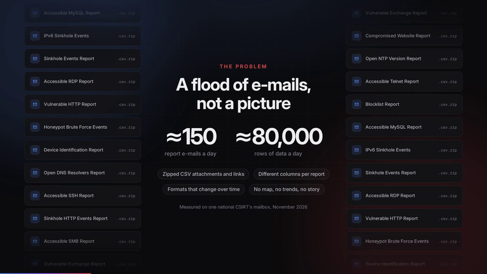

# Looking Glass, IntelMQ and the Elastic Stack

An honest comparison of the free tools a CSIRT can use with its [Shadowserver](https://www.shadowserver.org/what-we-do/network-reporting/)
reports, why Looking Glass exists, and how the three work **together**. Looking Glass is not a replacement for
IntelMQ or the Elastic Stack: each does a different job, and Looking Glass is built to sit beside them. Every figure
below has its source linked.

**In 2½ minutes:** the problem, the tools, and the comparison on screen (the player starts at the comparison; the
chapters take you anywhere else).

 <!-- film: overview start=130 -->

## Contents

- [The problem](#the-problem)
- [The tools today](#the-tools-today)
- [Side by side](#side-by-side)
- [Why it matters for smaller teams](#why-it-matters-for-smaller-teams)
- [Using them together](#using-them-together)
- [Sources](#sources)

## The problem

The Shadowserver Foundation sends free daily reports to national CSIRTs and network owners: **201 national CSIRTs
covering 176 countries** ([Shadowserver, 2024 year in review][ss-2024]), in **more than 80 report types**
([Shadowserver report overview][ss-overview]). Each report runs every morning for the previous 24 hours.

That is an excellent service, and a heavy one to use by hand:

- **Volume.** A national CSIRT's mailbox can receive **well over a hundred report e-mails a day**, holding
  **tens of thousands of rows** across dozens of report types.
- **Many shapes.** Every report type has its own columns ([Shadowserver report schemas][ss-schema]).
- **Formats change.** Shadowserver has modified and extended report formats over time and acknowledged that this
  can confuse recipients ([Shadowserver, 2021 report restructuring notice][ss-2021]); parsers have to follow
  ([IntelMQ mailing list][imq-schema]).
- **No picture.** A ZIP of CSV files does not show what is happening in the country, where, or what to fix first.

## The tools today

### IntelMQ

A free, open-source solution from CERT.at and the CSIRT community for collecting and processing security feeds
([docs.intelmq.org][imq-docs]). It works as a pipeline of *bots*: **collectors** (mailbox, API) → **parsers**
(including Shadowserver CSV and JSON) → **experts** (enrichment, contact look-up) → **outputs** (files, databases,
e-mail). Around it: IntelMQ Manager (web interface), certbund-contact and Mailgen (route events to the right contact
and e-mail them, PGP-signed), Fody (contacts and sent tickets) and Tuency (constituency portal) ([IntelMQ universe][imq-universe]).

Its latest release is on GitHub ([releases][imq-rel]). For Shadowserver it has a Reports API collector and a
parser that can download Shadowserver's schema itself when `auto_update` is on, so new report types are read without
waiting for an IntelMQ release ([bots][imq-bots]). It can send its events on to Elasticsearch (version 7) and to
MISP, through the MISP API or as a MISP feed ([bots][imq-bots]). Dashboards are left to other tools, such as the
Grafana-based Stats Portal ([overview][imq-overview]).

IntelMQ itself is one package. The IntelMQ Manager and IntelMQ API are optional packages installed beside it (the
Manager needs the API), and Redis is installed by the operator ([installation][imq-install]). Mailgen,
certbund-contact and Fody are separate projects by Intevation, each with its own installation and a PostgreSQL
database set up by hand ([certbund-contact][imq-cbc]).

| Strengths | What it needs |
|---|---|
| Free, open source, mature; used by many national CERTs | **Resources**: a Linux server and several services to run and keep updated (Redis message queue, databases, bots); minimum 4 GB RAM, 2 CPUs, 10 GB disk plus data ([hardware requirements][imq-hw]) |
| Automates notifying the owners of affected hosts | Staff to configure the bots and apply Shadowserver format updates |
| Handles many feeds, not only Shadowserver | Another tool to visualise the results (it moves and routes data; it is not a dashboard) |

### Elastic Stack (Elasticsearch, Kibana, Logstash)

A search and analytics platform. It has a **free self-managed tier**: Elastic says you can download it and use the
free features at no cost, and that the security features built into the stack are free ([Elastic pricing FAQ][es-faq]).
Since August 2024 the source is also available under the open-source AGPL licence ([Elastic announcement][es-agpl]).
Shadowserver publishes a script that loads its reports into Elasticsearch ([Shadowserver api_utils][ss-es]).

Which features are free is set out in Elastic's subscription matrix ([subscriptions][es-subs]). The free Basic tier
includes dashboards, the Maps app, Discover, the SIEM, case management and Kibana alerting with its Server Log and
Index connectors. Machine learning anomaly detection, the email and webhook alert connectors, and field- and
document-level security are in the paid tiers; Platinum is now for existing customers only.

Elasticsearch and Kibana are separate installs, with Logstash or Elastic Agent on top for getting data in, all on the
same version ([installing Elasticsearch][es-install]); Elastic's one-line start-local script runs Elasticsearch and
Kibana for local development and testing only.

| Strengths | What it needs |
|---|---|
| Free self-managed tier, security features included | **Resources**: memory-hungry nodes (a common rule of thumb is 8 GB RAM and 4 cores per production node, [Opster][es-size]), storage, and a cluster to run, secure and upgrade |
| Very fast search across all reports and any other data | Every Shadowserver dashboard designed in Kibana and kept up to date by the team (each report has its own fields) |
| Scales to very large volumes; any visualisation you can build | Specialist skills to tune and maintain it |

### Shadowserver Dashboard

Shadowserver's public dashboard shows up to two years of **aggregated, country-level** statistics, with nothing to
install ([dashboard][ss-dash]). It is ideal for the big picture and for sharing; it does not show your constituency's
individual hosts or let you follow them up.

### Looking Glass

Free and open source (AGPL-3.0), built for one job: turning a CSIRT's own Shadowserver reports into a picture people can use.

| Strengths | Limits (honestly) |
|---|---|
| Ready-made views of every Shadowserver report: a live map, the services platform, analysis, host lists, PDF and CSV reports | Shadowserver reports only, not a general feed or log platform |
| One guided installer sets up everything and checks every answer: MongoDB, the pipeline with the first days of reports, the platform, the HTTPS certificate, Caddy and Unusual activity, then runs the security check and compares both platforms with the database | Replays the previous day (as Shadowserver delivers it); not real-time ingestion of other feeds |
| Unusual activity built in: every network, report and pair of reports against its own normal of the last 28 report days, free | Does not e-mail constituents automatically (IntelMQ does) |
| The follow-up in one place: findings that are channels, cases, advisories to organisations (PDF), quarterly reports | No free-text search across arbitrary data (Elasticsearch does) |
| Sends its own analysis to your OpenCTI or MISP (connectors), so it joins what IntelMQ already feeds there | A young project: one maintainer team, single-server design |
| Modest resources: one server with 4 GB RAM for about 50,000 records a day ([installation guide](INSTALLATION.md)) | |
| Executive portal and reports with aggregates only; masked views for partners and public screens; an Audit portal for an outside auditor | |
| Security on by default: MFA for everyone, passkeys on installations open to the internet, a fresh check before high-value actions, roles, a hash-chained audit log, an installation check | |

## Side by side

| | IntelMQ | Elastic Stack | **Looking Glass** |
|---|:---:|:---:|:---:|
| Free to use | ✅ | ✅ Basic tier | ✅ |
| Ready-made views of Shadowserver data | no | ◐ build them | ✅ |
| Everything installed in one go, ready for production | ◐ the core, then the Manager, API, Redis and add-ons, each on its own | ◐ Elasticsearch, Kibana, then Logstash or Agent, each on its own (start-local is for testing) | ✅ one guided installer |
| Useful straight after installing | ◐ configure bots | ◐ build dashboards | ✅ |
| Executive reports and dashboard | no | ◐ build them | ✅ |
| Unusual activity against each network's own normal | no | ◐ machine learning, paid tiers | ✅ |
| Follow-up: findings, cases, advisories | ◐ separate add-ons (Mailgen, certbund-contact, Fody), each with its own install and database | ◐ case management | ✅ |
| Into MISP or OpenCTI | ✅ MISP | ◐ build it | ✅ both, its own analysis |
| Automatic notification of constituents | ✅ | no | no |
| Many feeds besides Shadowserver | ✅ | ✅ | no |
| Search across any data, at scale | no | ✅ | no |

✅ built in · ◐ partly, or with work · no: not its job

## Why it matters for smaller teams

The tools are free. **The resources to run them are not**: servers, storage, skilled staff and time.

- About **59 % of African states have a national CSIRT** ([UNIDIR policy brief, 2025][unidir]); many are young teams.
- Africa's cybersecurity workforce shortage is estimated at about **23 %** (BCG and the Global Cybersecurity Forum,
  2024, reported by [African Arguments][aa]).
- INTERPOL's 2025 assessment finds **capacity gaps are widespread** and threats are outpacing response capacity
  ([INTERPOL Africa Cyberthreat Assessment 2025][interpol]).

Looking Glass is built for that reality: one modest server, a guided installer that checks every answer, and views
that are useful on day one, so a small team, in any country, can see and act on its Shadowserver reports from day
one, alongside IntelMQ and Elastic as it grows.

## Using them together

| | Job |
|---|---|
| **IntelMQ** | collects many feeds, notifies the owners of affected hosts, and feeds MISP and Elasticsearch |
| **Elastic Stack** | searches everything you keep, for investigations and hunting |
| **Looking Glass** | shows the picture: what is happening in the country, where, what is unusual and what to fix first, for analysts, management and advisors; and sends its analysis to your OpenCTI or MISP |

Looking Glass reads the reports from the mailbox, the report API or a MongoDB you already have, and changes nothing
upstream, so it runs next to an existing IntelMQ or Elastic set-up. Its connectors add its own analysis to the
OpenCTI or MISP your team already uses, where it meets what IntelMQ sends: one place for the whole team, with each
tool doing its own job.

## Sources

Checked in November 2026.

[ss-2024]: https://www.shadowserver.org/news/shadowserver-2024-highlights-of-the-year-in-review/
[ss-overview]: https://www.shadowserver.org/wp-content/uploads/2022/06/Overview_of_Shadowserver_Reports_March_2022.pdf
[ss-schema]: https://github.com/The-Shadowserver-Foundation/report_schema
[ss-2021]: https://www.shadowserver.org/hp-rewrite/d1e0210d9617036984b6d00c24aff269
[imq-schema]: https://lists.cert.at/mailman3/hyperkitty/list/intelmq-users@lists.cert.at/thread/MWY3375RGHAGJLAMZ5AUWOG2VU7IT3Q5/
[imq-docs]: https://docs.intelmq.org/latest/admin/intro/
[imq-universe]: https://intelmq.readthedocs.io/en/latest/user/universe.html
[imq-hw]: https://intelmq.readthedocs.io/en/latest/user/hardware-requirements.html
[imq-rel]: https://github.com/certtools/intelmq/releases
[imq-bots]: https://docs.intelmq.org/latest/user/bots/
[imq-overview]: https://docs.intelmq.org/latest/overview/
[imq-install]: https://docs.intelmq.org/latest/admin/installation/linux-packages/
[imq-cbc]: https://github.com/Intevation/intelmq-certbund-contact
[es-install]: https://www.elastic.co/docs/deploy-manage/deploy/self-managed/installing-elasticsearch
[es-subs]: https://www.elastic.co/subscriptions
[es-faq]: https://www.elastic.co/pricing/faq
[es-agpl]: https://www.businesswire.com/news/home/20240829537786/en
[ss-es]: https://github.com/The-Shadowserver-Foundation/api_utils/tree/main/elasticsearch
[es-size]: https://opster.com/faq/elasticsearch-minimum-requirements
[ss-dash]: https://www.shadowserver.org/statistics/
[unidir]: https://unidir.org/wp-content/uploads/2025/12/UNIDIR_Strengthening_National_CSIRT_Cooperation_Domestic_Setups_International_Networks.pdf
[aa]: https://africanarguments.org/2026/10/cybersecurity-is-the-infrastructure-africa-is-forgetting-to-build/
[interpol]: https://www.interpol.int/content/download/23094/file/INTERPOL_Africa_Cyberthreat_Assessment_Report_2025.pdf

- Shadowserver, *2024: highlights of the year in review*: [link][ss-2024]
- Shadowserver, *Overview of free public benefit network security reports*: [link][ss-overview]
- Shadowserver, report schemas: [link][ss-schema]; 2021 report restructuring notice: [link][ss-2021]; public dashboard: [link][ss-dash]; Elasticsearch loader: [link][ss-es]
- IntelMQ releases: [link][imq-rel]; bots reference: [link][imq-bots]; overview: [link][imq-overview]; installation (Linux packages): [link][imq-install]; certbund-contact: [link][imq-cbc]
- Elastic, self-managed subscriptions (the feature matrix): [link][es-subs]; installing Elasticsearch: [link][es-install]
- IntelMQ documentation, introduction: [link][imq-docs]; the IntelMQ universe: [link][imq-universe]; hardware requirements: [link][imq-hw]; schema update thread: [link][imq-schema]
- Elastic, pricing FAQ: [link][es-faq]; AGPL announcement: [link][es-agpl]; Opster, Elasticsearch minimum requirements: [link][es-size]
- UNIDIR, *Strengthening national CSIRT cooperation* (2025): [link][unidir]
- African Arguments, *Cybersecurity is the infrastructure Africa is forgetting to build* (2026): [link][aa]
- INTERPOL, *Africa Cyberthreat Assessment Report 2025*: [link][interpol]
