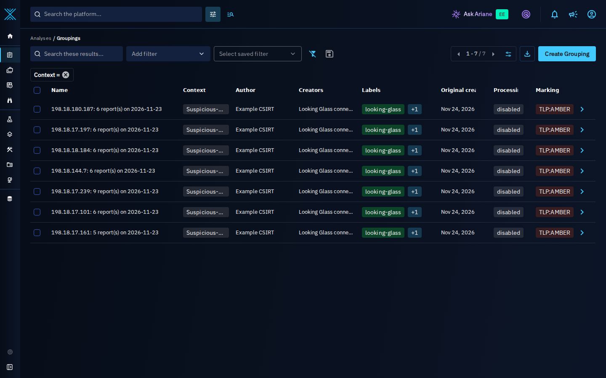
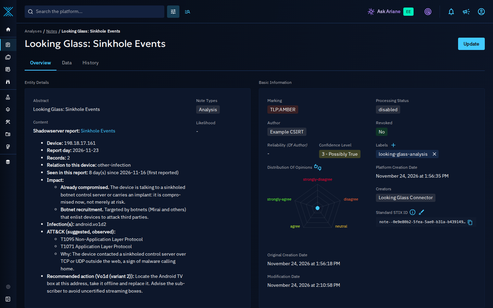
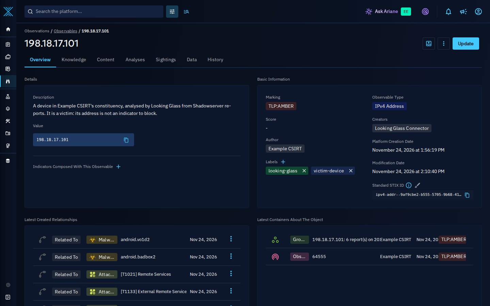
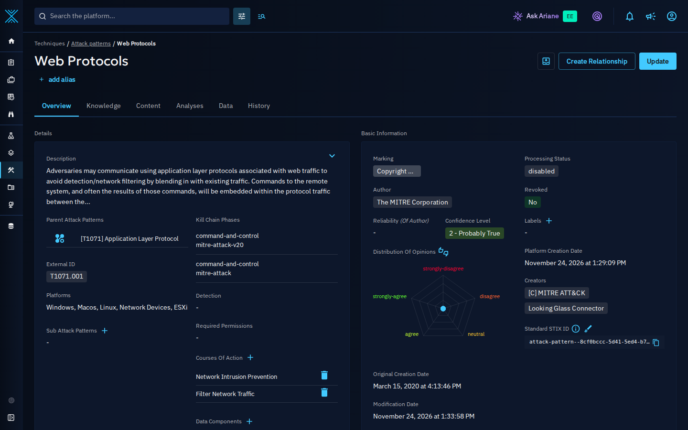
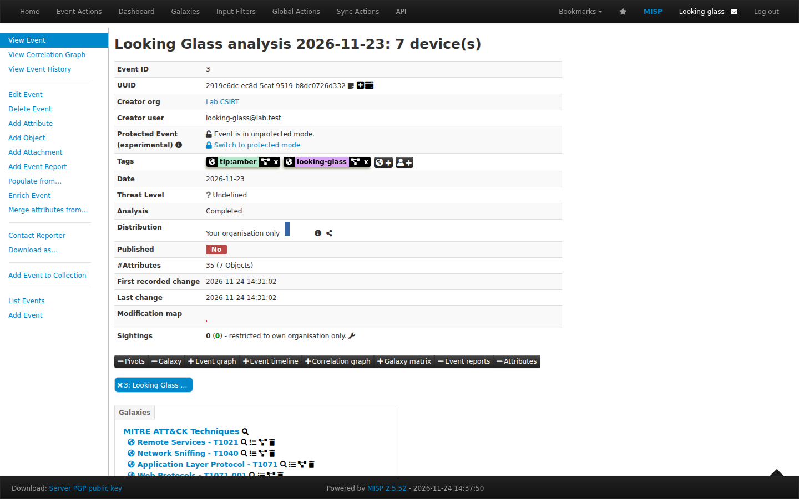
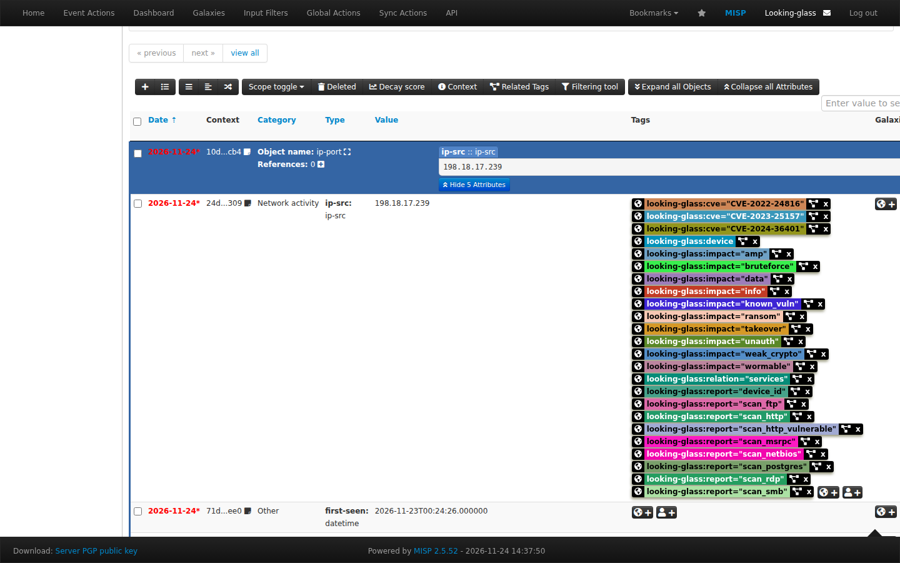
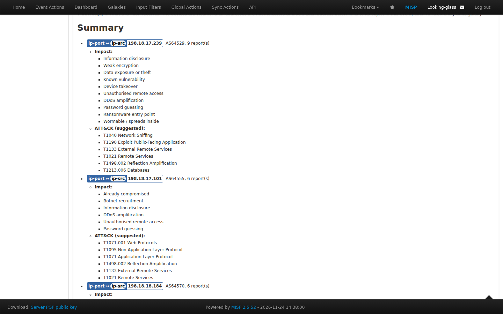
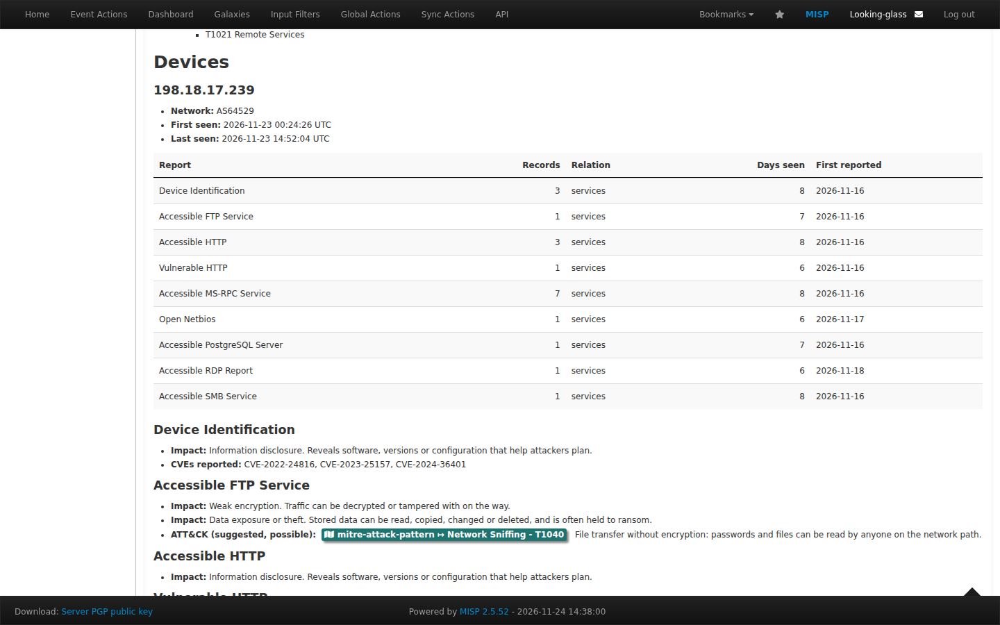

# Connecting OpenCTI and MISP

Looking Glass can send its own analysis of your Shadowserver reports to your CSIRT's OpenCTI or MISP. It sends;
nothing ever comes back in. Looking Glass stays standalone: OpenCTI and MISP run on their own servers, and a
connector only needs Looking Glass to reach them over HTTPS.

## What is sent, and what never is

**Sent**, per report day and per device in what the target receives:

- the Shadowserver reports the device is in that day, how many records, and how the report relates to the device;
- how many days it has been seen in each report, and the day it was first reported;
- the impact of each report, in plain words;
- the infections, with Looking Glass's description and recommended action;
- the CVEs Shadowserver reported;
- the suggested ATT&CK techniques with Looking Glass's reason, marked as suggested until a researcher confirms them;
- a decoded check-in's family and format only.

**Never sent:** Shadowserver's raw rows (OpenCTI and MISP have their own Shadowserver connectors for those),
findings, notes, names of people, time to act, and Looking Glass's combination codes.

The devices are victims. Their addresses are never marked as indicators to block: in MISP `to_ids` is off, and in
OpenCTI the address has no score.

## Before you start

- **Outbound HTTPS** from the Looking Glass server to the platform. Connectors work in every `ACCESS_MODE`,
  `local` included: the access mode is about who can reach Looking Glass, and a connector only goes out.
- **A certificate Looking Glass trusts.** A public certificate works as it is. For your organisation's own
  certificate authority, put its certificate (PEM) in `CONNECTOR_CA_FILE` in `.env`. The authority's certificate
  needs the *key usage* extension: newer Python versions refuse one without it.
- **A name or an address.** The platform can be reached by its host name or, on an internal network, by its IP
  address, as long as its certificate names that address. Addresses such as the loopback, link-local and cloud
  metadata addresses are always refused. The connection goes straight to the platform, without a proxy.
- **`CONNECTOR_KEY_SECRET`** in `.env`, set by the installer: the keys you enter are stored encrypted with it.
  If it is missing: `openssl rand -hex 32`, then `deploy/reload.sh`.
- **The sender.** Sending runs as its own service, every 15 minutes, never inside the web service:

  ```bash
  deploy/connectors_timer.sh install    # once (sudo)
  deploy/connectors_timer.sh status     # whether it runs, and when next
  deploy/connectors_timer.sh run        # send now, for a first look
  ```

  Settings → Connectors says when the sender is not installed.

## Setting up OpenCTI

Written for OpenCTI 7. An administrator of your OpenCTI does this once.

1. **MITRE ATT&CK data.** Run OpenCTI's MITRE ATT&CK connector first. Looking Glass links its ATT&CK suggestions to
   those entries; it never sends its own copy of a technique.
2. **A role** (Settings → Security → Roles), for example "Looking Glass connector", with only these capabilities:
   access knowledge and create / update knowledge (`KNOWLEDGE`, `KNOWLEDGE_KNUPDATE`), the TAXII feeds (`TAXIIAPI`),
   and the API with a token (`APIACCESS`, `APIACCESS_USETOKEN`). Do not give it *Manage labels* or any settings right.
3. **A group** (Settings → Security → Groups) with that role, a maximum confidence of **50**, and these markings:
   TLP:CLEAR, TLP:GREEN, TLP:AMBER (and TLP:AMBER+STRICT or TLP:RED only if you will send with them), plus the
   **MITRE ATT&CK statement marking**, so the connector can link to MITRE's entries.
4. **A user** in that group only. OpenCTI adds new users to its default group as well: remove that group from the
   user, or set the user's own maximum confidence to 50, otherwise Looking Glass's objects arrive at confidence 100.
5. **Three labels** (Settings → Taxonomies → Labels): `looking-glass`, `victim-device`, `looking-glass-analysis`.
   Looking Glass sends only these; without them OpenCTI leaves the labels off and nothing else changes.
6. **An API token** for that user. OpenCTI shows it once: copy it then.
7. **A TAXII Push ingester** (Data → Ingestion → TAXII Push) owned by that user, and **start it**: a new one is
   stopped, and while it is stopped its address answers "not found". Its address, for Looking Glass, is
   `https://<your OpenCTI>/taxii2/root/collections/<its id>/objects/`.

What arrives, per report day:

- one **grouping** per device ("198.18.17.101: 6 report(s) on 2026-11-23"), marked with the target's TLP and signed
  by your organisation;
- one **note** per device and report, laid out as a list: the report (linked to Shadowserver's page), records, days
  seen, impact, infections, CVEs, the ATT&CK suggestion with its reason, the recommended action;
- the **address**, with a short description saying it is a victim, linked to its malware, CVEs and techniques.









## Setting up MISP

Written for MISP 2.5. An administrator of your MISP does this once.

1. **A role** (Administration → Add role), for example "Looking Glass connector", with only **Add**, **Tagger** and
   **Tag Editor**. Looking Glass refuses a key whose user is a site or organisation administrator, or can sync:
   MISP's built-in roles that may create tags also have rights Looking Glass does not need.
2. **A user** in your organisation with that role, and an **auth key** for it.
3. **The tlp taxonomy** enabled (Event Actions → Taxonomies).
4. **Galaxies updated** (Galaxies → Update galaxies), so the ATT&CK suggestions show as MISP's ATT&CK galaxy.

The key is used for MISP's API only, never to sign in to MISP's pages.

What arrives: one **event** per report day ("Looking Glass analysis 2026-11-23: 7 device(s)"), shared with your
organisation only and never published by Looking Glass. It holds one device object per address (MISP's ip-port
object, with tags for the reports, relation, impact, infections and CVEs), the ATT&CK suggestions as galaxy
entries, and an **event report**: a summary with every device, then per device a table of its reports and the
details as a list. In the report, each address and technique links to its entry in the event.









## Adding the target in Looking Glass

Settings → Connectors → **Add a target** (administrators):

1. Choose OpenCTI or MISP, give the address and the key, and pick the TLP (AMBER unless you choose otherwise).
2. **Test.** Looking Glass checks the address, the certificate, the key and its rights, then sends one test object
   ("Looking Glass connector test"). A target can only be saved after its test passed, so a wrong address, key or
   right is found here, not later.
3. The target is saved **off**. Tick what it receives: networks of your constituency (whole, or some of their address
   blocks) and other ranges. A new target receives nothing until you tick something.
4. **Turn it on.** The next run sends the last 30 days, then each new day once its reports have arrived.

Adding, changing and removing a target, and giving it a new key, ask you to confirm with your passkey or
authenticator code every time. Every send, failure and revocation is in the audit log.

## How the data stays up to date

Each **report day** is sent as its own unit:

| | MISP | OpenCTI |
|---|---|---|
| A new day | a new event for that day | new groupings and notes for that day |
| The same day, changed | the same event updated | the same objects updated |
| Something no longer true for that day | its tags removed | revoked |
| A day the quarterly purge removed | its event deleted | revoked |

**A new day never overwrites an earlier one.** A device seen on the 23rd and the 24th is in both days' events in
MISP (MISP's correlation links them), and in both days' groupings in OpenCTI. The note of the 23rd keeps saying
"seen on 8 days"; the note of the 24th says 9. That is the history, not a duplicate.

**Within a day, nothing is ever doubled.** Every object has a fixed id, so sending a day again updates what is
there. A day is worked out again when late records for it arrive, when Looking Glass's knowledge changes (an
ATT&CK suggestion confirmed, a recommended action reworded), or when the target's TLP or what it receives changes.
Only the objects that changed are sent.

**What is shared across days exists once in OpenCTI:** the address, the malware, the CVEs and MITRE's techniques.
Each day adds its links to them, so the address's page shows every day it appeared.

**OpenCTI imports after it accepted a send.** Ten minutes later Looking Glass asks OpenCTI which of its objects it
holds and sends any missing one again, up to three times. One still missing is reported in the connector's log and
the audit log; OpenCTI's own reason is under Data → Ingestion, in the work's errors.

The auditor sees every target and everything sent, retried, revoked or refused on the Audit portal's **Data sent
out** tab.

## When a target pauses

Before each run the checks run again, without a test object. A target whose checks fail, or that failed three runs
in a row, is **paused**: nothing is sent, Settings → Connectors says why in plain words, and the administrators'
bell rings (*Connector paused: Lab MISP (MISP)*, with the reason). Fix the cause on the platform, then turn the
target on again.

| The message says (in short) | What to do |
|---|---|
| the certificate is not trusted | add your authority's certificate to `CONNECTOR_CA_FILE`, then `deploy/reload.sh` |
| the collection is not known, or its ingester is stopped | OpenCTI: Data → Ingestion → TAXII Push, check the id and start the ingester |
| the key was refused | issue a new key on the platform and use **New key** on the target |
| more rights than Looking Glass needs | MISP: give the user the custom role above |
| the tlp taxonomy is not enabled | MISP: Event Actions → Taxonomies, enable tlp |

## Keys

The key is entered once on the page, tested, and stored encrypted in `data/connector_keys.enc`; it is never shown
again, sent back to a page or written to a log. To keep it outside Looking Glass's data instead, put it in `.env` as
`LG_TARGET_<ID>_KEY` (the exact name is on the target's card), then `deploy/reload.sh`: a key there is used in place
of the stored one. To replace a key, use **New key** on the target: the new one is tested before it is kept.
