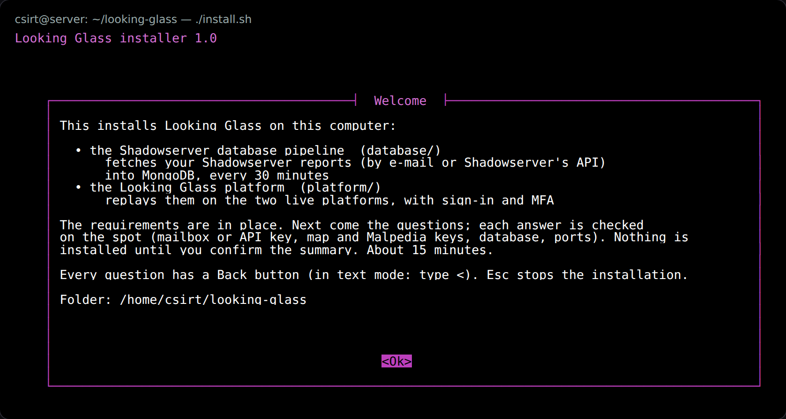
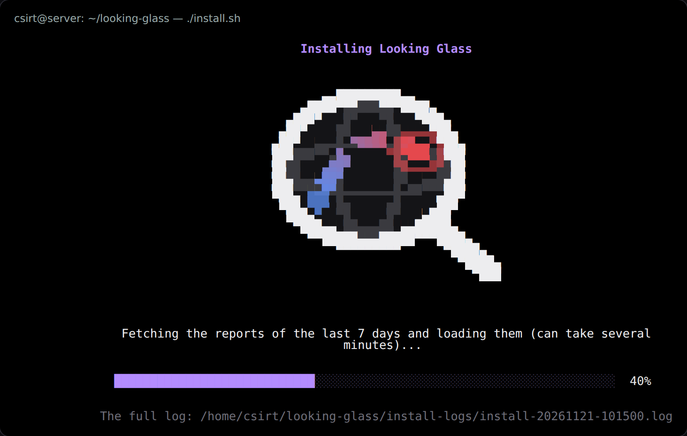

# Installing Looking Glass

## The easy way: the guided installer



On Windows, do [A1](#a1-wsl-with-systemd-and-mirrored-networking) first (systemd and mirrored networking), then
run these steps in the Ubuntu window. On Ubuntu, run them in a terminal, as the ordinary user who will run Looking Glass
(not as root).

1. **Install git**, if the computer does not have it yet:
   ```bash
   sudo apt update && sudo apt install -y git
   ```
2. **Get the code:** clone the repository and go into it.
   ```bash
   git clone https://github.com/anonghosty/looking-glass.git
   cd looking-glass
   ```
3. **Run the installer:**
   ```bash
   ./install.sh
   ```
   It asks its questions in windows (`./install.sh --text` for plain prompts), checks every answer (mailbox login,
   tokens, MongoDB, ports), installs both parts and runs the checks.
   - **Back** on every question returns to the one before, keeping your earlier answers (in text mode, type `<`).
     **Esc** stops the installation. Going back runs the answer checks between the two questions again, so it can
     take a few seconds; passwords are never written down for it, so a password question comes back empty.
   - **Who may open it:** *this computer only*, *this computer and chosen networks* (then: *any computer on our
     internal network*, every private address and never the internet, or only the addresses and ranges you list), or
     *anyone* (internet-facing, HTTPS required). The list refuses `0.0.0.0` (that lets nobody in) and `0.0.0.0/0`
     (that is the whole internet).
   - **The port:** any free port browsers open; it refuses those browsers block (6000 among them: *ERR_UNSAFE_PORT*)
     and suggests one.
   - **Ubuntu's automatic updates** often run right after a computer starts and hold the package manager. The
     installer waits for them and shows what it is waiting for and how far it is; after 10 minutes without progress
     it asks: keep waiting, stop the update for now (it runs again later by itself), or stop the installation.
   - **Network names** (optional, No by default): looks up the names of the networks in your reports once they are
     loaded (only AS numbers are sent, to PeeringDB and RIPEstat). Without them, demo mode shows every network as
     "Unlisted network" and one check (the demo masking alias test) is skipped; do it later with
     `platform/manage/asn_registry.py 7` or Settings → Identify networks.
   - **Sign-up on the sign-in page:** *No* means only people an administrator invites (Admin → Users → Add a
     person); the first administrator always signs up with the setup code either way.
4. **Open the address it shows** and create the first administrator (see [A6](#a6-the-first-administrator-security)).

Later updates are a `git pull` in the same folder (see [Updating](#updating)).

**What the computer needs.** Before it asks anything or installs anything, the installer checks three things and
refuses anything else, saying which one failed:

| | Accepted |
|---|---|
| Operating system | **Ubuntu 24.04 or later** only (Desktop or Server, on the computer, in a virtual machine or on WSL 2), read from `/etc/os-release`. Other systems, Debian and systems based on Ubuntu among them, are refused |
| Python | **3.12, 3.13 or 3.14**: the `python3` that will run Looking Glass (the one Ubuntu brings) |
| Processor | **x86_64** (Intel, AMD) or **aarch64** (64-bit ARM) |

The same check runs in `deploy/install.sh`, the pipeline's `deploy.sh` and `deploy/update_libraries.sh`. To run it on
its own: `python3 platform/deploy/safe_libraries.py check-machine`. The Python libraries are then installed only from the
lock files, each file checked first ([The libraries](#the-libraries-only-files-that-match-the-lock)).

The rest of this guide is the same installation by hand, and the background the installer's questions refer to
(access modes, HTTPS, firewall).

**MongoDB already on the computer?** The installer finds it and shows its version, port, whether it is running and
whether it requires a login. It then uses that MongoDB as it is: its configuration is never rewritten (other programs
may rely on it), a stopped MongoDB is started if you agree, and you give one of its administrator accounts. A MongoDB
that requires no login is accepted with a warning (turn on `authorization` when you can). A MongoDB in Docker, which
shows up only as a busy port, can be used the same way. If the reports database already holds data, new reports are
added and rows already there are skipped. Running the installer again on an installation it made keeps MongoDB's port,
data and administrator account: leave the MongoDB password empty and it is taken from the existing `database/.env`
(the installer stops with a clear message if it cannot find one, and never writes an empty password).

Looking Glass has two parts, installed in this order:

1. **The Shadowserver database pipeline** (`../database`): fetches your Shadowserver report e-mails every day and
   loads them into MongoDB. Install it first: [../../database/README.md](../database/README.md).
2. **The Looking Glass platform** (this folder): reads that database and replays it on the two platforms.

Two setups are supported, with the same code:

- **A. Windows with WSL 2:** Ubuntu running inside Windows on an analyst's PC or laptop.
- **B. Ubuntu Desktop or Server:** Ubuntu 24.04 or later, on its own computer or in a virtual machine. Recommended for a permanent, shared installation. On Ubuntu Server, create the first administrator through an SSH tunnel (`ssh -L <your port>:127.0.0.1:<your port> user@server`, then open `http://localhost:<your port>`).

Throughout this guide, `<your port>` is the port you selected for Looking Glass: the guided installer's **Port**
question, or `deploy/install.sh --port`. It is written in `.env` as `LG_PORT`.

Security is described in [../docs/SECURITY.md](SECURITY.md). Steps marked
**(security)** are part of the hardening and must be done on every installation.

---



For a plain screen without the logo's movement, use `./install.sh --no-animation`.

## What you need

| | |
|---|---|
| Countries | every country and territory (ISO 3166-1), chosen by continent then country; regions maps for about 200 of them, the rest drawn as one area |
| Operating system | Ubuntu 24.04 or later, Desktop or Server, with systemd (on the computer itself, in a virtual machine, or Ubuntu on WSL 2 on Windows 10/11) |
| Python | 3.12 or newer, with `venv` |
| MongoDB | 6 or newer, with authentication on, filled by the database pipeline |
| Shadowserver | your CSIRT's free Shadowserver reports (https://www.shadowserver.org/what-we-do/network-reporting/) delivered to a mailbox, or fetched with your Shadowserver API key |
| Mapbox | a free account and a public access token (`pk.…`) for the map: https://account.mapbox.com |
| Malpedia (optional) | an API token, so Malpedia joins the sources behind the "Look up" buttons |
| Name sources (no account needed) | MISP Galaxy, MITRE ATT&CK and MITRE CTID's KEV mappings: the installer downloads the first copies (public files on GitHub, about 60 MB to fetch, about 6 MB kept, a minute) and schedules a weekly refresh. Without internet the installation goes on without them; look-ups then use the definitions and Malpedia until the next refresh |
| Memory / disk | **Minimum: 4 GB RAM** for the whole server. That is enough for up to about 50,000 records a day (about half a million records kept), which covers most countries; more records a day need more, see [How much memory](#how-much-memory). Disk: `git clone` downloads about 70 MB (about 45 MB with `--depth 1`, the latest version only); the files take about 70 MB on disk, of which the code itself is about 6 MB and the rest screenshots, film posters (about 37 MB) and the world maps (about 24 MB). The two Python environments the installer makes add about 115 MB. MongoDB needs space for your reports |

## How much memory

**Minimum: 4 GB RAM.** What uses memory is the reports, not the people: Looking Glass runs as **one process with 8
threads** (`gunicorn --workers 1 --threads 8`) that every user and every role shares. It holds the report day (and the
day before) and the Executive portal's 7-day baseline in memory once, for everyone; more users only queue a moment
when more than eight requests arrive together. Adding workers would not help: each would hold its own copy.

So the size to look at is **how many records your Shadowserver reports bring a day** (both platforms together; the
Executive portal shows it). Measured on a test installation with made-up data, from a cold start through a working
session (the map, the services platform, the Executive portal's 7-day baseline, Intel gathered):

| Records a day | Web service (peak) | MongoDB (peak) | Together | Server RAM: minimum | comfortable |
|---|---|---|---|---|---|
| 50,000 | 1.2 GB | 0.7 GB | 1.9 GB | **4 GB** | 6 GB |
| 100,000 | 2.3 GB | 1.3 GB | 3.5 GB | 6 GB | 8 GB |
| 200,000 | 4.0 GB | 1.5 GB | 5.5 GB | 8 GB | 12 GB |
| 300,000 | 5.2 GB | 1.5 GB | 6.7 GB | 10 GB | 16 GB |

Measured again on the current version (2026-11-18, the same way, on the test installation with made-up data at about
67,000 records a day, after a cold start, every role's pages and all seven kinds of PDF): web service 1.5 GB at its
peak, MongoDB 0.8 GB, together 2.3 GB, within the 4 GB minimum. The speed work since the table was made (day loads
streamed, fewer database reads) made pages faster without raising memory.

The web service grows with the records (about 2 GB per 100,000 a day); MongoDB levels off, as it keeps only what it
is reading in memory. The server figures add Ubuntu itself (about 1 GB) and room to grow: during a day of use the web
service's caches fill, and an installation measured 1.4 GB just after a restart and 2.9 GB after a full day.

After your first week, `tools/resource_check.py` prints what yours actually uses, against the budgets
`RESOURCE_WEB_MB` and `RESOURCE_MONGO_MB` (4096 each by default; raise them for a large country). To use less memory
on a small server, lower `MGMT_PAST_RECORDS` (records of past days the Executive portal keeps in memory, 3,000,000 by
default): older days are then read from MongoDB when needed, a little slower.

## Who can reach Looking Glass: `ACCESS_MODE`

| `ACCESS_MODE` | Who can open the sign-in page | Use for |
|---|---|---|
| `local` (default) | this computer only | a single analyst workstation |
| `private` | this computer + the addresses / ranges in `VIEWER_NETWORKS` | an internal deployment behind an allow list |
| `public` | any address (`VIEWER_NETWORKS=any` means the same) | an internet-facing deployment, with HTTPS in front (B5) |

In every mode, everything behind the sign-in page needs an account with MFA, and other computers can only sign in
over HTTPS. The service must also listen on the network (`deploy/install.sh --network`, or a reverse proxy) and the
firewall must let the traffic through (A6, A7, B6).

**An internet-facing site always uses HTTPS with Caddy in front.** For `public`, the guided installer offers one choice
only: a certificate for your domain (a free one, for example from Let's Encrypt, or a bought one), with Caddy set up in
front of Looking Glass (B4a). "No HTTPS", a self-signed certificate and a reverse proxy of your own are not offered for
`public`: every visitor would see a warning, or Caddy could not be guaranteed in front. Looking Glass itself never
faces the internet.

---

## Where the database runs **(security)**

By default the installer puts MongoDB on the same computer, reached on 127.0.0.1 only. If your organisation already
runs MongoDB, the installer can use an **internal** MongoDB on another server of your network instead
(*Use an internal MongoDB on another server of your network*):

- **Internal only.** Its address must be a private one (10.x, 172.16–31.x, 192.168.x, or a name that resolves to
  one). A database on the internet is refused by the installer, the platform and the pipeline alike, and no setting
  allows it.
- **Encrypted.** The installer asks whether it accepts TLS (recommended) and for the CA that signed its certificate;
  the certificate and the server's name are always checked. Without TLS it goes on only after you confirm the link
  between the two servers is trusted (`MONGO_ALLOW_PLAINTEXT=1`).
- **A Looking Glass database.** It tests the login, then checks that the database has the Looking Glass structure
  (each report collection with its unique row index). A new, empty name is fine: the pipeline creates it. A database
  that holds something else is never written into: the installer offers to **create a new database for Looking Glass
  on that server**, or to **install MongoDB on this computer instead**.
- **Accounts.** Given an administrator account there, it creates the platform's read-only account and the pipeline's
  own account, as on one server. For a MongoDB run by someone else, `--print` on the account scripts (below) shows the
  commands for its administrator.

The settings are in [CONFIGURATION.md](CONFIGURATION.md) (`MONGO_HOST`, `MONGO_TLS`, `MONGO_TLS_CA_FILE`,
`MONGO_ALLOW_PLAINTEXT`).

## A. Windows with WSL 2

### A1. WSL with systemd and mirrored networking
1. In an **administrator** PowerShell, install WSL with Ubuntu:
   ```powershell
   wsl --install -d Ubuntu-24.04
   ```
2. In Ubuntu, make sure systemd is on (the default on new installs). `/etc/wsl.conf` must contain:
   ```ini
   [boot]
   systemd=true
   ```
3. Give WSL the same network address as Windows. In `%UserProfile%\.wslconfig` on Windows:
   ```ini
   [wsl2]
   networkingMode=Mirrored
   ```
   Then restart WSL from PowerShell with `wsl --shutdown`, and open Ubuntu again.

With mirrored networking your Windows browser opens Looking Glass at `http://localhost:<your port>`.

### A2. Get the code, then the database
Clone the repository into your home folder; both parts are installed from it:
```bash
sudo apt update && sudo apt install -y git
cd ~ && git clone https://github.com/anonghosty/looking-glass.git looking-glass
```
Then install MongoDB and the Shadowserver pipeline from its `database` folder as described in
[../../database/README.md](../database/README.md), and let it load your reports once (`shadowserver run`).
Looking Glass needs at least one day of reports to show.

### A3. Install the platform
```bash
sudo apt install -y python3-venv python3-pip curl openssl
cd ~/looking-glass/platform
deploy/install.sh
```
`deploy/install.sh` checks Python, creates the virtual environment (`.venv`), installs the packages, creates `.env`
from `.env.example` (mode 600) and the private `data/` folder, and writes the service file `deploy/looking-glass.service`
for your user and folder. It never uses sudo; it prints the commands that need it.

Then fill in `.env` (all settings: [CONFIGURATION.md](CONFIGURATION.md)):
```bash
nano .env
```
At least: `MONGO_USER` / `MONGO_PASSWORD` (the account the pipeline created, replaced by a read-only one in A5),
`MAPBOX_TOKEN`, and `COUNTRY` (your country's two-letter code, for example `KE`, `NG`, `SN`, `ZA`).

### A4. The service **(security)**
The service listens on 127.0.0.1 only and runs sandboxed (it can write only to `data/`). Install it:
```bash
sudo cp deploy/looking-glass.service /etc/systemd/system/looking-glass.service
```
```bash
sudo systemd-analyze verify /etc/systemd/system/looking-glass.service
```
```bash
sudo systemctl daemon-reload && sudo systemctl enable --now looking-glass
```
Check that it runs, and on 127.0.0.1:`<your port>` only (put your port number in place of `<your port>`):
```bash
systemctl status looking-glass --no-pager | head -5; ss -ltn | grep <your port>; curl -s localhost:<your port>/healthz
```
After changing the code or `.env`, restart it without sudo with `deploy/reload.sh`.

The service file lets Looking Glass read its own code but never change it. The whole folder is read-only for the
service, except `data/`, where it keeps everything it writes, and nothing in `data/` may be run as a program. You, as
the account that owns the installation, update and change the code as usual: that happens outside the service.

**Keeping WSL running:** WSL stops when nothing from Windows uses it. For an always-on screen, start it at Windows
logon with a Task Scheduler task: trigger *At log on*, action `wsl.exe`, arguments
`-d Ubuntu-24.04 --exec sleep infinity`, and tick "Run whether user is logged on or not".

### A5. Read-only database account **(security)**
Looking Glass only reads the database. Give it an account that cannot write:
```bash
.venv/bin/python deploy/create_readonly_db_user.py && deploy/reload.sh
```
The script uses the administrator account in `.env` once, creates `lookingglass_ro` with read access only, checks
that it cannot write, and puts it in `.env`. The old file, `.env.before-readonly`, holds the administrator password:
when the database pipeline is next to the platform, the script moves that account to
`/etc/looking-glass/mongo-admin.env` (readable only by root; it asks for your sudo password) and removes the copy.
Otherwise, move the copy off the computer.

The pipeline gets its own account too, with read and write on its database only (in the database folder):
```bash
./create_pipeline_db_user.py
```
It keeps the administrator account in `/etc/looking-glass/mongo-admin.env` too, never in the project folders, where
the programs' own Linux user could read it (`sudo cat` it when you need it). The installer does all of this. When
MongoDB runs on another server, run by someone else, add `--print` to either script:
it shows the commands for that server's administrator to run, and they give you the password for `.env`. Their own
account is never needed or changed.

### A6. The first administrator **(security)**
On the computer itself (your Windows browser counts), open `http://localhost:<your port>`:
1. Click **Let's get started**. It asks for the one-time **setup code**: in a terminal, in the platform folder, run
   `cat data/setup_code` (the installer printed this command). It proves you can reach the server itself, works
   once, and is deleted when the administrator exists.
2. Enter your full name, organisation, email, country, a user name and a strong password.
3. Scan the QR code with an authenticator app (Google Authenticator, Microsoft Authenticator, Aegis, 2FAS...) and type the code it shows.
4. Keep the 8 recovery codes offline. Never paste them, or the key, into chat or email.

This first account is the administrator. Colleagues then use **Create an account** on the sign-in page, and you
approve them in **Admin → Users** with a role (external, analyst or admin; [USER_GUIDE.md](USER_GUIDE.md)).

If every administrator is ever locked out, use the command line on the computer:
```bash
manage/manage_users.py add YOURNAME --admin
```

### A7. Windows firewall **(security)**
With mirrored networking two firewall layers decide whether other computers reach `<your port>`: the Windows Defender
Firewall and the Hyper-V firewall for WSL. If only this computer uses Looking Glass, make sure no rule opens
`<your port>`. In an **administrator** PowerShell, list them (put your port number in place of `<your port>`):
```powershell
Get-NetFirewallRule -Enabled True -Direction Inbound | Where-Object { ($_ | Get-NetFirewallPortFilter).LocalPort -contains '<your port>' } | Select DisplayName, Profile
```
```powershell
Get-NetFirewallHyperVRule | Where-Object { $_.LocalPorts -contains '<your port>' } | Select Name, DisplayName, RemoteAddresses
```
Disable any you find with `Disable-NetFirewallRule -DisplayName "<name>"` and
`Get-NetFirewallHyperVRule | Where-Object DisplayName -eq "<name>" | Remove-NetFirewallHyperVRule`.
Keep untrusted networks (hotel, mobile hotspot) on the **Public** profile.

### A8. Other screens (optional)
To show Looking Glass on a TV, a wall screen or colleagues' computers:
1. **HTTPS:** `deploy/make_tls_cert.sh` creates a certificate for this computer's names and addresses, switches the
   service to HTTPS and prints the certificate's SHA-256 fingerprint. Then make every screen that opens Looking Glass
   trust it, so no warning ever appears there:
   - **Check it first:** open the address once, view the certificate (the warning page's certificate details) and
     compare its SHA-256 fingerprint with the one the script printed. Trust it only if they match.
   - **Windows:** copy `data/tls/cert.pem` to the screen, rename it `looking-glass.crt`, double-click it, choose
     Install Certificate, Local Machine, and place it in "Trusted Root Certification Authorities".
   - **macOS:** double-click it to add it to the System keychain in Keychain Access, open it, and set Trust to
     "Always Trust".
   - **Ubuntu:** `sudo cp cert.pem /usr/local/share/ca-certificates/looking-glass.crt` then
     `sudo update-ca-certificates`. Firefox keeps its own list: Settings, Certificates, View Certificates,
     Authorities, Import.

   A certificate from your organisation's CA can replace the two files in `data/tls/` instead; screens that already
   trust that CA need nothing more.

   **Never click past a certificate warning for Looking Glass.** A warning on a screen that already trusts the
   certificate means something is wrong: stop and tell the administrator.

   The certificate is named after the first name you give (`deploy/make_tls_cert.sh lookingglass.example.org`), else
   this computer's name; never after the product, so internet scanners cannot list installations by it. Certificates made before
   2026-11-19 are named "Looking Glass": run the script again to replace yours (each screen then trusts the new one
   once more; the old pair is kept in `data/tls/previous-<time>/`).
2. **Listen on the network:** run `deploy/install.sh --network`, then copy the service file again and restart (A4 commands, then `sudo systemctl restart looking-glass`).
3. **`.env`:** `ACCESS_MODE=private` with `VIEWER_NETWORKS=<screen address or range>` (for example `192.168.10.0/24`),
   or `ACCESS_MODE=public`. Other host names than the computer's own go in `ALLOWED_HOSTS`. Then `deploy/reload.sh`.
4. **Firewall:** open `<your port>` to those screens only, on the **Private** profile, in both layers (administrator PowerShell):
   ```powershell
   New-NetFirewallRule -DisplayName "Looking Glass (screens)" -Direction Inbound -Protocol TCP -LocalPort <your port> -RemoteAddress <screen-address> -Profile Private -Action Allow
   ```
   ```powershell
   New-NetFirewallHyperVRule -Name LookingGlassScreens -DisplayName "Looking Glass (screens)" -Direction Inbound -VMCreatorId '{40E0AC32-46A5-438A-A0B2-2B479E8F2E90}' -Protocol TCP -LocalPorts <your port> -RemoteAddresses <screen-address> -Action Allow
   ```
5. **On the screen:** open `https://<computer-name>:<your port>` and sign in. For a public screen, use an **external**
   account (always masked) or set `PUBLIC_DEMO=1`, and tick **Stay signed in for 5 days**.

---

## B. Linux server (Ubuntu)

Ubuntu 24.04 or later only, with Python 3.12, 3.13 or 3.14 on x86_64 or aarch64 (see *What the computer needs* above);
`deploy/install.sh` refuses anything else before it installs anything.

### B1. System and database
```bash
sudo apt update && sudo apt install -y python3-venv python3-pip git curl openssl ufw
sudo adduser --system --group --home /opt/looking-glass lookingglass     # a dedicated service account
sudo -u lookingglass -H git clone https://github.com/anonghosty/looking-glass.git /opt/looking-glass/src   # the code
```
Install MongoDB and the pipeline from `/opt/looking-glass/src/database` ([../../database/README.md](../database/README.md)). Keep
`net.bindIp: 127.0.0.1` and `security.authorization: enabled` in `/etc/mongod.conf`. If MongoDB runs on another
server, allow only this server to reach it, and use TLS for MongoDB.

### B2. Platform
```bash
sudo -u lookingglass -H bash -c 'cd /opt/looking-glass/src/platform && deploy/install.sh'   # the code is from B1
sudoedit /opt/looking-glass/src/platform/.env          # MongoDB, MAPBOX_TOKEN, COUNTRY (CONFIGURATION.md)
```

### B3. Service **(security)**
`install.sh` wrote `deploy/looking-glass.service` for the `lookingglass` user and the folder above, listening on
127.0.0.1 only: the reverse proxy (B5) is the only thing that talks to it.
```bash
cd /opt/looking-glass/src/platform
sudo cp deploy/looking-glass.service /etc/systemd/system/
sudo systemd-analyze verify /etc/systemd/system/looking-glass.service
sudo systemctl daemon-reload && sudo systemctl enable --now looking-glass
systemd-analyze security looking-glass --no-pager | tail -1
```
As in A4, the service may read its code but write only in `data/`, and nothing in `data/` may be run as a program.

### B4. Accounts and database **(security)**
```bash
sudo -u lookingglass .venv/bin/python deploy/create_readonly_db_user.py && sudo systemctl restart looking-glass
```
Create the first administrator: read the setup code on the server (`sudo -u lookingglass cat data/setup_code` in the
platform folder), then open `http://localhost:<your port>` in a browser on the server, or tunnel to it over SSH
(`ssh -L <your port>:127.0.0.1:<your port> you@server`, then open `http://localhost:<your port>` on your computer), or, once the reverse
proxy below is set up, its HTTPS address; choose **Let's get started** and type the code. Or on the command line:
```bash
sudo -u lookingglass manage/manage_users.py add YOURNAME --admin
```

### B4a. HTTPS with a certificate bought for a domain **(security)**
The recommended way for an internet-facing site, and the guided installer's first choice for it (HTTPS: "A
certificate bought for a domain name"). You need the domain (for example `lookingglass.example.org`), the certificate
your provider sent, its private key (without a passphrase) and, usually, a file of intermediate certificates.

The installer checks them before anything is installed, and installs nothing if a check fails:

| Check | Refused when |
|---|---|
| key | it is not the certificate's own key, is protected by a passphrase, or is weaker than RSA 2048 / EC 256 bits |
| domain | the certificate does not name the domain (a wildcard `*.example.org` covers one label) |
| dates | it has expired or is not valid yet (fewer than 30 days left is said, not refused) |
| chain | it does not verify against the trusted roots, even with the intermediate certificates given |
| DNS | (a note only) the domain does not point to an address of this computer; nothing is asked of an outside service |

Then it copies the certificate with its chain and the key into `platform/data/tls/` (the key readable only by
Looking Glass's user) and puts **Caddy** in front: Caddy answers on port 443, and Looking Glass itself listens only on
this computer (`127.0.0.1`, on a port of its own between 5000 and 5099), so a few deliberately slow connections can
never hold it up. `deploy/caddy_front.sh` installs Caddy from its own signed package repository (its signing key is
accepted only with the fingerprint `65760C51EDEA2017CEA2CA15155B6D79CA56EA34`), gives Caddy a root-owned copy of the
certificate in `/etc/caddy/looking-glass/`, and writes `/etc/caddy/Caddyfile`. Caddy fetches no certificate of its
own, has no admin endpoint, reads each request in full under time limits (its headers within 10 seconds), speaks
HTTP/1.1 and HTTP/2 over TCP only, and names itself in no answer. Caddy's service runs locked down (a systemd drop-in,
`caddy.service.d/looking-glass.conf`): only the right to listen on a low port, nothing writable but its own state
folder, no new privileges, the usual system calls only. It is kept within 1 GB of memory and 512 processes, staples no
OCSP answer (it never calls the certificate authority), and a firewall table of Looking Glass's own (`inet lg_caddy`,
nftables) lets it send only to this computer and holds each address to 100 connections at once
(`deploy/caddy_front.sh setup --conn-limit N` changes it); those rules are loaded again whenever the nftables service
starts or reloads. Caddy's security updates install by themselves (its repository is added to Ubuntu's automatic
updates). It reaches Looking Glass over HTTPS, checking its
certificate for the domain. A Caddyfile you wrote yourself is never replaced: the installer stops and says so. The
installer then opens 443 in `ufw` when it is active, and checks `https://lookingglass.example.org` by its name,
through Caddy, with the certificate verified as a browser does. The installation is recorded in the audit log. Point
the domain's DNS record at the server's public address.

**Renewal:** the bell warns administrators 30, 14 and 3 days before the certificate expires. Install the renewed one
as Looking Glass's user; the same checks run first, the previous pair is kept in `data/tls/previous-<time>/`, the
service reloads and the site is checked again:
```bash
manage/install_cert.sh lookingglass.example.org new.crt new.key ca-bundle.crt
manage/install_cert.sh --check lookingglass.example.org new.crt new.key ca-bundle.crt   # the checks only
manage/install_cert.sh --status                                                       # domain, days left
```
When Caddy is in front, `manage/install_cert.sh` also copies the renewed certificate to Caddy (it asks for sudo once)
and checks the site on Caddy's port.

### B5. HTTPS with a reverse proxy **(security)**
**Caddy** (simplest: it gets and renews certificates by itself when the name is reachable from the internet; on an
internal network use your CA or `tls internal`). In `/etc/caddy/Caddyfile`:
```
lookingglass.example.org {
    reverse_proxy 127.0.0.1:<your port>
    encode gzip
}
```
**nginx** alternative:
```nginx
server {
    listen 443 ssl http2;
    server_name lookingglass.example.org;
    ssl_certificate     /etc/ssl/lookingglass/fullchain.pem;
    ssl_certificate_key /etc/ssl/lookingglass/privkey.pem;
    ssl_protocols TLSv1.2 TLSv1.3;
    add_header Strict-Transport-Security "max-age=31536000" always;
    location / {
        proxy_pass http://127.0.0.1:<your port>;
        proxy_set_header Host $host;
        proxy_set_header X-Forwarded-For $remote_addr;
        proxy_set_header X-Forwarded-Proto $scheme;
        proxy_set_header X-Forwarded-Host $host;
        client_max_body_size 64k;
    }
}
server { listen 80; server_name lookingglass.example.org; return 301 https://$host$request_uri; }
```
**Keep nginx patched.** When a security advisory concerns nginx's HTTP/2, change `listen 443 ssl http2;` to
`listen 443 ssl;` until nginx is updated; browsers fall back to HTTP/1.1. Looking Glass itself speaks only HTTP/1.1.

In `.env`:
- `TRUST_PROXY=1`: the real client address and `https` come from the proxy's headers, so session binding, address checks and Secure cookies work. The proxy **must** send `X-Forwarded-For` (Caddy does by itself; for nginx keep the `proxy_set_header` lines above): a request without it is refused, because it would look like it came from the server itself. The headers are believed only from a proxy on this computer. With `TRUST_PROXY=1`, an SSH tunnel to `<your port>` is refused too (it carries no such header): use the proxy's address. **One proxy, on this computer:** Looking Glass takes the **last** address in `X-Forwarded-For` (the one your proxy added) and the last `X-Forwarded-Proto`, so a proxy that appends to what the visitor sent (nginx's `$proxy_add_x_forwarded_for`) still gives the visitor's real address, never a forged `127.0.0.1`. With two proxies in a row (a CDN or load balancer in front of nginx), the last address is the first proxy's: have the outer one's address replace the header at the inner proxy (nginx `real_ip` module), or the sign-in limits and session binding will see that proxy, not your visitors;
- `ALLOWED_HOSTS=lookingglass.example.org`;
- `ACCESS_MODE=private` with `VIEWER_NETWORKS=` your CSIRT's address ranges, or `ACCESS_MODE=public` for an internet-facing site.

Then `sudo systemctl restart looking-glass`.

**Strict-Transport-Security.** Looking Glass sends it itself on every answer over HTTPS (behind the proxy too, from
its `X-Forwarded-Proto`): one year, `HSTS_MAX_AGE` in seconds; `HSTS_INCLUDE_SUBDOMAINS=1` and `HSTS_PRELOAD=1` only if
every name under the domain is on HTTPS for good. The nginx line above may stay (the same value).

**Requests per person.** Looking Glass limits each person's heavy views itself (`HEAVY_PER_USER`, `HEAVY_PER_MINUTE`;
[CONFIGURATION.md](CONFIGURATION.md)). For an internet-facing site you can also limit at the proxy: nginx
`limit_req_zone $binary_remote_addr zone=lg:10m rate=20r/s;` in `http {}` and `limit_req zone=lg burst=60 nodelay;` in
the `location`; for Caddy, the `rate_limit` plug-in.

### B6. Firewall
```bash
sudo ufw default deny incoming && sudo ufw allow OpenSSH
sudo ufw allow from 10.20.0.0/24 to any port 443 proto tcp     # your CSIRT network only (or: sudo ufw allow 443/tcp)
sudo ufw enable
```
`<your port>` and MongoDB's 27017 stay closed to the network.

---

## After installing (both setups)

1. Check the security protections (about 2 minutes); it must end with **ALL PASSED**:
   ```bash
   security_testing/security_retest.py
   ```
2. Check both platforms against the database:
   ```bash
   tests/run_all_checks.sh
   ```
3. Open Looking Glass, sign in, and open **Settings** to choose your country and constituency ([USER_GUIDE.md](USER_GUIDE.md)).
4. Build the network-name registry for your country (company names instead of AS numbers):
   ```bash
   .venv/bin/python manage/asn_registry.py 7
   ```
5. In your Mapbox account, restrict the token to your site's address.
6. Make a backup key on your own computer and put its public half in `data/backup_public_key`, then back up
   (`manage/backup.sh`: the archive is encrypted to it) and copy the archive off the computer
   ([OPERATIONS.md, Backups](OPERATIONS.md#backups)).
7. Put the server's disk on an encrypted volume (LUKS; BitLocker for Windows with WSL): MongoDB does not encrypt its
   files ([OPERATIONS.md, Encryption at rest](OPERATIONS.md#encryption-at-rest)). **Settings → Task monitor** shows
   whether it is. Day-to-day running: [OPERATIONS.md](OPERATIONS.md).

## The libraries: only files that match the lock

Looking Glass's Python libraries are installed from **lock files**: `platform/requirements.lock`,
`database/requirements.lock` (and `docs/requirements.lock` for the documentation site). A lock names every library,
the libraries they need included, at one exact version, with the sha256 value of every file published for it.
`requirements.txt` beside it holds the ranges people edit; the lock is made from it on purpose
([OPERATIONS.md, Updating the libraries on purpose](OPERATIONS.md#updating-the-libraries-on-purpose)), never during an
installation. Every way of installing goes through one tool, `platform/deploy/safe_libraries.py` (the pipeline keeps a
copy beside its `deploy.sh`): the guided installer, `deploy/install.sh`, the pipeline's `deploy.sh` and
`deploy/update_libraries.sh`.

### Where the files come from

For each library, the sources are tried in this order, and **every file from every source is checked against the lock
of this Looking Glass folder**:

1. **PyPI**, the Python package index.
2. **The library repository**: each release's library files, attached to that release on
   [github.com/anonghosty/looking-glass-libraries](https://github.com/anonghosty/looking-glass-libraries) as
   `looking-glass-libraries-<release>.tar.gz` (for Python 3.12, 3.13 and 3.14 on x86_64 and aarch64). It is used when
   PyPI cannot give a matching file. The release is the folder's newest tag (`git describe --tags`).
3. **The local copy**: `~/looking-glass/libraries/<release>/platform/` and `.../database/`, with a `SHA256SUMS` file.
   After every successful installation, the files it checked are kept there, read-only, for the last 2 releases. It is
   not part of the encrypted backups (`manage/backup.sh` leaves it out; copy it yourself if you want it elsewhere). For
   a computer without internet, unpack the release's `looking-glass-libraries-<release>.tar.gz` into
   `~/looking-glass/libraries/<release>/` and run the installer.

Only ready-built files (wheels) are used, never source packages that would have to be built. The new environment is
built **beside** the running one (`.venvs/` next to `.venv`), and `.venv` switches to it only when every file matched,
installed and loads. Until then the running installation is untouched; the environment before it is kept in `.venvs/`.

### When a library file does not match

A file whose sha256 value is not in the lock is **refused**: it may have been tampered with on the way or at its source.

- During the installation, a warning shows the library and version, the source, the sha256 value the lock expects and
  the one received, and the next source is tried. The installation goes on only with a matching file.
- If no source has a matching file, it stops with **"Nothing was changed"**: the running environment stays as it was.
- Afterwards it is recorded in four places: `suspected-packages.json` and `suspected-packages.txt` in the installation
  folder (the top of the Looking Glass folder for the guided installer, else `platform/` or `database/`), with the
  library, version, source address, both sha256 values and the time; the installer's log; and, once the platform
  restarts, the **audit log** (System tab: "Library file refused") and the **administrators' bell**.

The guided installer also says so on its last screen. A library listed in no lock is refused too.

### Reporting suspected library files

Keep `suspected-packages.txt` and report it privately: on GitHub, **Security → Report a vulnerability** in the
[Looking Glass repository](https://github.com/anonghosty/looking-glass/security), or as `.github/SECURITY.md` describes.
Include the file (it holds library names, versions, sources and hashes only, nothing about your constituency). Do not
delete the report until it has been looked at.

## Updating

```bash
manage/backup.sh
git pull
deploy/update_libraries.sh            # the libraries from requirements.lock only (and the pipeline's beside it)
deploy/reload.sh                     # or: sudo systemctl restart looking-glass
security_testing/security_retest.py && tests/run_all_checks.sh
```
`deploy/update_libraries.sh` checks the computer, builds new environments beside the running ones from the locks, runs
`tests/check_libraries.py`, and leaves an environment alone when its lock did not change. If it stops, nothing was
changed: see [When a library file does not match](#when-a-library-file-does-not-match).

**Old files are moved aside.** Each release lists the files it ships. When you update, any code file that an earlier
Looking Glass release shipped and this one no longer does, for example a page script an older release used, is moved to
`backups/stale-<date>-<time>/` in the same folder, under the same path. The update names every file it moved, and
`moved.log` in that backup folder lists them too. Nothing is deleted: to bring a file back, move it back. Files Looking
Glass never shipped, such as your own scripts, are never moved: the update names each one as left in place. Releases
before this one carry no history list, so on the first update from them nothing is moved, and the files the new release
does not list are named so you can check them.

Only the code folders are tidied. Your data, `.env`, the Python environments, logs, backups, certificates and report
folders are never touched. Your own scripts in the code folders are never moved, because only files an earlier release
shipped can be moved. To keep former Looking Glass files where they are as well, run the update with `LG_KEEP_STALE=1`:
it lists what would move and leaves everything in place. If the release's list is missing or looks wrong, nothing is
moved and the update says why.

> **Public installations with a bought certificate (from this release).** The guided installer now puts Caddy in
> front of them. An installation made earlier keeps serving the internet directly until you run the guided installer
> again with the same answers: it moves Looking Glass to `127.0.0.1` and sets up Caddy on the same public port.
> Internal installations (`local`, `private`), and installations behind your own reverse proxy, need nothing.
> A public installation that used a self-signed certificate or a proxy of its own needs a certificate for its domain
> first (a free one, for example from Let's Encrypt, works): public now offers only a certificate with Caddy in front.

> **The service file changed (from the release after 2026-11-21 (6)).** It adds one rule: nothing in `data/` may be
> run as a program (the service could already write only there). Your own additions, such as an audit checkpoint copy
> folder, need nothing. At the end of the update, `deploy/update_libraries.sh` compares the installed service file with the
> one this release would write and says when it is out of date. Then run, in the `platform` folder:
> ```bash
> python3 deploy/service_unit.py install
> ```
> It shows what changes and asks first, keeps a copy of the old file in `backups/`, then installs the new one with sudo
> and restarts Looking Glass. Your own additions made with `sudo systemctl edit` are kept. To only check, without
> sudo: `python3 deploy/service_unit.py check`.

> **Old files are moved aside.** Nothing to do. The first update may move leftovers from older releases into
> `backups/stale-<date>-<time>/`.

> **The quarterly purge is off until an administrator turns it on (from the release after 2026-11-21 (3)).** After
> updating, no report rows are deleted by the quarterly purge until an administrator turns it on in Settings →
> Quarterly (it shows what it would delete and when, and asks for their own password). An installation that wants the
> purge should turn it on before Friday 22 January 2027, the purge day for October to December 2026. Nothing else to
> do: update the database pipeline with the platform as usual, since it checks the same switch
> ([OPERATIONS.md](OPERATIONS.md#the-quarterly-report-and-the-purge)).

> **Libraries only from the lock files (from the release after 2026-11-20 (9)).** `pip install -r requirements.txt` is
> no longer used: every installation and update installs the exact versions in `requirements.lock`, each file checked
> against its sha256 value (see [The libraries](#the-libraries-only-files-that-match-the-lock)). After `git pull`, run
> `deploy/update_libraries.sh` once from the platform folder: it builds new environments for the platform and the
> database pipeline, and `.venv` becomes a link into `.venvs/`. Then `deploy/reload.sh`. Ubuntu 24.04 or later with
> Python 3.12-3.14 on x86_64 or aarch64 is required: on anything else it stops and changes nothing. If you run the
> installer again on Debian, it is refused now.
> **Backups need your public key (from 2026-11-15).** `manage/backup.sh` encrypts every backup to a public key and
> **refuses to run without one** (it exits with "NOT BACKED UP" and says how to make the key). Before the first backup
> after this update, make a key pair on your own computer and copy its public half to `data/backup_public_key`
> ([OPERATIONS.md, Backups](OPERATIONS.md#backups)). Keep the private key off the server: without it the backups cannot
> be restored. `manage/backup.sh --unencrypted` still makes a plain backup if you must, but it holds `.env` and the
> accounts in the clear.

> **MongoDB's log is rotated (from 2026-11-17).** MongoDB writes its own log, `/var/log/mongodb/mongod.log`, and
> nothing rotated it: on a busy installation it reached hundreds of MB. New installations get a rotation rule (daily,
> or past 100 MB; 14 old logs kept, compressed). If MongoDB was installed by Looking Glass before this update, add the
> rule once, from the Looking Glass folder (the one holding `database/` and `platform/`; `git pull` there brings the
> script):
> ```bash
> sudo database/mongo_log_rotation.sh --now
> ```
> `--now` also rotates the current log straight away. Running it again changes nothing. It writes no rule when
> another one already rotates that log, and MongoDB is not restarted. If your MongoDB runs elsewhere or was yours
> before Looking Glass, its log is yours to rotate; the same script can do it there too.

> **Accounts and network changes (from the release after 2026-11-19 (4)).** Nothing to do when updating. New:
> administrators are told in the bell when someone signs up; **Admin → Users → Add a person** makes one-time sign-up
> links; the first administrator always signs up with the setup code, also when `REGISTRATION=0`; `VIEWER_NETWORKS`
> accepts `internal` (any computer on the internal network); and the bell warns administrators when this computer's
> address no longer matches the self-signed certificate or MongoDB's listening address (`MONGO_BIND`), saying how to
> fix it. If it warns about the certificate: `cd platform && deploy/make_tls_cert.sh <the name or address people use>`.

> **What the outside sees (from 2026-11-19).** Someone who is not signed in can no longer tell what runs here: the
> sign-in pages name no product (the organisation's name and logo instead, Settings → Organisation → *Sign-in page
> logo*), error pages and redirects are plain, and the platform's scripts and styles need a sign-in. Two things to
> check after updating:
> - **`/healthz` answers this computer only.** Monitoring that called it from another computer gets "Not Found": run
>   the check on this computer (`curl -sk https://localhost:<your port>/healthz`) or through the reverse proxy here.
> - **The HTTPS certificate keeps its old name** ("Looking Glass") until you make a new one:
>   `deploy/make_tls_cert.sh <the name people use>`. Each screen then trusts the new certificate once more. A certificate
>   from your organisation's CA is not affected.

An update installs exactly the versions in `requirements.lock`; the lock changes only when the maintainers make it
again, inside the ranges in `requirements.txt` (each library within its major version, so fixes but no big changes).
If `check_libraries.py` fails, its line names the library.
If `deploy/looking-glass.service.template` changed, the update says so: run `python3 deploy/service_unit.py install`
in the `platform` folder (it asks first and keeps your `sudo systemctl edit` additions).

## Checking a release's signature

Every release tag and every commit on `main` is signed with the maintainer's SSH key. GitHub lists it as **Looking Glass
commit signing**, with this fingerprint:

```
SHA256:OgsRca17219/hsf7eF8MztBJXbPMgEYzatsAqKWznlU (ED25519)
```

To check a release tag (here `v2026.11.16`) in your copy of the repository:

```bash
curl -s https://api.github.com/users/anonghosty/ssh_signing_keys \
  | python3 -c 'import json,sys; [print("* namespaces=\"git\"", k["key"]) for k in json.load(sys.stdin)]' > allowed_signers
ssh-keygen -lf <(cut -d' ' -f3- allowed_signers)        # must show the fingerprint above
git -c gpg.ssh.allowedSignersFile=allowed_signers tag -v v2026.11.16
```

A good tag ends with `Good "git" signature ... with ED25519 key SHA256:OgsRca...`. Compare the fingerprint with the one
on this page before you trust it. On GitHub, signed commits and tags show **Verified**.

**Checking the installed files against the signed release.** In the `platform` folder, run
`python3 deploy/verify_install.py --fetch`, and add `--folder ../database` for the database pipeline. It fetches the
release's signed tag from GitHub, checks the signature against the key above, and compares every installed code file
with the release's list. It names each file that was changed, added or is missing. It is the only time this tool
connects anywhere. Without `--fetch` it compares with the list on this computer, which someone able to change the code
could change too.

## Uninstalling

Run `./uninstall.sh` from the top of the Looking Glass folder (the one with `install.sh`), as the user who installed
it. It shows what it will remove and what it keeps, and asks before it starts.

| Command | Removes | Keeps |
|---|---|---|
| `./uninstall.sh` | the platform service, the pipeline's schedule, the global `shadowserver` command (man page, completion) | the reports database, MongoDB, this folder (settings, accounts, findings, audit log) |
| `./uninstall.sh --remove-database` | also the reports database and the accounts `lookingglass_pipeline` and `lookingglass_ro`, and `/etc/looking-glass` | other databases and accounts in the same MongoDB |
| `./uninstall.sh --remove-mongodb` | also MongoDB itself and **all** its data, only if Looking Glass installed it | a MongoDB that was there before Looking Glass (never touched) |
| `./uninstall.sh --remove-files` | also this folder | nothing |
| `./uninstall.sh --all` | everything above | system packages (python3, cron, curl…) |

- `./uninstall.sh --dry-run` (with any of the options) shows what would be done and changes nothing.
- Deleting data needs a typed confirmation: the database name, `remove-mongodb`, or the folder name. Unattended:
  `--yes --i-understand-data-loss`.
- It removes only what belongs to **this** folder. Another installation's service, schedule or command, other cron
  jobs, and a MongoDB that Looking Glass did not install are left alone.
- **Back up first** if you may want the data again: `platform/manage/backup.sh` for the platform (it needs your public
  key in `platform/data/backup_public_key` and refuses without one: [OPERATIONS.md, Backups](OPERATIONS.md#backups)),
  and `mongodump` for the reports.
- Firewall rules you added for the platform's port (A7 / B6) are not removed: remove them yourself.
- The local copy of the library files, `~/looking-glass/libraries`, goes with `--remove-files` only when it is inside
  this folder. Elsewhere it stays (it is read-only): `chmod -R u+w ~/looking-glass/libraries && rm -r ~/looking-glass/libraries`.
- After `./uninstall.sh` without options, `./install.sh` in the same folder installs again with the kept settings
  and data.

## Troubleshooting

| Symptom | Cause / fix |
|---|---|
| `install.sh`: Python too old | Ubuntu 24.04 or later (Desktop or Server), or install a newer `python3` |
| Service does not start | `journalctl -u looking-glass -n 50`; usually `.env` (MongoDB address or account) or a path in the service file |
| Pages load but show no data | The database has no reports for the replay day yet: check the pipeline (`shadowserver status`), and `tools/diagnose_reports.py` |
| "Unknown host name" (400) | The name in the address bar is not allowed: add it to `ALLOWED_HOSTS` (or `*` for any name) |
| "Looking Glass is not available from your network" (403) | `ACCESS_MODE` is `local`, or the address is not in `VIEWER_NETWORKS` |
| Sign-in page says the connection is not encrypted | Other computers must use HTTPS (A8 / B5) |
| Authenticator: "illegal character" | Type the key without spaces |
| Code always "wrong" | The phone's clock is off: turn on automatic time |
| "Too many failed attempts" | Wait 15 minutes, or restart the service |
| Signed out unexpectedly | Idle or maximum time reached, password changed, or the session was used from another address or browser |
| Map blank | Check `MAPBOX_TOKEN` and the browser console; the map needs WebGL 2 (a browser from about 2021 on) |
| Something is blocked by the browser | Set `CSP_REPORT_ONLY=1`, restart, look at the browser console, and set it back to 0 |
