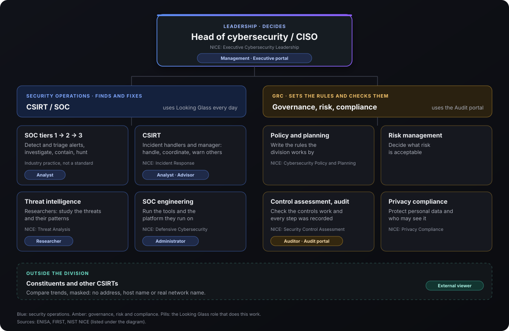

# Who does what: the roles at a CSIRT, a SOC and a cybersecurity division

Looking Glass gives each person only what their job needs. This page maps its roles to the roles that published
frameworks describe for CSIRTs and SOCs, so a team can see where each of its people fits. The mapping is ours; the
framework roles it maps to are quoted from their sources (listed at the end).

## In one line

**Researcher** finds the pattern → **Analyst** finds the devices → **Management** decides → **Advisor** tells the
organisation → **Auditor** checks it was done properly. **Administrators** run the platform; **external viewers**
compare trends, masked.

## The roles in Looking Glass

| Role | Their question | What they do in Looking Glass | What they never see |
|---|---|---|---|
| **Researcher** | What is this threat, and what pattern is it? | Studies the threats in the reports: Definitions, Intel gathered, exact combinations, notes with codes; opens a finding when something needs action. | Who is affected: no IP address, host name or organisation's devices. |
| **Analyst** | Which devices are affected, and where? | Turns a pattern into real devices: the Combinations search, analyst codes, drill-downs, CSV and PDF reports; sends the evidence to management. | Nothing is hidden: the role that sees addresses. |
| **Management** | Does this matter, and do we act? | The Executive portal (trends, a 7-day baseline, figures only); approves or rejects findings, decides what the advisory carries and names the advisor. | Addresses: counts and trends only. |
| **Advisor** | What do we tell the organisation? | Writes the advisory (subject, description, recommended actions), generates the PDF and CSV for each organisation, marks it sent. | Only the devices of the findings handed to them. |
| **Auditor** | Was everything done properly? | The Audit portal: who did what and when, the access review, the controls mapping, Trace a leak. | The threat data itself. |
| **Administrator** | Does the platform run? | Accounts and roles, settings, installation and updates; can act in any role when needed (recorded as such). | Nothing. |
| **External viewer** | How do the trends compare? | A constituent, or a member of another CSIRT: three pages, read only, to compare trends: network communications, publicly accessible / vulnerable services, and Abused or Compromised. | Addresses, host names, organisations, e-mail addresses, free-text details and real network names (masked); no ransomware victims; no downloads, look-ups or other pages. |

An external viewer sees the whole constituency's trends, masked: the other organisations appear only as aliases.
The rule follows the permissions: any role whose only permission is "view" gets exactly these three pages.

## A CSIRT and a SOC: what the sources say

**A CSIRT** is "a team that is assigned to handle computer security … incidents" (ENISA). Incident handling is its
core service, and over the years its role has grown to coordinating with other organisations, sectors and countries.
ENISA names four mandatory roles in a CSIRT:

- **Duty officer**: takes "all in-coming requests" and makes sure every incident has an owner;
- **Triage officer**: decides whether the team handles an incident, when, and who handles it;
- **Incident handler**: analyses the data, resolves the incident and communicates with the constituents;
- **Incident manager**: coordinates "all incident handling activities" and represents the team outside it.

Optional roles: public relations officer, legal officer, team manager, hotline operator. Teams may also have
researchers, and senior specialists write advisories (ENISA).

**A SOC** "provides an incident detection service by observing technical events" (ENISA). It may also handle
incidents; in large organisations it often only detects, and hands incidents to a CSIRT. In small organisations the
two are often the same team. A sector CSIRT quoted by ENISA: "SOC is the first line, they receive all alerts".

SOC staff are commonly organised in tiers. This is industry practice, not a standard:

- **Tier 1**: monitors and triages alerts, following playbooks;
- **Tier 2**: investigates deeper, confirms or refutes Tier 1, contains threats;
- **Tier 3**: threat hunting, forensics, major incidents;
- specialists alongside them: threat intelligence, SOC engineering, digital forensics.

## Looking Glass roles mapped to them

| Looking Glass | At a CSIRT (ENISA) | At a SOC | NICE work role (NIST) |
|---|---|---|---|
| **Researcher** | Researcher | Threat intelligence; Tier 3 threat hunter | Threat Analysis (PD-WRL-006) |
| **Analyst** | Triage officer and incident handler | Tier 1 and Tier 2 analyst | Incident Response (PD-WRL-003) |
| **Management** | Incident manager; team manager; team leads | SOC manager; team leads | Executive Cybersecurity Leadership (OG-WRL-007), for the head of the team |
| **Advisor** | The incident handler's communication with constituents; the senior specialist who writes advisories | The responder who tells the IT team what to fix | Incident Response (its communication part) |
| **Auditor** | Outside the core CSIRT roles | Outside the SOC | Security Control Assessment (OG-WRL-012) |
| **Administrator** | Not a core role (often IT support) | SOC engineering | Defensive Cybersecurity (PD-WRL-001) |
| **External viewer** | A constituent, or another CSIRT sharing information | Another team given a read-only view | none |

The difference that matters most: **a CSIRT warns other organisations** about problems on *their* networks (the
advisor is central, and the CSIRT does not fix anything itself), while **a SOC protects its own organisation** (the
"advisory" is usually a ticket to its own IT team).

## Which CSIRT services Looking Glass supports (FIRST)

FIRST's CSIRT Services Framework describes the **services** a CSIRT can offer, not job roles: it is "a collection
of cyber security services and associated functions", and "no CSIRT is expected to provide all described services"
(section 1). Its five service areas, and where Looking Glass helps:

| FIRST service area | Services (FIRST v2.1) | In Looking Glass |
|---|---|---|
| Information Security Event Management | 5.2 Event analysis | Both platforms, Intel gathered, the Combinations search |
| Information Security Incident Management | 6.2 Incident analysis; 6.5 Incident coordination (6.5.1 communication, 6.5.2 notification distribution) | Findings, management's review, the advisory sent to each organisation |
| Situational Awareness | Data acquisition; analysis and synthesis; communication | The pipeline (the Shadowserver reports), the Executive portal, the masked view for constituents and other CSIRTs |
| Knowledge Transfer | 9.4 Technical and policy advisory | The advisory's recommended actions |
| Vulnerability Management | Coordination and disclosure, among others | In part: the CVEs found on constituents' devices, with CISA KEV and EPSS; not discovery or disclosure |

Looking Glass does not provide 5.1 *Monitoring and detection* itself: it reads what Shadowserver detected.

## In a full cybersecurity division (CSIRT or SOC, and GRC)

[](media/roles-division.svg)

*Click the diagram to open it full size.*

??? note "Show the diagram as text"

    ```text
    Head of cybersecurity / CISO                      NICE: Executive Cybersecurity Leadership
    │
    ├── Security operations (CSIRT / SOC)             finds and fixes
    │     SOC tiers 1 → 2 → 3                         detect and triage
    │     CSIRT: incident handlers, incident manager  handle, coordinate, warn others
    │     Threat intelligence / researchers           study the threats
    │     SOC engineering                             run the tools
    │     Team leads                                  may hold the Executive portal (Management)
    │
    └── GRC: governance, risk and compliance          sets the rules and checks them
          Policy and planning                         NICE: Cybersecurity Policy and Planning (OG-WRL-002)
          Risk management                             decide what risk is acceptable
          Control assessment / internal audit         NICE: Security Control Assessment (OG-WRL-012)
          Privacy compliance                          NICE: Privacy Compliance (OG-WRL-008)
    ```

Where Looking Glass sits in it:

- **Security operations** use it every day: researchers, analysts, advisors.
- **The head of the division**, senior managers or **team leads** use the Executive portal (Management). Giving the
  role to team leads too means every decision does not wait on management.
- **GRC** uses the Audit portal (Auditor): who did what, the access review, the controls mapping and Trace a leak,
  never the threat data. That is the separation of duties GRC is there to check.

In one sentence: operations finds and fixes, GRC sets the rules and checks they were followed, leadership decides,
and Looking Glass gives each of them only what their job needs.

## Why the roles are split

- **Privacy**: the person who studies threats never sees who is affected, so constituents' identities stay with the
  few who need them.
- **Separation of duties**: the person who sees the devices does not decide alone; management decides, and an
  advisor speaks for the CSIRT.
- **Accountability**: every step is recorded, so an auditor can check it afterwards.

## Sources

- ENISA, [Good Practice Guide for Incident Management](https://www.enisa.europa.eu/sites/default/files/publications/Incident_Management_guide.pdf), chapter 6 "Roles" (pp. 28–30).
- ENISA, [How to set up CSIRT and SOC](https://www.enisa.europa.eu/publications/how-to-set-up-csirt-and-soc) (December 2020), §1.4 "Definitions of CSIRT and SOC" (pp. 6–7).
- ENISA, [Recruitment of CSIRT staff (toolset)](https://enisa.europa.eu/topics/trainings-for-cybersecurity-specialists/online-training-material/documents/2016-resources/recruitment_of_csirt_staff-toolset).
- FIRST, [CSIRT Services Framework v2.1](https://www.first.org/standards/frameworks/csirts/csirt_services_framework_v2.1): sections 1 and 5–9 (services, not roles).
- NIST / CISA NICCS, [NICE Framework work roles](https://niccs.cisa.gov/workforce-development/nice-framework) (Protection and Defense; Oversight and Governance), among them [Cybersecurity Policy and Planning](https://niccs.cisa.gov/tools/nice-framework/work-role/cybersecurity-policy-and-planning) and [Executive Cybersecurity Leadership](https://niccs.cisa.gov/tools/nice-framework/work-role/executive-cybersecurity-leadership).
- SOC tiers (industry practice): [Palo Alto Networks, SOC roles and responsibilities](https://paloaltonetworks.com/cyberpedia/soc-roles-and-responsibilities).
