# Using Looking Glass

Looking Glass replays your country's Shadowserver reports from the previous day, at the same time of day, as two
live platforms:

- **Reported network communications** (the map): infected and attacking hosts in your country and what caught
  them: infected devices calling botnet sinkholes (sinkholed C2 domains), and attackers caught by honeypots, drawn as
  arcs on a 3D map.
- **Publicly accessible / vulnerable services**: hosts in your country with exposed or vulnerable services
  (open databases, remote desktop, old TLS, vulnerable devices, compromised or blocklisted hosts).

It is built for national and sector CSIRTs: analysts use it to find and follow up affected hosts, and managers and
partners see the country's situation at a glance on a wall screen.

> Every screenshot in this guide uses **dummy data** (documentation IP ranges, private AS numbers, fictional
> networks). New terms are explained in the [glossary](GLOSSARY.md).

## Contents

- [Common tasks, step by step](#common-tasks-step-by-step)
- [1. Signing in](#1-signing-in) · [Roles](#roles)
- [2. The intro page](#2-the-intro-page)
- [3. Reported network communications (the map)](#3-reported-network-communications-the-map)
- [4. Publicly accessible / vulnerable services](#4-publicly-accessible--vulnerable-services)
- [5. Analysis and follow-up](#5-analysis-and-follow-up) · [Findings and cases](#findings-cases-and-who-holds-them)
- [Management portal (Executive)](#management-portal-executive)
- [Advisories (the advisor)](#advisories-the-advisor) · [TLP](#tlp-how-far-an-advisory-may-travel)
- [Notifications (the bell)](#notifications-the-bell)
- [6. Demo mode and public screens](#6-demo-mode-and-public-screens)
- [7. Settings (administrators)](#7-settings-administrators)
- [8. Administration](#8-administration)
- [9. Good practice](#9-good-practice)

## Common tasks, step by step

**See what happened in the country yesterday**
1. Sign in; the intro page opens with yesterday at a glance.
2. Read the totals and the activity over the day; the **Glossary** tab explains any term.
3. Choose **Explore the platform** on *Reported network communications* or *Publicly accessible / vulnerable services*.

**Find the hosts to follow up first**
1. On either platform, click a figure in the top bar (for example **Critical** or **Hosts with issues**).
2. The analysis opens with key findings and **the hosts to follow up first**, ranked by their reasons.
3. Open **Details ›** on a tile for the full list; **Download CSV** or **Download report (PDF + CSV)**.

**Look into one host**
1. Click its row in the stream (bottom), or its address in any list.
2. Read every report, service and issue for it; use **Enrich with Malpedia** or **Explain issues**.

**Show the platforms on a wall screen or to partners**
1. Sign in with an **external** account (always masked) and tick **Stay signed in**.
2. Open the platform full screen; it adapts to TVs by itself (Display: Auto / Full / Lite).

**Give management a report**
1. A **management** account opens straight into **Executive**; choose the day and any filter.
2. **Executive report** downloads a PDF in the dashboard's design plus CSV files.

**Send a finding on several networks to management (analyst)**
1. On **Combinations**, search the code; tick the across-report patterns to send.
2. Pick the networks it concerns and **Send to management**: one network opens a finding for that organisation,
   several open a **case** with one sub-finding each.

**Decide a finding (management)**
1. The bell shows it; open the review from **Findings**.
2. **Approve** and name the advisor (it goes straight to them), or **Reject** with the reason (it closes).

**Send an advisory to an organisation (advisor)**
1. Open the finding from the **Advisory portal**; its organisation and that organisation's devices are already there.
2. Write the heading, **Description** and **Recommended Actions**, choose the **TLP**, then **Generate the report**.
3. **Mark as drafted**. Download the report, extract it, and mail the PDF and the devices CSV to the organisation
   (two attachments, never the archive).
4. On **Findings**, **Mark as sent**: the sub-finding closes, then its case once every sub-finding is closed.

**Add a colleague**
1. They choose **Create an account** on the sign-in page and link an authenticator app.
2. An administrator approves them in **Admin → Users** with a role.

---

## 1. Signing in

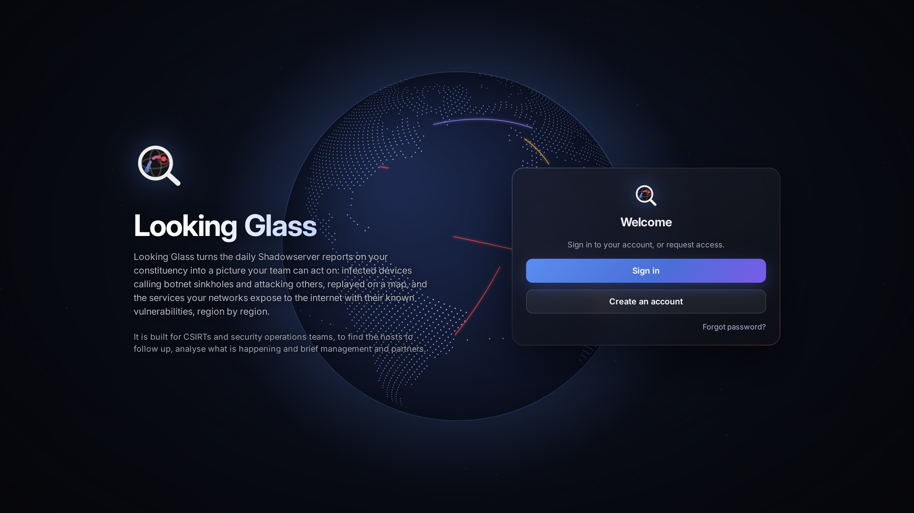

### First time on a new installation
The very first visit shows only **Let's get started**: it asks for the one-time setup code from the server
(`cat data/setup_code` in the platform folder; the installer shows the command), then creates the first
administrator (name, organisation, email, country, user name, password) and links an authenticator app with a QR code. Keep the recovery codes it
shows somewhere safe and offline.

### Getting an account
Choose **Create an account**, fill in your full name, organisation, email, country, a user name and a password,
and scan the QR code with an authenticator app (Google Authenticator, Microsoft Authenticator, Aegis, 2FAS...).
Your account then waits until an administrator approves it and gives it a role.

Passwords need at least 12 characters with upper and lower case letters, a digit and a symbol, and must not contain
your name or common words. The eye button shows what you typed; the bar shows its strength.

### On a phone, tablet or TV

The globe on the sign-in page turns with a finger (pinch to zoom, tap to launch an attack) or with a TV remote: the
first arrow press goes to **Sign in**, Up / Down move through the form, Up from the first item reaches the globe (arrows
turn it, OK launches an attack, Back returns to the form).

### Signing in
**Sign in** asks for your user name and password, then the 6-digit code from your authenticator app. Tick
**Stay signed in** on a computer or screen only you use (up to 5 days); otherwise the session ends when the browser
closes, after an hour without use, or after 12 hours. After 5 failed attempts the account waits 15 minutes; the page
says how many attempts are left.

### Forgot password
**Forgot password?** (right of the Sign in button) offers two ways:
- **Reset it yourself:** with a code from your authenticator app plus one of your recovery codes.
- **Ask an administrator:** the administrators are notified; one of them allows a reset in **Admin → Users**, and
  you then set a new password with your authenticator code.

### Roles
| Role | Sees | Can |
|---|---|---|
| **External** | both platforms, always masked: IP addresses become an opaque label (`Host 3f9a2c41b07e`, no part of the address), network names become aliases ("Telco 1"), host names are hidden | view only. No Demo switch, exports or Malpedia |
| **Analyst** | everything, unmasked | analyse, export CSV, look up Malpedia, switch Demo on for presentations |
| **Management** | only the **management portal** (Executive, `/management`): aggregated figures of both platforms, never individual addresses | filter, explain infections and vulnerabilities, download executive PDF reports. No other role can be given this portal (admins can preview it) |
| **Researcher** | only the **Definitions** page (no platforms or addresses) | the organisation's security researchers: define, with references, the malware names Malpedia does not know and the issues that are not CVEs; add notes to CVEs; correct network names and types |
| **Advisor** | the **Advisory portal** and the findings management sends them (with the organisation's devices) | write each organisation's advisory, generate its report, mark it drafted and sent; their dashboard shows what went out and to whom |
| **Auditor** | only the **Audit portal** (`/audit`): the audit log by tab, the dashboard and control checks, the access review, the log's integrity | read and export evidence for a period. Read only everywhere; never the platforms or any host data |
| **Admin** | everything | also Settings, definitions, accounts, roles, the Audit portal; **Peace of mind** steps out of the operations |

Every role has an **Overview**, and every role but the auditor the **Findings** page (only the findings it takes part in).

**Permanent roles.** Admin, Management, Researcher, Advisor, Auditor and External are permanent: no one can remove them or change
their permissions (on the Roles page they have no Remove button and their boxes cannot be changed). Administrators
only give people these roles. Three permissions
belong to one role only and cannot be given to any other: *definitions* (Researcher), *advisory* (Advisor) and
*users* (Admin), as *management* belongs to Management.

Administrators can make custom roles from the other permissions (view, unmasked data, export, Malpedia, settings,
networks, audit).

---

## 2. The intro page

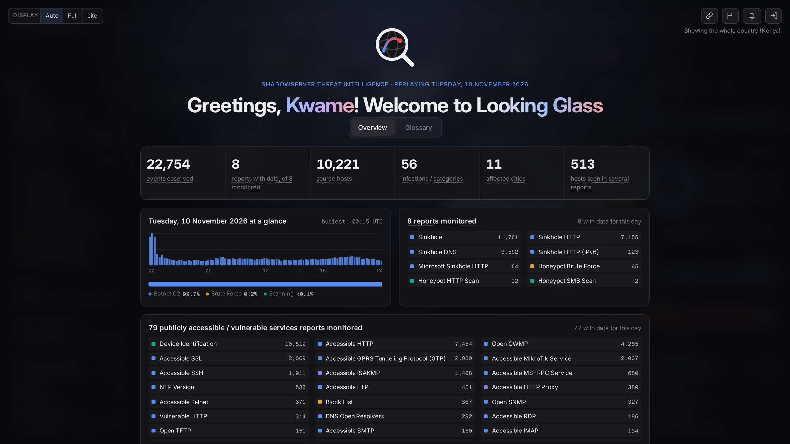

Every role starts on its own **Overview**. The first time you open it, it greets you by your first name: *Greetings,
Kwame! Welcome to Looking Glass*. After that it picks one of thirty greetings at random each time (some of them for
fun). It uses the name the administrator entered, never the user name.

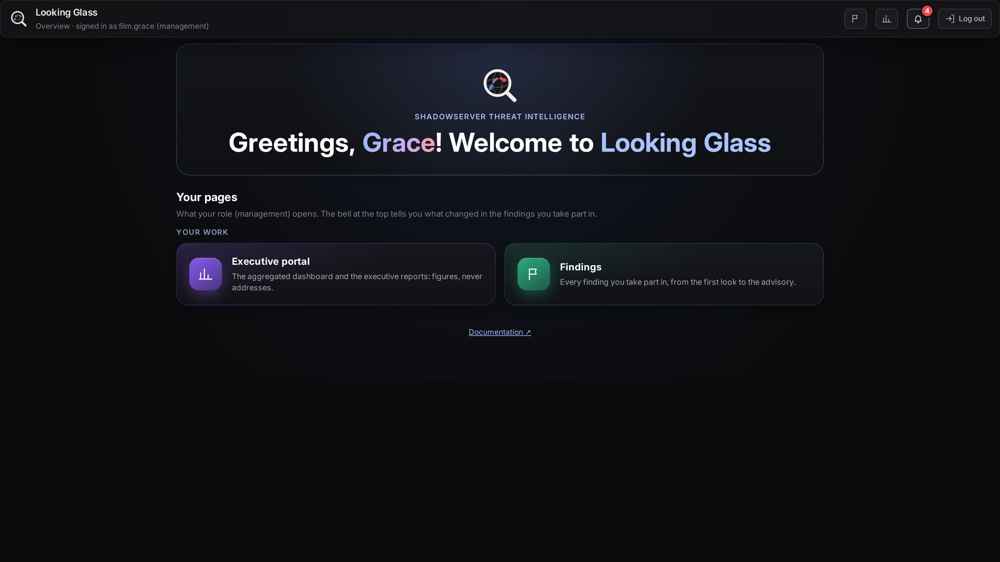

Below the day at a glance, **Your pages** lists exactly what your role opens, in titled groups: the platforms, your
work (Findings, Combinations, the Advisory portal, Executive, Definitions, as your role allows) and administration
(Admin, Audit, Settings). Each card says what the page is for.

At the top left: **Display** quality (Auto / Full / Lite, see section 6). At the top right: your pages as buttons, the
**bell** (see [Notifications](#notifications-the-bell)), **Settings**, and **Log out** last; under them, whether both
platforms show the whole country or your constituency.

The day at a glance: totals, the activity over the day, the mix of attack types and every monitored report. The
**Glossary** tab explains every term and every Shadowserver report in plain language, with links to Shadowserver's own
report pages.

Come back to it at any time with the **Overview** button, which is in every page's header, or the logo.

## 3. Reported network communications (the map)

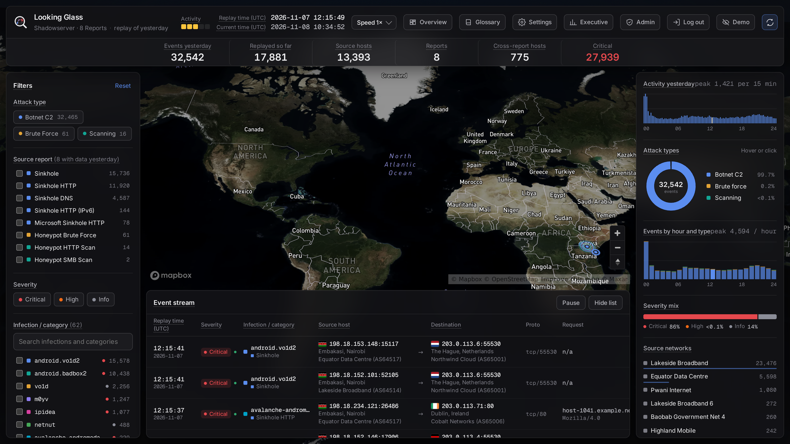

- **Top bar:** the day's figures (events yesterday, replayed so far, source hosts, reports, hosts in several
  reports, critical). Every figure opens an analysis. The clocks show the replay time and the current time (UTC).
- **Map:** every connection of the day with the active filters, plus the live replay on top: an arc for each event
  as it happens. Hover anything to see what it is; click to analyse it.
- **Filters** (left): attack type, report, severity, infection, affected city, target country, source network,
  destination network, tag, port and protocol. Networks are grouped by company (all AS numbers of one operator).
- **Intel** (right): attack types, events by hour, severity mix, networks, infections, cities, C2 domains...
  Every line is clickable.
- **Stream** (bottom): every event as it replays. Click a row for the full details (the raw request, the infected
  host, the destination, the report file it came from). Pin rows with 📌. Drag the top edge to resize; **L** hides it.
  The stream only shows what has been replayed so far, while the figures, Intel and map cover the whole day. When a
  filter's events all come later in the day, the stream says so and when: "None of the 6 matching events of 2026-01-15
  has been replayed yet: the first is at 09:30:00 UTC and the replay is at 07:30:00 UTC, so it appears in about 2 hours.
  Their 5 IP addresses are already in the charts and statistics: click them to analyse them, or find them on the map."
  (The services record stream does the same, for records and hosts.)

  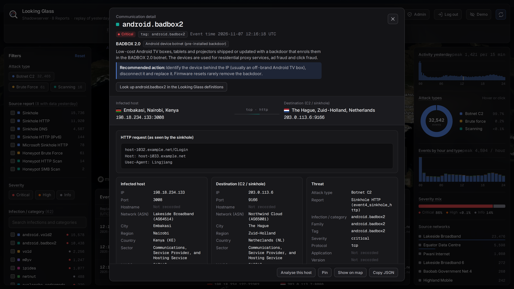
- **Playback:** pause, speed (1×, 5×, 15×, 60×) and **Catch up**. A hidden browser tab pauses itself and resumes
  where it stopped.

## 4. Publicly accessible / vulnerable services

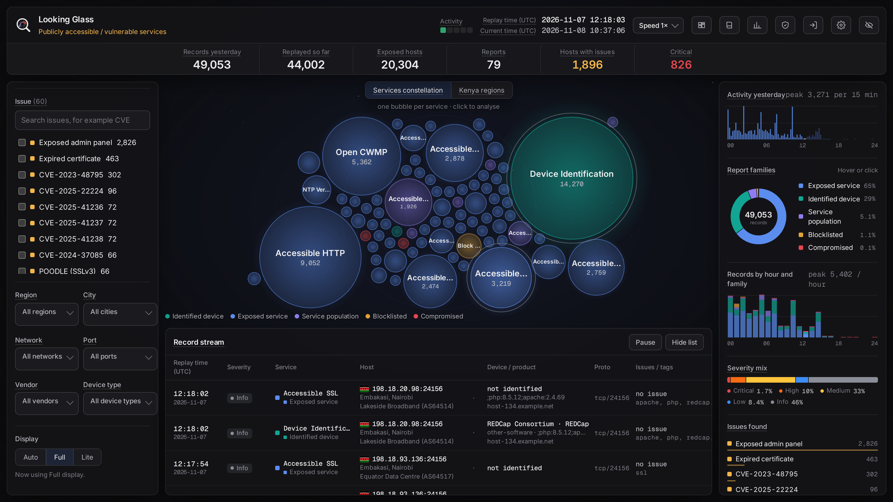

The same layout, without a map:
- **Services constellation:** one bubble per service, sized by its records; a dot flies in as each record replays.
  Click a bubble to analyse that service.
- **Regions map:** your country's regions coloured by records; hover for what makes up a region, click to analyse it.
- **Filters:** only hosts with issues, report family (exposed, population, identified device, compromised,
  blocklisted), report, severity, issue (CVE, POODLE, expired certificate, exposed admin panel...), region, city,
  network, port, vendor, device type, **Hosts in several reports** and **Hosts with multiple issues**.
- **Intel and stream** as on the map, with the report's definition in every record's details.

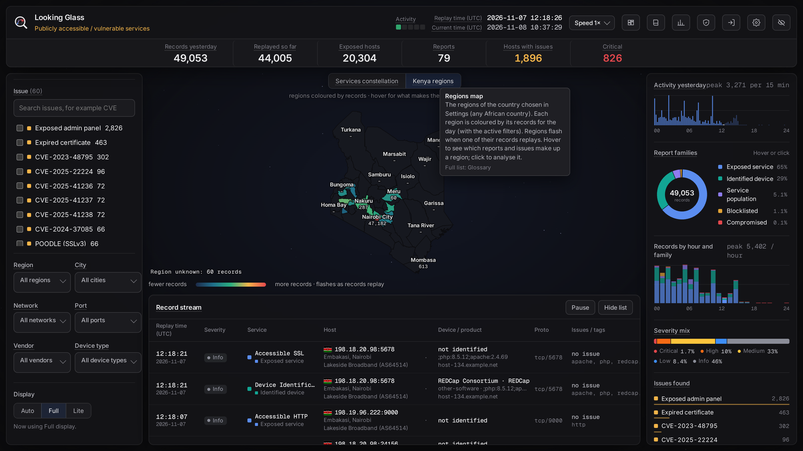

## 5. Analysis and follow-up

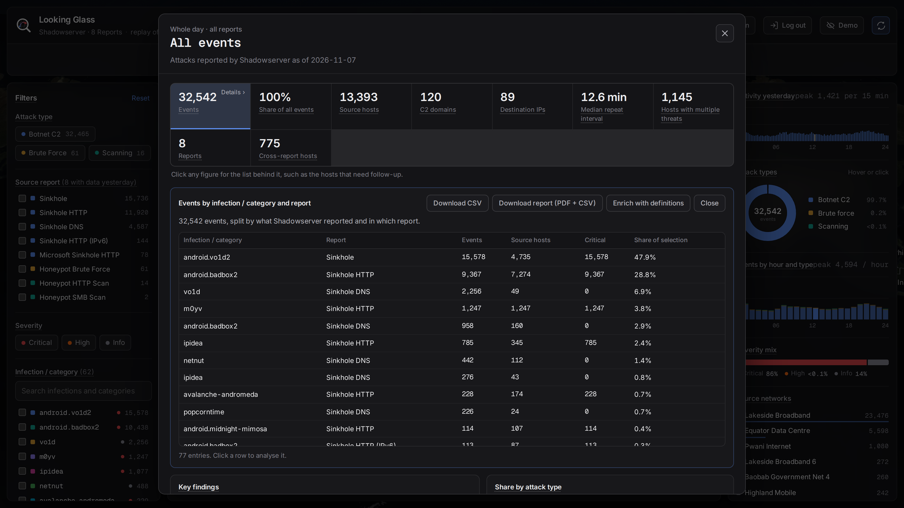

Clicking any figure, bubble, region, chart line or row opens the **analysis**: key findings, charts, breakdowns and
the hosts to follow up first, ranked by reasons such as "10 issues · critical · 5 reports". Each tile has
**Details ›** with the list behind it and **Download CSV** (all rows; analysts and admins). Clicking inside the
analysis narrows it (for example SSH · one region · CVE-2023-48795); **Filter the view** applies that selection to the
whole platform.

**Hosts in several reports** and **Hosts with multiple issues** compare each host across all its reports of the
day, so a blocklisted host that also runs an outdated web server shows up in both.

**Malpedia** (analysts and admins, with a Malpedia token): host lists with infections have **Enrich with Malpedia**,
which looks up every infection / category of the list once and adds a Malpedia column to the table and two columns
to the CSV (families found, and why the others are not there: an activity such as scanning, a proxy network, a
generic sinkhole label, or simply not catalogued). A host's own analysis (click its IP) looks up all its infections at
once.

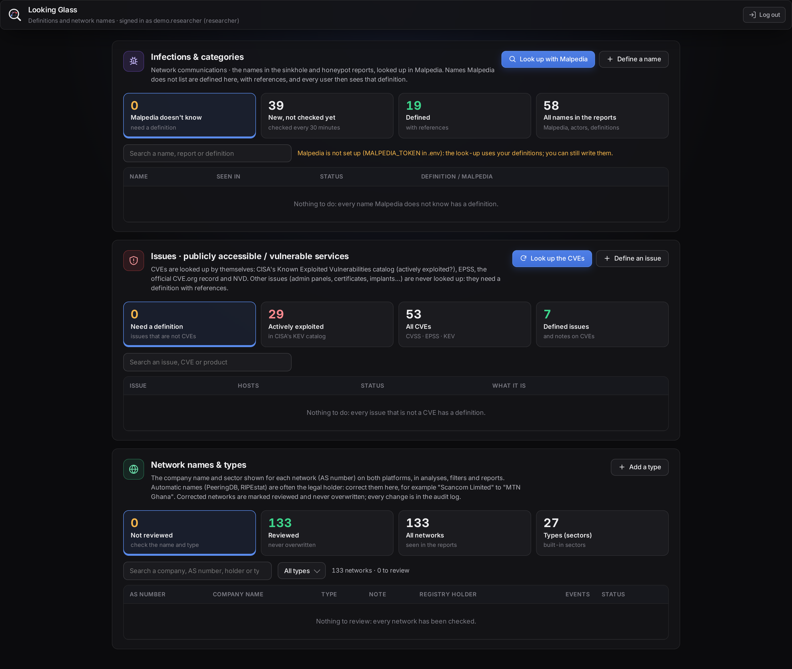

**Definitions for names Malpedia does not know** (researchers and admins: the **Definitions** page at `/definitions`,
a page of its own; admins open it with the **Definitions** button on the intro page, the map, the services platform
and Settings).
Names that Malpedia cannot match are listed under **Malpedia doesn't know**; names that new reports bring in appear under
**New, not checked yet** by themselves and are checked with Malpedia in the background every 30 minutes (or at once with
**Check new names with Malpedia**). Scanning, brute-force and other activities are not malware and are left out.
**Define** opens an editor:

- **Name in Malpedia** (optional): if Malpedia lists the malware under another name, search it with **Find in Malpedia**
  and pick the family (for example `lumma-stealer-beacon` → `win.lumma`). Future look-ups of the name show that family.
  Leave it empty when Malpedia does not have the malware at all. Names of attacker groups (threat actors, such as
  `tick`) are found automatically and shown as a *Malpedia · threat actor* card; the search also lists actors
  (`actor:tick`).
- **Title, type and a plain description**, and **References (evidence)**: web links to the research that supports the
  definition (vendor blogs, CERT advisories). At least one reference is needed; only `http(s)` links are accepted.

From then on every user sees the definition (badge *Looking Glass definition*, with its references and who wrote it and
when) in the stream, host lists, host analysis, the CSV and the PDF reports, instead of "not in Malpedia". Every change
is in the audit log. Definitions written on a site are kept in `data/definitions.json` (kept on upgrades, included in
backups); the definitions that come with Looking Glass are in `data/infections.json` and `data/issues.json`.

**Who wrote it.** Definitions, notes and network corrections name their author by the **full name** given when the
account was registered, not the username. The definitions that come with Looking Glass are signed **Looking Glass**.

**Seen in.** The *Seen in* column shows each report a name was seen in as a small card: **intel · N kinds** when that
report carries indicators for it (domains, URLs, user agents…), **name only** when it carries just the name. Click a
card to open *Intel gathered* on that report. A name that is not in today's reports shows **Last seen in *report* on
*date*** (the last 30 days are remembered), or *Not seen in the last N days*.

**Intel gathered** (button on every infection and issue). What the reports carry for that name, organised as
**name › report › what comes with it there**:

- for infections and categories: the C2 domains contacted, DNS lookups, TLS server names, URLs, user agents, request
  patterns and the usernames tried by brute-force bots;
- for issues: the other CVEs found on the same hosts, the associated tags, products, certificate names and fingerprints;
- **Combinations**: the exact sets that occur together on one record (for example *iot + router-os + winbox*), with
  the number of records, their share of the report, the number of devices and how many devices **repeat** it (↻: more
  than one record each). A combination many devices keep repeating is a pattern, not a one-off;
- every value shows records, share and devices, and can be copied: one value, one set, or a whole card as lines or as
  one line.

Indicators only: researchers never see the hosts themselves, and addresses inside URLs and banners are masked.

**Looking Glass asks: can you look into this?** The card at the top of the Definitions page lists matches the platform
found in the reports: the same indicator under two names (possibly one family under two names, or shared
infrastructure; it says so when one of them has no definition yet), the same indicator in two reports for one name (a
probable indicator of that name, worth putting in its notes), and an infection's C2 domain that is also the certificate
name of a service in the constituency. Each match is an analysis box: what kind of match, the indicator (with copy),
**where Looking Glass saw it** (every name and report with its records, and whether the name is defined; click a name to
open its intel on that report) and what Looking Glass saw, in words. Looking Glass states what it saw and leaves the
conclusions to the researcher. At the top of the card: how many matches, names involved and names without a definition,
and chips to show one kind of match. Values that are common to everything (stock browser user agents, "/", usernames
such as *root*) are never raised.

**Across reports** (first in the report rail when a name is seen in two or more reports) looks at the reports together:
**combinations across reports** (for the devices seen in more than one report, exactly what each carried in each report,
for example *iot + router-os* in one report **and** the same set in another, with the number of devices), the
**reports seeing the same devices** (the exact sets of reports per device), and the **indicators in more than one
report** (for example a domain looked up in Sinkhole DNS and contacted in Sinkhole HTTP), with records per report.

In the Intel window the combinations are shown as a **List** (each set as its values joined with +) or as a **Matrix**
(values as columns, sets as rows). *Devices* counts the distinct devices that carry a value; they are counted, never
shown. Values are listed with the most records first. **Focus** (click a value) dims everything that does not carry
it; **search** (`/`) works across all cards; `[` and `]` switch report, Esc clears the search, then the focus, then closes.

**Notes.** Every row of both tables has a **Notes** button, apart from Define. It opens the name's Notes window for new
findings ("the C2 moved to …", "seen together with … since Monday"). A note is saved at once, dated and signed, and
appears on every card of that name (map, services, Executive) and in the PDF reports as **Notes shared by Researcher:
*full name* (*date*)**. Notes are kept apart from the definitions (`data/notes.json`) and are never replaced by an
update. The author or an administrator can remove a note; both are in the audit log. (For a CVE, the define button reads
*Add context*: your organisation's remarks on the CVE, which NVD describes.)

### Combination codes, the combination search and findings

These three tie the team's work together: the researcher names exactly what was found, management decides it matters,
the analyst pulls exactly those devices and writes the advisory. Two complete walk-throughs, with the figures of the
demonstration data, are in [Use case scenarios: a needle through the haystack](USE_CASES.md).

**Combination codes.** Every combination in Intel gathered carries a code: **`LG-C-…`** for one exact combination in
one report, **`LG-X-…`** for a cross-report pattern (what a device carried in each of several reports). The same
combination always has the same code, and a code carries no address. Click a code to copy it.

**Attaching codes to a note.** The Notes window has a **Combinations for this note** section with three ways in:
- **Seen in the reports:** every combination of the name, grouped by report like a detailed drop-down list, with
  records, devices and repeating devices, and a filter. One click attaches it.
- **Build one:** pick a report and tick the indicators that must come together (the name's real values only). Looking
  Glass makes the code and says how many records and devices carry exactly that now.
- **Paste a code:** a code from another note or colleague; it is checked before it is attached.

The note's codes are printed with it on every card and in the PDFs (Executive reports included).

**Track as a finding.** Tick it in the Notes window (with a short title) to follow the note up on the **Findings** page
(`/findings`). It gets a number (#1, #2…) and a status, and goes to the person named (see
[Findings, cases and who holds them](#findings-cases-and-who-holds-them)); no address is ever shown there. Management gets
**Show in Executive** on each code: the Executive portal opens filtered to exactly that combination (a *Combination
code* chip; counts only; no 7-day comparison for a code). Analysts get **Search**, the combination search below.

**Analyst codes: the other way round.** In any analysis window (map or services platform), **Make analyst code** turns
the current selection (for example *Source network: Example Telecom · Host: …*) into an analyst code, **`LG-A-…`**, and a
finding with your title and note. The code keeps exactly the records of that selection on that day.
- *Researchers* open it from the finding (**Open as researcher**, or `/intel/LG-A-…`): the selection in words (a host
  is "1 host", never its address), the analyst's note, and for every name in those records its definition, its
  combinations and cross-report patterns with their codes. Tick the codes that answer the analyst and **Send the
  reply**: it goes into the finding's history with the codes.
- *Management* uses **Show in Executive**: the portal opens on the code's day, filtered to exactly those records
  (counts only).
- *Analysts* find every analyst code in the searchable **Analysts' codes** list at the top of the Combinations page,
  to revisit one and download its PDF + CSV for the advisory (**Report (PDF + CSV)** on the finding does the same).

Any finding takes replies (text and codes) from everyone who works on it.

**Sorting and the Across reports flag.** Both tables on the Definitions page sort by a click on a column heading (↕,
then ▲ / ▼). The **Across reports** column flags every name whose devices (or hosts) were seen in more than one of its
reports, with how many; click the flag to open that name's cross-report view.

**The combination search (analysts).** The **Combinations** page (`/combinations`, from the map, the services platform
or the Findings page) is for roles that see addresses and may export:
1. Paste the code and **Look up**: what it stands for, the name, the report(s), and the researchers' notes (the ones on
   this code are marked).
2. Choose where to look: **the days in memory** (exactly the counts the researcher saw) or **a date range of the stored
   history** (up to 31 days, read from the database one day at a time; the progress shows each day).
3. The result: the key figures (devices, records, repeating, on several days, in other reports, networks, regions and
   cities, peak hour); a **map** of the country's regions coloured by devices (hover a region for its devices,
   records, cities, networks and IP addresses) with each region and its cities beside it; networks, cities, activity
   by hour, what the devices are and ports; **the busiest devices** (address, network, region, city, records, last
   seen, other reports); and **across reports**: what these devices carried in the name's other reports, each exact
   pattern with its own `LG-X` code to search next.
4. **Download PDF + CSV (ZIP)**: a PDF in the Executive report's design (overview with key findings and activity, the
   region map with its cities, networks and cities, the devices with their addresses, across reports, and the
   explanations of the name (each name, for an analyst code) and of every CVE in the combination, each with its
   references as links and where it comes from, and the researchers' notes on those names, or a line saying there are
   none yet; a chart with nothing to show, such as across reports when no device was in another report, is left out)
   and two CSV files: one
   row per device (with the other reports it was seen in and its cross-report code) and one row per record. The columns
   have fixed names, ready for enrichment and dashboards. If the search has expired (after an hour), the button runs it
   again and then downloads.
5. **A report for one network provider**, to attach to the advisory sent to that operator: choose it in **Report for**
   next to the download button, or click the network in the *Networks* card. The PDF and both CSV files then cover
   only that provider's devices and records, and its name is in the title and the file names.

6. **Send to management** (when the devices turn up in other reports, the download waits for this): tick the
   across-report patterns, write a title and a comment, name the manager, and **pick the networks** it concerns. No
   network: an overview, and the advisor picks the organisations later. One network: a finding for that organisation.
   Several: a **case** with one sub-finding per organisation, each decided on its own.

"Exactly" means the record carries these indicators and no other indicator of the kinds compared (C2 domain, DNS
lookup, TLS name, user agent and tags; for services, the associated tags and CVEs). The search is off in Demo mode, a
search can be downloaded for an hour by the analyst who ran it, and every search is in the audit log.

**Without a Malpedia token** the same buttons (**Enrich with definitions**, the look-ups in the stream and the host
analysis) still work: they show the Looking Glass definitions written by researchers and the built-in knowledge base,
and a plain explanation for anything not defined yet ("No definition yet").

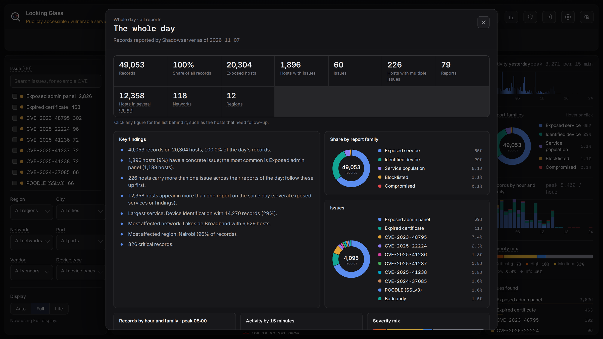

**Issues explained** (publicly accessible / vulnerable services; permission *malpedia*). Lists with issues have
**Explain issues**. Issues that are CVEs are looked up in the NIST National Vulnerability Database (description, CVSS
score, weakness, references), in CISA's Known Exploited Vulnerabilities catalog (**actively exploited**, with the date
CISA added it, ransomware use and CISA's required action) and in FIRST EPSS (probability of exploitation in the next 30
days). Issues that are not CVEs (Exposed admin panel, Expired certificate, POODLE, BADCANDY…) are never looked up: their
definition and references are used. A progress window shows each step and every issue as it is looked up (it takes a few seconds; the look-up continues if you close the window). The CVEs are looked up in batches: the official CVE.org records at once, NVD's own analysis in the background within minutes. **Enrich with Malpedia** (network communications) uses the same progress window.

**Network names and types** (on the Definitions page, researchers and admins; permission *networks*. Settings shows
them read-only for reference). Correct a
network's company name, type (sector) and note; the change is marked reviewed and is never overwritten by the automatic
look-ups. Types come from PeeringDB's categories and the company name (bank, university, hospital, power company…); if a
sector is missing, **Add a type** (with the word used for it in Demo mode, for example Institution). Added types are kept
in `data/network_types.json` and offered everywhere, also in the Settings constituency filter.

**Reports (PDF + CSV).** Every list behind an analysis figure, on both platforms, has **Download report (PDF + CSV)**
next to **Download CSV** (permission *export*). It is a ZIP file with the PDF and the complete list as CSV; the PDF
does not repeat every address, it refers to the CSV. The PDF contains:

- a cover block: report day, selection, figure, constituency, who generated it and when;
- an **executive summary**, the key figures, and activity by hour of the day;
- **priorities**: the hosts with the strongest signs, to be followed up first;
- on network communications, **the infections and categories explained**: each one's Malpedia family or threat actor
  (description, aliases, attribution, references), or the Looking Glass definition with its evidence, or why it is not
  malware; with or without a Malpedia token;
- **breakdowns** with charts (reports, attack types, networks, cities, countries, services, issues, ports…);
- on publicly accessible / vulnerable services, **the issues explained**: actively exploited CVEs first, each with
  CVSS, EPSS, CISA KEV status and required action, NVD description and references; other issues from their definitions;
- **the complete list**: a pointer to the CSV file in the same ZIP (same columns as on the platform, plus what each
  infection / issue is);
- the Shadowserver definitions of the reports involved, and the sources.

In Demo mode the PDF is masked like the page. Each download is recorded in the audit log (`report_pdf`).

CSV files are safe to open in a spreadsheet: a cell that would start a formula (`=`, `+`, `-`, `@`) gets a leading
apostrophe, so text that came from scanned devices (a vendor or product banner) can never run as a formula.

### Findings, cases and who holds them

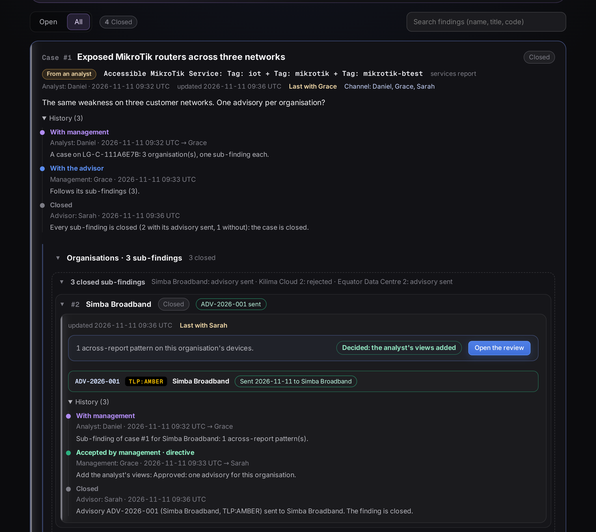

**Every hand-over names a person.** A finding always goes to someone by name: the researcher sends it to a manager,
the analyst sends a combination to a manager, the manager approves it to a named advisor. Nothing moves on its own, and
there is no general "move it on".

**Findings are channels.** Only the people a finding has passed through (and administrators) see it. Others never
learn it exists.

**The flow:**
1. A researcher (from a note) or an analyst (from the combination search) opens a finding and sends it to a manager.
2. Management **approves** it and names the analyst or advisor who takes it next, or **rejects** it with a reason (it
   closes, on the record).
3. For an advisory: the analyst sends the combination for one or more networks; management decides each organisation
   on its own and approves it to an advisor.
4. The advisor writes the organisation's advisory and marks it **sent** on the Findings page. The finding closes once
   every organisation in it has its advisory sent. A case closes once every one of its sub-findings is closed. Every step is in the finding's history and the audit
   log.

**The page is a ticket tree.** A case shows its sub-findings beneath it, one per organisation. Closed sub-findings fold
into their own group, and every level opens and closes with a click. The **state pill** says where each one stands
and who holds it (*With management · Efua Owusu*). The filters at the top count each state; **Open** and **All** switch
between work in progress and everything.

## Management portal (Executive)

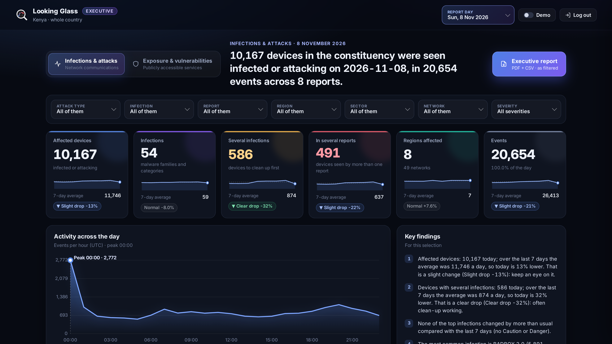

Accounts with the **management** role open straight into the **Executive** portal (`/management`); admins reach it with
**Executive** on the intro page and in the top bar. It is a dashboard for managers and executives with two views:

- **Infections & attacks** (network communications): affected devices, infections, devices with several infections,
  devices seen by more than one report, regions, networks, sectors, attack types, and the countries infected devices
  connect to.
- **Exposure & vulnerabilities** (publicly accessible services): internet-facing hosts, hosts with an issue, hosts with
  **actively exploited** vulnerabilities (CISA KEV), critical CVEs, exposed services, regions, sectors and industries.

Under **Deeper insight** the analyst figures appear as aggregates: devices with several infections (by number, and the
infections most often found together), hosts with several issues (and the issues most often found together),
cross-report analysis (devices or hosts in 2, 3, 4+ reports, which reports or services overlap, devices both infected and
attacking), repeat behaviour (devices beaconing at a regular rhythm and the typical interval), C2 / sinkhole domains,
kinds of issue, devices (vendor and type) and severity.

Every figure is aggregated: no address, host name or host list is ever shown (the server never sends them; the check
`tests/check_management.py` verifies it). Choose a **report day** and the filters at the top, or click any bar, slice or
region on the map to focus every chart on it; the chips show what is focused and **Reset all** clears it. Click an
infection or an issue to have it **explained** (Malpedia, threat actors and the Looking Glass definitions; for CVEs: CISA
KEV with the required action, CVSS, EPSS and the official records). **Explain all** looks up the top names with a progress
window. **Executive report** downloads a ZIP: a polished PDF in the dashboard's design of exactly what is on screen (overview and
key figures, activity, regions with their cities, sectors, the top infections or issues, deeper insight with the top
findings, and the explanations), plus CSV files with every combination behind the top findings (infections or issues
found together on one device / host, and reports or services seeing the same device / host), with their counts.
The dashboard shows the top 10 of each; the CSVs list all of them. **Click a combination** (for example
two infections found together on 500 devices) to focus the whole portal on exactly the devices or hosts with that
combination: every figure, chart, map, list and the executive report then break those 500 devices down by region,
network, sector, report and so on. The chip at the top shows it; click the row again, or ×, to show everything.
**Demo** replaces network names with aliases for presentations.

### The 7-day baseline

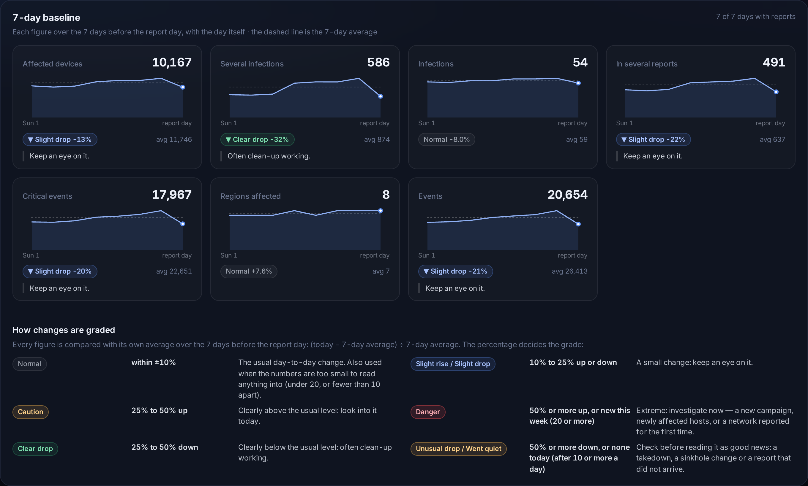

Every figure is compared with its own average over the **7 days before the report day**, so management can follow what
the analysts deal with from day to day. The figure tiles, the **7-day baseline** card and every row of **Top infections**
/ **Top issues** show a trend line (the 7 days and the report day), the 7-day average and a grade; the **key findings**
explain it in plain words ("1,700 hosts today; over the last 7 days the average was 1,850 a day, so today is 8% lower.
That is a normal day-to-day change"). The baseline is built in the background and is ready when the portal opens; any
filter or clicked combination gets its own baseline in about a second (the past days are kept in memory). The executive report
has a **7-day baseline** page and a `seven-day-trend` CSV.

**How changes are graded** — change = (today − 7-day average) ÷ 7-day average:

| Grade | Change | What it means |
|---|---|---|
| Normal (grey) | within ±10% | the usual day-to-day change; also when the numbers are too small to read anything into (under 20, or fewer than 10 apart) |
| Slight rise / Slight drop (blue) | 10% to 25% | a small change: keep an eye on it |
| Caution (amber) | 25% to 50% up | clearly above the usual level: look into it today |
| Danger (red) | 50% or more up, or new this week (20 or more) | extreme: investigate now — a new campaign, newly affected hosts, or a network reported for the first time |
| Clear drop (green) | 25% to 50% down | clearly below the usual level: often clean-up working |
| Unusual drop / Went quiet (amber) | 50% or more down, or none today (after 10 or more a day) | check before reading it as good news: a takedown, a sinkhole change or a report that did not arrive |

The same scale is printed on the portal under the 7-day baseline card and in the executive report.

The management role has this portal, its Overview and the Findings it decides: it cannot see the platforms, lists,
Settings or Definitions, and the permission cannot be given to any other role (the roles editor locks it; the server
enforces it).

## Advisories (the advisor)

[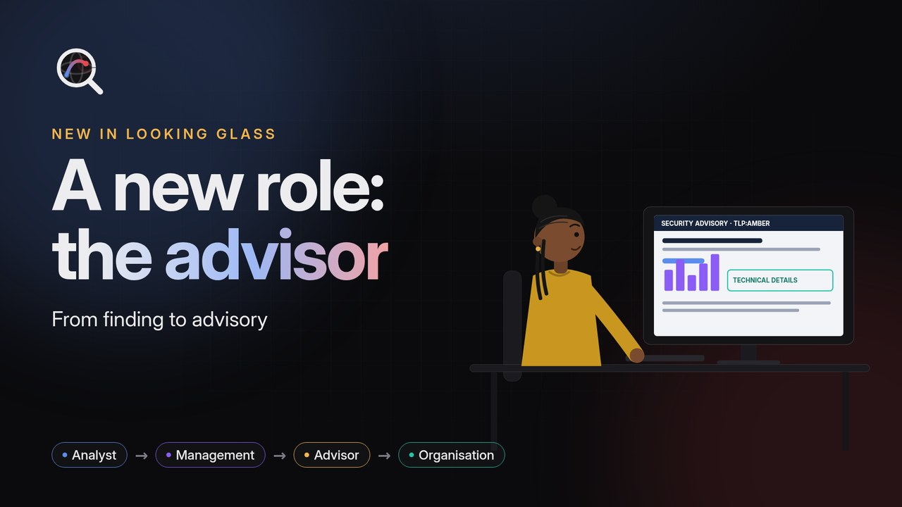](https://www.youtube.com/watch?v=BUv13KMQSEM) <!-- film: finding-to-advisory -->

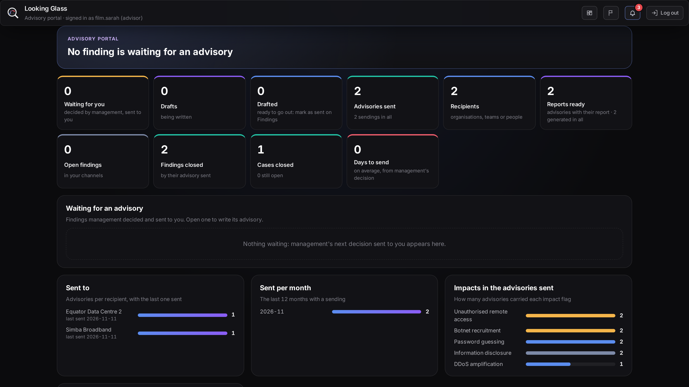

The **advisor** role turns approved findings into advisories for the organisations concerned. Its **Advisory portal**
(`/advisory`) is a dashboard showing:
- **Waiting:** what is waiting for an advisory.
- **In progress:** drafts and advisories marked drafted.
- **Sent:** advisories sent, and the recipients.
- **Findings:** findings still open and findings closed.
- **Days to send:** on average, from management's decision.
- **Charts:** sent per recipient, sent per month, and the impacts the advisories carried.

**One advisory per organisation.** Open a finding and its organisation (network) is already chosen, with that
organisation's IP addresses: the reports they appear in, what the devices are (*Seen as*), their CVEs and weaknesses
(*issues*), and the **impact** of each report (for example *Unauthorised remote access*, *Botnet recruitment*).

**Never from a blank page.** The advisor writes only the short part: a description and the actions to take. The
report brings the rest by itself:
- **INSIGHTS:** the analysis behind the finding, the analyst's report on this organisation's devices. It shows the
  pattern across reports, the networks, regions and cities, and the busiest devices, so the organisation sees why it
  matters, not just a list.
- **TECHNICAL DETAILS:** every weakness and every tag in it defined, from the researchers' definitions and the CVE
  look-ups, each with its references.
- **REFERENCES:** the Shadowserver report pages for each report involved.

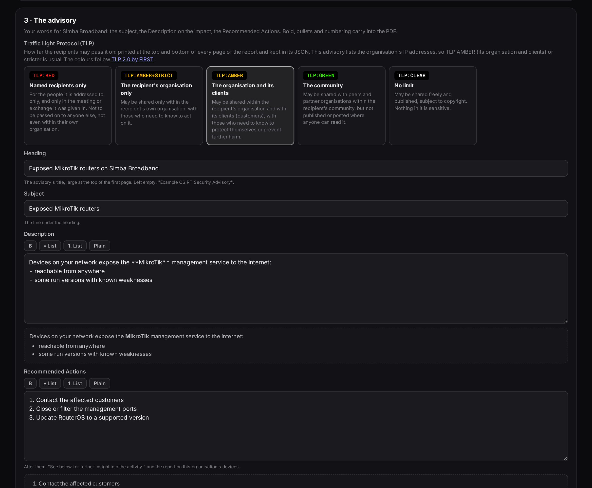

**Writing it:**
1. Choose the **TLP** (see below). It is TLP:AMBER unless you choose otherwise.
2. Write the **heading**: the advisory's title on the first page. Left empty, it reads *"<your CSIRT> Security
   Advisory"*.
3. Write the **Description** (what was found and what it means) and the **Recommended Actions**, with the **B**, **•
   List** and **1. List** buttons. A preview shows the result.
4. **Generate the report.** Generating again replaces it: there is only ever one download.
5. **Mark as drafted** when it is ready to go out.

**The report** opens with the **ADVISORY** pages (the organisation's devices, the impact, the description and the
actions), then **INSIGHTS**, **TECHNICAL DETAILS** and **REFERENCES**, each with its label. It is signed by your CSIRT
(its name and logo from Settings), never by a person; who wrote it is kept in the audit log. It carries no internal code
and no researcher's note, and every page shows the TLP at the bottom right and in the header line.

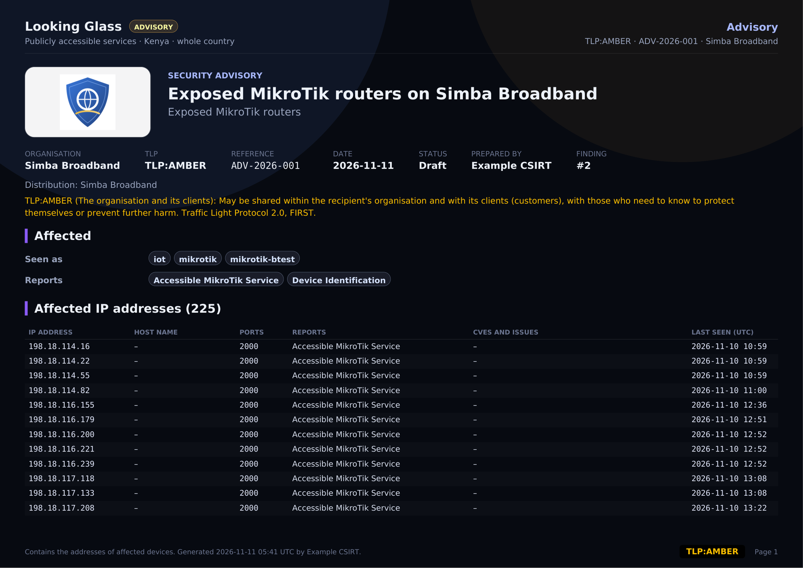

**What goes to the organisation.** The download is one archive, named `CSIRT_organisation_title_yyyymmdd`. Extract it
and mail its two files as attachments: the **PDF** and the **devices CSV** (the affected addresses). Never send the
archive itself: a zipped attachment from outside looks like phishing. **Export JSON** is for your own tools; it is not
in the archive.

**Mark as sent** on the Findings page once it has gone out. The organisation's sub-finding closes, then its case when
every sub-finding is closed. Each step is in the history and the audit log, and the dashboard updates.

If two people (or two tabs) change the same advisory at once, the second change is refused with "changed meanwhile":
open the advisory again to see the latest, then make the change. Nothing is overwritten, and a sent advisory stays sent.

### TLP: how far an advisory may travel

The Traffic Light Protocol 2.0 (FIRST) is chosen on the advisory page and explained there and on the Definitions page.

| Level | Who may receive it |
|---|---|
| **TLP:RED** | the named recipients only, in the meeting or exchange it was given in |
| **TLP:AMBER+STRICT** | the recipient's own organisation only, those who need to know |
| **TLP:AMBER** | the recipient's organisation **and its clients** (customers) who need to know: the default, since an advisory lists the organisation's addresses |
| **TLP:GREEN** | peers and partners in the recipient's community, not published |
| **TLP:CLEAR** | anyone; may be published |

## Notifications (the bell)

Every role has a **bell** in its header. It counts what changed in the findings you take part in: a finding sent to
you, a decision, a reply, an advisory sent. Open it to see each one, with what happened and when; click one to go
straight to it. **Clear all** clears your own list only. With Peace of mind on, an administrator gets no findings
notifications.

## 6. Demo mode and public screens

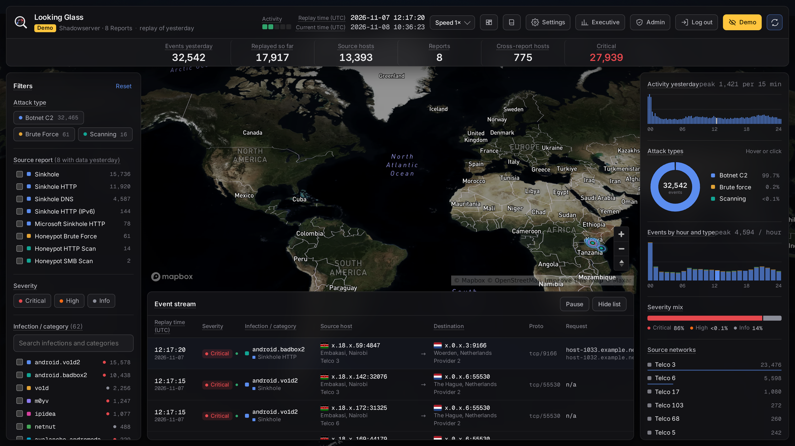

**Demo** in the top bar masks the data while it keeps playing: IP addresses lose their 1st and 3rd parts, network
names become stable aliases ("Telco 1", "Bank 2"), host names disappear. Masking happens on the server, so the
hidden values never reach the browser. External accounts are always masked; `PUBLIC_DEMO=1` masks everyone.
While masked, filters accept only the aliases and opaque host references: typing a real network name, AS number or
address finds nothing, so a viewer cannot test whether a network or host is in the data.

**Pinned events** (the pin at the end of a row on the map) keep their full details in your browser only while you are
signed in: they belong to your account and are deleted when you log out. Masked accounts do not keep pins.

For a TV or wall screen: sign in with an external account, tick **Stay signed in**, and open the
platform full screen. The display adapts to TVs and weaker devices by itself (`?perf=lite` forces the light mode).

## 7. Settings (administrators)

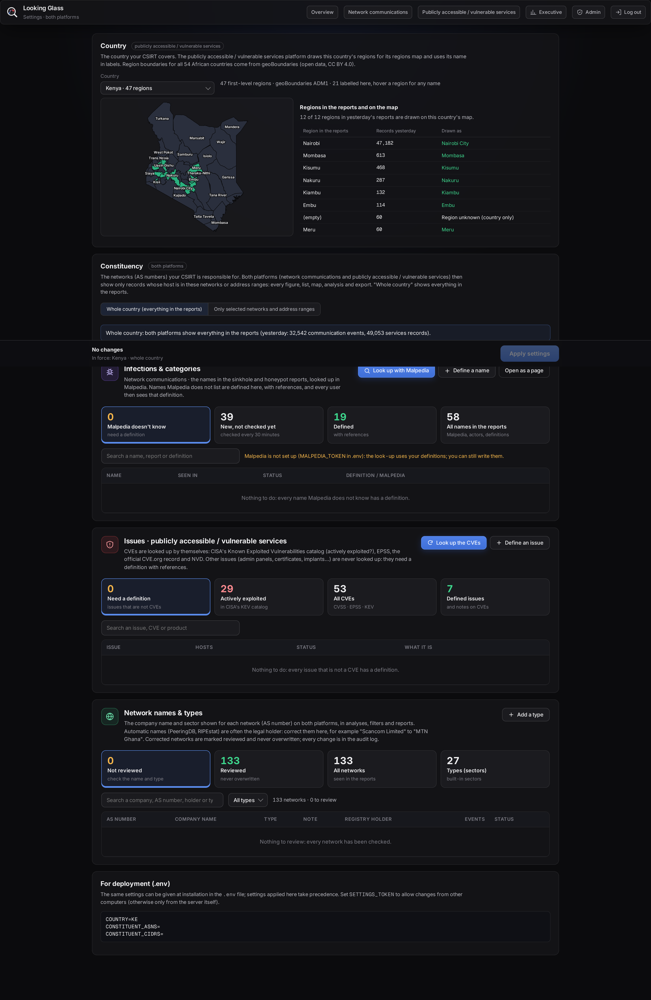

**Settings** (gear on the intro page, or the button in the top bar):
- **Country:** any of the 54 African countries. The services platform shows its regions and uses its name.
- **Constituency:** the whole country, or the networks your CSIRT is responsible for: choose companies (all their
  AS numbers) and add address ranges. Both platforms then show only your constituency.

- **Organisation:** your CSIRT's name and logo (PNG or JPEG, at most 40 KB). Advisories are signed with them.

**Apply settings** saves and applies at once for everyone.

Settings also lists the **network names and types** read-only, for reference; they are corrected on the Definitions
page (**Edit on the Definitions page**). The researchers' work (definitions, Intel gathered, notes) is on that page too.

**Identify networks** (above the network list) looks up the company name and type of every network in the data that
is not identified yet, from PeeringDB and RIPEstat (free public sources; only AS numbers are sent). A window shows the
progress: how many are looked up, identified, already known (skipped) or failed. Names you corrected by hand are never
changed, and failed look-ups are tried again next time. The names then appear everywhere at once.

## 8. Administration

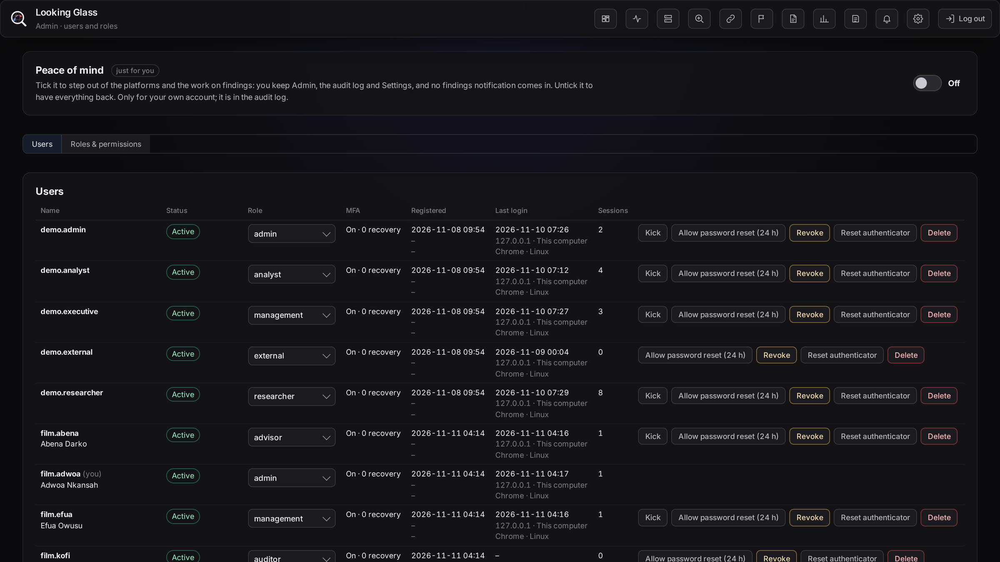

**Admin** in the top bar (administrators):
- **Users:** approve new accounts with a role (only accounts waiting for approval; an active account's role changes
  with Role, which never removes the last administrator), change roles, revoke or restore, reset an authenticator, allow a
  password reset, end someone's sessions, delete. Each account shows its profile and when it last signed in.
  You cannot remove the last administrator or your own account.
- **Roles & permissions:** the permissions of each role, and custom roles.
- **Peace of mind** (just for you): turn it on to step out of the day-to-day work. The two platforms, Findings,
  Definitions, Combinations and the Executive and Advisory portals close for you, and no findings notification comes
  in. You keep Admin, the Audit portal, Settings and the Overview (to keep an eye on the database). Turn it off to have
  everything back. It changes only your own account, and each switch is in the audit log.

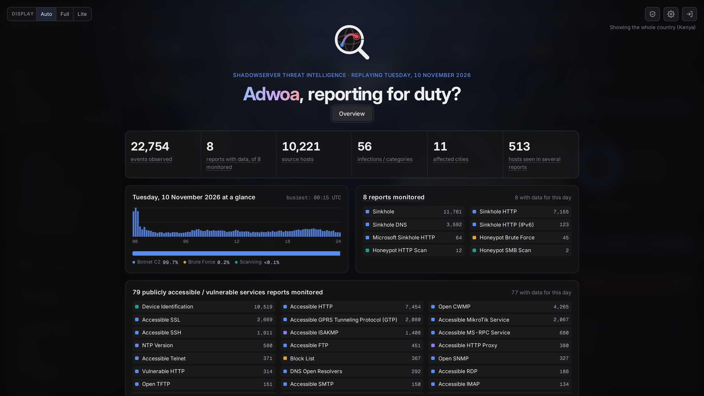

### The Audit portal (`/audit`)

For the **Auditor** role and administrators (permission *audit*). It is built for an IT audit (for example by a
CISA-certified auditor) and is **read only**: nothing on it changes anything. Choose the **period** at the top
(7 days, 30 days, 90 days, 12 months, or any two dates, in UTC); every tab follows it.

- **Overview:** the key figures (sign-ins, failed sign-ins and the failure rate, lockouts, privileged changes,
  exports, sign-ins outside working hours), sign-ins per day and by hour, events by kind, failed sign-ins by address,
  exports by person, the recent privileged changes, and the **control checks** LG-01 to LG-15. Each is an automated
  check of Looking Glass's own controls, **mapped to the NIST SP 800-53 Rev. 5 (Release 5.2.0) controls** it supports,
  cited by their official titles (for example LG-01 → IA-2(1), IA-2(2) multi-factor authentication; LG-06 → AC-7
  unsuccessful logon attempts; LG-10 → AU-9, AU-9(3) protection of audit information; LG-11 → AU-11 retention). The LG
  numbers are Looking Glass's own, not NIST control numbers. Each check gives its evidence and **no pass or fail**:
  whether a control is implemented and operating effectively is the auditor's conclusion. Click a check to open the
  records behind it. The evidence report states the scope and limits of the checks.
- **One tab per kind of event:** Authentication, Accounts and access, Sessions, Configuration changes, Data access
  and exports, Workflow, and System and self-test. Each has its count, a search, *Alerts only*, and **Export CSV**.
  The built-in security test's events are kept apart in System and self-test.
- **Access review:** every account with its role and what that role may do, its authenticator, last sign-in, who
  approved it and flags (no authenticator, dormant, pending too long, every permission), and the roles matrix.
- **Signed in now:** every session with its address, location, browser and expiry (read only).
- **Integrity and evidence:** **Verify the audit log** walks every entry. Each one carries the fingerprint (SHA-256)
  of the one before it, so a changed, inserted or removed entry breaks the chain and the check says where. It shows
  the **head** (hash@entry). Then download the **evidence report (PDF)** or **every event (CSV)** for the period. After
  each download the page shows the file's own SHA-256 to note with it. Every check and every export is itself in the
  audit log.
- **Proof to take away:** Verify is Looking Glass checking itself. The **proof package (ZIP)** lets the auditor check
  it without trusting Looking Glass: the log's files exactly as stored, `MANIFEST.json` with the SHA-256 of each, and
  `verify_audit_log.py`, a short verifier in plain Python (standard library only) that recomputes the whole chain on
  the auditor's own computer (`python verify_audit_log.py`). The auditor keeps the package's SHA-256 and its head. At
  the next audit, **Compare with an earlier audit** (or `python verify_audit_log.py --earlier HASH@ENTRY` on a new
  package): each entry's hash depends on every entry before it, so if the earlier head is still at its entry number,
  the log up to it is unchanged, even against someone able to rewrite the whole log on the server. The package's
  SHA-256 is written into the log too, so each package carries the receipt of the one before. How and why this works,
  step by step, and what it does not cover: [How the audit log proves itself](AUDIT_LOG_PROOF.md).

Entries are archived, not deleted, when the log grows (kept `AUDIT_RETENTION_DAYS`, default 400 days); the thresholds
of the checks are in `.env` ([CONFIGURATION.md](CONFIGURATION.md)).

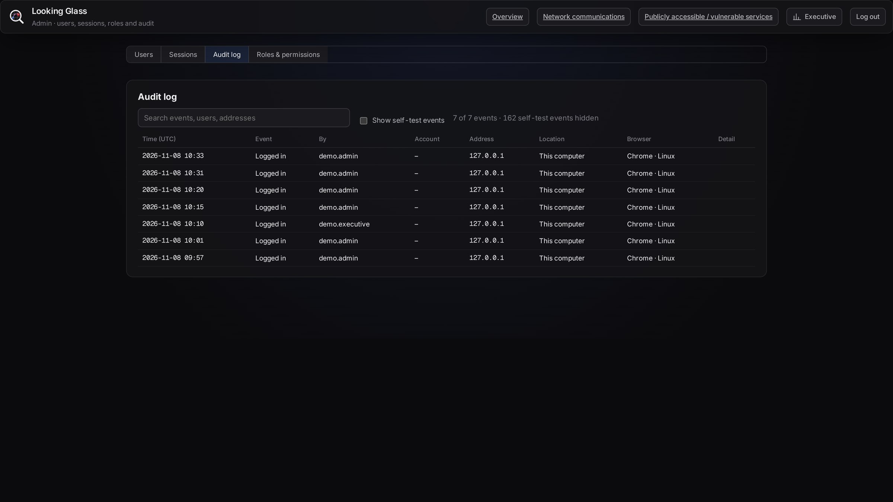

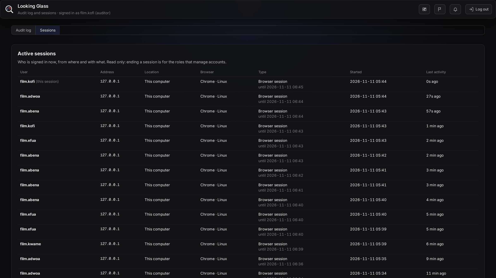

Changes need a recent sign-in: in a 5-day session older than 12 hours, Looking Glass asks you to sign in again
before changing anything.

## 9. Good practice

- Use an **external** account for anything shown to people outside the CSIRT.
- Treat CSV exports as confidential: they contain unmasked addresses.
- Send an advisory as two attachments (the PDF and the devices CSV), never the archive, and at the TLP it carries.
- Never share recovery codes or the authenticator key.
- Sign out (top bar) on shared computers.
