# Using Looking Glass

Looking Glass replays your country's Shadowserver reports from the previous day, at the same time of day, as two
live platforms:

- **Reported network communications** (the map): infected and attacking hosts in your country and what caught
  them: infected devices calling botnet sinkholes (sinkholed C2 domains), and attackers caught by honeypots, drawn as
  arcs on a 3D map.
- **Publicly accessible / vulnerable services**: hosts in your country with exposed or vulnerable services
  (open databases, remote desktop, old TLS, vulnerable devices, compromised or blocklisted hosts).

It is built for national and sector CSIRTs: analysts use it to find and follow up affected hosts, and managers and
partners see the country's situation at a glance on a wall screen.

> Every screenshot in this guide uses **dummy data** (documentation IP ranges, private AS numbers, fictional
> networks). New terms are explained in the [glossary](GLOSSARY.md).

## Contents

- [Common tasks, step by step](#common-tasks-step-by-step)
- [1. Signing in](#1-signing-in) · [With the keyboard only](#with-the-keyboard-only) · [Roles](#roles)
- [2. The intro page](#2-the-intro-page)
- [3. Reported network communications (the map)](#3-reported-network-communications-the-map)
- [4. Publicly accessible / vulnerable services](#4-publicly-accessible--vulnerable-services)
- [5. Analysis and follow-up](#5-analysis-and-follow-up) · [Findings and cases](#findings-cases-and-who-holds-them)
- [Abused or Compromised (analysts)](#abused-or-compromised-analysts)
- [Management portal (Executive)](#management-portal-executive)
- [Advisories (the advisor)](#advisories-the-advisor) · [TLP](#tlp-how-far-an-advisory-may-travel)
- [Notifications (the bell)](#notifications-the-bell)
- [6. Demo mode and public screens](#6-demo-mode-and-public-screens)
- [7. Settings (administrators)](#7-settings-administrators)
- [8. Administration](#8-administration)
- [9. Good practice](#9-good-practice)

## Common tasks, step by step

**See what happened in the country yesterday**
1. Sign in; the intro page opens with yesterday at a glance.
2. Read the totals and the activity over the day; the **Glossary** tab explains any term.
3. Choose **Explore the platform** on *Reported network communications* or *Publicly accessible / vulnerable services*.

**Find the hosts to follow up first**
1. On either platform, click a figure in the top bar (for example **Critical** or **Hosts with issues**).
2. The analysis opens with key findings and **the hosts to follow up first**, ranked by their reasons.
3. Open **Details ›** on a tile for the full list; **Download CSV** or **Download report (PDF + CSV)**.

**Look into one host**
1. Click its row in the stream (bottom), or its address in any list.
2. Read every report, service and issue for it; use **Explain the names** or **Explain issues**.

**Show the platforms on a wall screen or to partners**
1. Sign in with an **external** account (always masked) and tick **Stay signed in**.
2. Open the platform full screen; it adapts to TVs by itself (Display: Auto / Full / Lite).

**Give management a report**
1. A **management** account opens straight into **Executive**; choose the day and any filter.
2. **Executive report** downloads a PDF in the dashboard's design plus CSV files.

**Send a finding on several networks to management (analyst)**
1. On **Combinations**, search the code; tick the across-report patterns to send.
2. Pick the networks it concerns and **Send to management**: one network opens a finding for that organisation,
   several open a **case** with one sub-finding each.

**Decide a finding (management)**
1. The bell shows it; open the review from **Findings**.
2. **Approve** and name the advisor (it goes straight to them), or **Reject** with the reason (it closes). On a review
   where the analyst drilled down, choose the researcher's view or the analyst's view: either way the report covers
   exactly the devices the analyst drilled down to.

**Follow what is abused or compromised (analyst)**
1. Open **Abused or Compromised** from the header or the Overview card.
2. Compare today with the usual on the group tiles, then **Open the records** of a report; filter on its own fields,
   click an address for what else that host carries, **Export CSV**, or make an analyst code from the view.

**Send an advisory to an organisation (advisor)**
1. Open the finding from the **Advisory portal**; its organisation and that organisation's devices are already there.
2. Write the heading, **Description** and **Recommended Actions**, choose the **TLP**, then **Generate the report**.
3. **Mark as drafted**. Download the report, extract it, and mail the PDF and the devices CSV to the organisation
   (two attachments, never the archive).
4. On **Findings**, **Mark as sent**: the sub-finding closes, then its case once every sub-finding is closed.

**Add a colleague**
- They sign up themselves: **Create an account** on the sign-in page, with an authenticator app. Every administrator is
  told in the bell (*"… asks for an account"*); one approves them in **Admin → Users** with a role, or refuses.
- Or an administrator invites them: **Admin → Users → Add a person** makes a one-time sign-up link (their role, 72
  hours) to send them. They set their own password and authenticator, and the account works at once with that role.
  This also works when sign-up on the sign-in page is closed.

---

## 1. Signing in

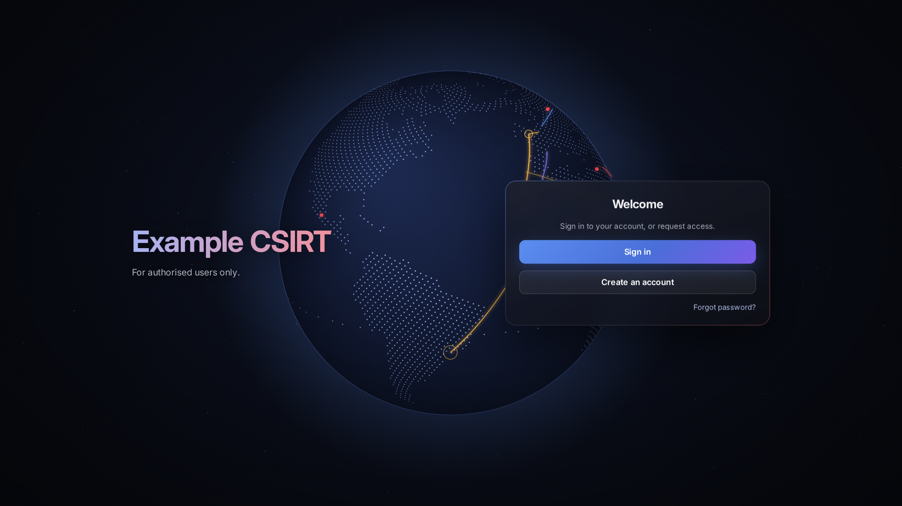

The card turns over between **Sign in** and **Create an account** (and **Back**), and each next step (the
authenticator, the recovery codes, the sign-in code, a new password) turns in. After you sign in, the button fades,
the view dives deep into the globe until the screen is black, the Looking Glass logo draws itself, and your Overview
opens (or the page your link asked for). If your computer is set to reduce motion, all of this is skipped.

The sign-in pages show your organisation's name only: no logo, picture or tab icon, so that internet scanners have
nothing to recognise. The Looking Glass logo appears only after a successful sign-in.

### First time on a new installation
The very first visit shows only **Let's get started**: it asks for the one-time setup code from the server
(`cat data/setup_code` in the platform folder; the installer shows the command), then creates the first
administrator (name, organisation, email, country, user name, password) and links an authenticator app with a QR code. Keep the recovery codes it
shows somewhere safe and offline. This works whether sign-up on the sign-in page is open or closed (`REGISTRATION`):
closing it only closes sign-up for everyone else.

### Getting an account
Choose **Create an account**, fill in your full name, organisation, email, country, a user name and a password,
and scan the QR code with an authenticator app (Google Authenticator, Microsoft Authenticator, Aegis, 2FAS...).
Your account then waits until an administrator approves it and gives it a role; the administrators are told in the
bell.

With a **sign-up link** from an administrator, open the link and do the same: the page says you were invited, and your
account works as soon as you finish, with the role the administrator chose. A link works once, for 72 hours; one that
was used, revoked or has expired says so: ask for a new one.

Passwords need at least 12 characters with upper and lower case letters, a digit and a symbol, and must not contain
your name or common words. The eye button shows what you typed; the bar shows its strength.

### On a phone, tablet or TV

The globe on the sign-in page turns with a finger (pinch to zoom, tap to launch an attack) or with a TV remote: the
first arrow press goes to **Sign in**, Up / Down move through the form, Up from the first item reaches the globe (arrows
turn it, OK launches an attack, Back returns to the form).

### With the keyboard only

Every page can be used without a mouse. **Tab** moves to the next control and **Shift+Tab** back; a blue ring shows
where you are. **Enter** (or **Space** on a button) acts on it, and **Escape** closes a dialog. On the map and the
services platform the chart legends (the attack types, the report families, the severity levels) are buttons too:
Tab to one and press Enter to analyse it, as a click does. On an hourly or 15-minute chart, Tab to the chart, choose
a time with the **Left** and **Right** arrows (**Home** and **End** for the first and last), and press **Enter** to
analyse it; the time and its count are written under the chart and read out by a screen reader. A section that is
folded shut (a finding's details, say) opens with Enter on its heading; what is inside is reached once it is open.

**Shortcuts**

| Where | Keys | What they do |
|---|---|---|
| Any page | **Tab** / **Shift+Tab** | Next or previous control |
| | **Enter**, **Space** | Act on the control |
| | **Escape** | Close a dialog, a menu or a drop-down |
| The map | **L** | Show or hide the event list (not while typing in a box) |
| | **Arrow keys**, **+** / **-** | Move and zoom the map |
| The event and record lists | **Up** / **Down** | Move between rows |
| | **Enter** or **Space** | Open the row's details |
| Drop-down lists | **Up** / **Down**, **Home** / **End** | Move through the choices |
| | Typing | Search a long list |
| | **Enter** / **Escape** | Choose, or close without changing |
| Intel gathered | **/** | Go to the search box |
| | **]** or **Right** / **Down**, **[** or **Left** / **Up** | Next or previous report |
| The guided tour | **Right** / **Left** | Next or previous step |
| The sign-in globe | **Arrow keys**, **+** / **-** | Turn and zoom the globe |

**Confirming it's you** opens a dialog with the focus already in the code box (or on **Use your passkey**): type the
code and press **Enter**. **Escape** or **Cancel** stops the action; until then the focus stays inside the dialog.

On **Unusual activity**, each card's actions (**Show the devices**, **Confirm**, **Dismiss**, **Stop watching**) are
ordinary buttons, and **Confirm** asks for the thread's name in the browser's own box. Each chart is described in words
for screen readers: its dates and its normal.

### Signing in
**Sign in** asks for your user name and password, then the 6-digit code from your authenticator app. On an
installation open to the internet, a **passkey** takes the place of the code once you have registered yours (see
[Your account and passkeys](#your-account-and-passkeys)). Tick **Stay signed in** on a computer or screen only you use (up to 5 days); otherwise the session ends when the browser
closes, after an hour without use, or after 12 hours. After 5 failed attempts the account waits 15 minutes; the page
says how many attempts are left.

**Looking Glass never sends you a link to sign in.** Open it only from your own bookmark or the address your
administrator gave you; any message with a sign-in link is phishing, so report it.

### Forgot password
**Forgot password?** (right of the Sign in button) offers two ways:
- **Reset it yourself:** with a code from your authenticator app plus one of your recovery codes.
- **Ask an administrator:** the administrators are notified; one of them allows a reset in **Admin → Users**, and
  you then set a new password with your authenticator code.

### Your account and passkeys
**Your account** (in the menu of every page) shows your passkeys. A passkey is kept by your device: Windows Hello,
Touch ID or Face ID, your phone, or a security key. Looking Glass keeps only its public half, and a look-alike site
cannot use it: your browser offers it to the real site only.

- **On an installation open to the internet**, everyone signs in with a passkey. The first time, after your password
  and authenticator code, Looking Glass opens only Your account until you have registered **two** passkeys (for
  example this computer and your phone, or a security key), so losing one device does not lock you out. You cannot
  remove a passkey if that would leave you with fewer than two.
- **On an internal installation** you sign in with your authenticator code as before, and may add a passkey to use
  instead of the code when Looking Glass asks you to confirm. Browsers allow passkeys only on a site with a host name
  and a trusted certificate; the page says when that is not the case.

Give each passkey a name you will recognise (**Rename**), and remove one you no longer have (**Remove**). Adding or
removing a passkey asks you to confirm it's you first. Your bell (in the next release, in testing now) tells you when a passkey is added to or removed from
your account (except the first two you register), so you would notice one you did not add. Lost all your devices? An administrator uses **Reset
passkeys** on your account (Admin → Users); at your next sign-in you register new ones.

### Confirming it's you
Before a high-value action, Looking Glass asks you to confirm it's you: with a passkey, or with a fresh code from
your authenticator app on an internal installation. This stops malware that has taken over your signed-in browser,
since it has neither your device nor your phone. One confirmation covers 10 minutes of these actions:

- downloading a complete or unmasked list;
- showing leaked accounts unmasked;
- tracing a leak;
- changing the constituency or the configuration;
- running the quarterly purge;
- generating or sending an advisory.

These ask **every time**, even within the 10 minutes: changing accounts, roles or sign-up links, turning on or
changing a connector, and adding or removing a passkey. Each confirmation, and each failed one, is in the audit log;
wrong codes count towards the sign-in lock.

### Roles
| Role | Sees | Can |
|---|---|---|
| **External** | three pages only: network communications, publicly accessible / vulnerable services and Abused or Compromised, always masked: IP addresses become an opaque label (`Host 3f9a2c41b07e`), network names become aliases ("Telco 1"), host names, organisations, accounts and e-mail addresses are hidden | View only: no Demo switch, downloads, look-ups or copying; every other page is refused |
| **Analyst** | everything, unmasked | analyse, export CSV, look up Malpedia, switch Demo on for presentations |
| **Management** (managers, executives or team leads) | only the **management portal** (Executive, `/management`): aggregated figures of both platforms, never individual addresses | filter, explain infections and vulnerabilities, download executive PDF reports. No other role can be given this portal (admins can preview it) |
| **Researcher** | only the **Definitions** page (no platforms or addresses) | the organisation's security researchers: define, with references, the malware names Malpedia does not know and the issues that are not CVEs; add notes to CVEs; correct network names and types |
| **Advisor** | the **Advisory portal** and the findings management sends them (with the organisation's devices) | write each organisation's advisory, generate its report, mark it drafted and sent; their dashboard shows what went out and to whom |
| **Auditor** | only the **Audit portal** (`/audit`): the audit log by tab, the dashboard and control checks, the access review, the log's integrity | read and export evidence for a period. Read only everywhere; never the platforms or any host data |
| **Admin** | everything | also Settings, definitions, accounts, roles, the Audit portal; **Peace of mind** steps out of the operations |

Every role has an **Overview**. Researchers, management, analysts, advisors and admins also have the **Findings** page
(only the findings they take part in); external accounts and the auditor do not.

**Permanent roles.** Admin, Management, Researcher, Advisor, Auditor and External are permanent: no one can remove them or change
their permissions (on the Roles page they have no Remove button and their boxes cannot be changed). Administrators
only give people these roles. Three permissions
belong to one role only and cannot be given to any other: *definitions* (Researcher), *advisory* (Advisor) and
*users* (Admin), as *management* belongs to Management.

Administrators can make custom roles from the other permissions (view, unmasked data, export, Malpedia, settings,
networks, audit).

### Everything is recorded under your name

Every page's header names you by the full name you registered with, and the Overview says it plainly: *Everything
you view, copy or export on Looking Glass is recorded under your name.*

- **Copying is only through the copy buttons** (Copy JSON, Copy the addresses, the copy icons of Intel gathered, Copy
  the code). Text on the pages cannot be selected, copied or dragged out, except in the fields you type in. Each copy
  button records the copy **before** it copies: who, what, how many lines and addresses, which page, when. If the copy
  cannot be recorded (the connection dropped, the disk is full), **nothing is copied** and the button says why.
- **Every copy and every downloaded file is sealed:** keyed fingerprints of the whole, of each line and of each
  address (a download also its SHA-256, and each file inside a ZIP), never the text itself. If a list turns up
  outside, an auditor can trace it back to the copy or the download it came from (*Trace a leak*, in the Audit
  portal).
- Your own recovery codes are shown once when you set up your authenticator; that page comes before you are signed
  in, so its copy button is not recorded.

Said plainly: blocking selection in a browser deters, it does not make copying impossible (the browser's developer
tools, a photo of the screen). What it guarantees is that every copy made the normal way is on record.

### The guided tour

Every page with a header has a **Tutorial** button (a question mark, before the bell and Log out). It shows a short
tour of that page: one part at a time is lit up, the rest dimmed, with what it shows; then the header's buttons, each
with what it does. **Next** and **Back** (or the **Right** and **Left** arrows) move through it; **Skip the tour** or
**Escape** ends it, and the focus goes back to the button. A part that is not on the page for you (another role's,
an empty list) is left out.

The first time you open a page, a small box offers the tour: **Take the tour**, **Skip**, or **Don't show again** (for
every page). Your answer is remembered for your account, in every browser, and the Tutorial button still shows the
tour any time.

---

## 2. The intro page

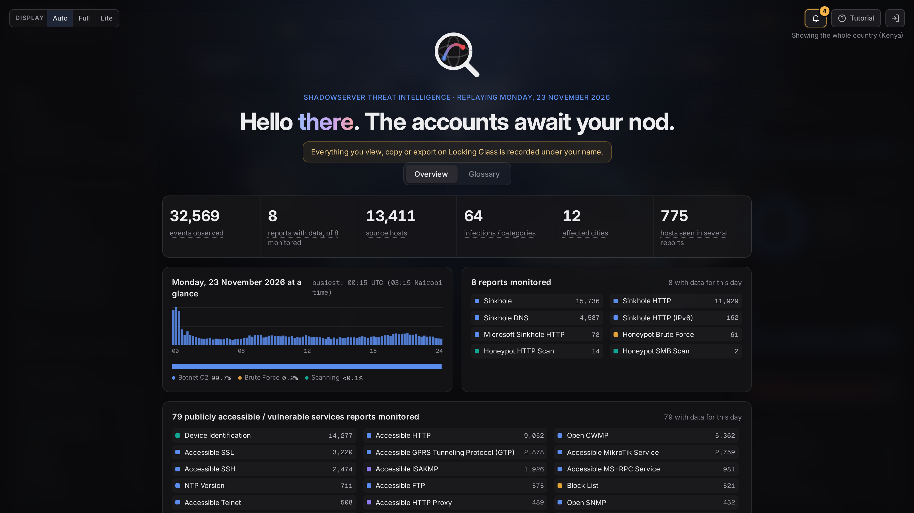

Point at any button in a page's header (or move to it with the keyboard) and its name shows under it at once, for
example *Findings* or *Settings*.

Every role starts on its own **Overview** after signing in (a link to a particular page still opens that page). The
first time you open it, it greets you by your first name: *Greetings, Kwame! Welcome to Looking Glass*. After that it
picks one of thirty greetings at random each time, each role its own thirty (some of them for fun). It uses the name the
administrator entered, never the user name.

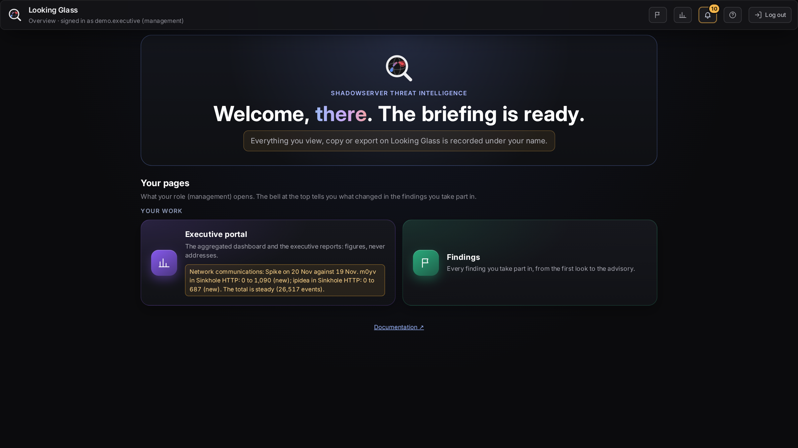

Below the day at a glance, **Your pages** lists exactly what your role opens, in titled groups: the platforms, your
work (Findings, Combinations, the Advisory portal, Executive, Definitions, as your role allows) and administration
(Admin, Audit, Settings). Each card says what the page is for.

**Spike notice.** When the latest report day moved sharply against the day before, the cards say so, with what is
behind it: analysts and admins on the two platform cards, management on the Executive portal's, researchers on
Definitions'. For example *Spike on 15 Nov: 2,400 events, +100% on 14 Nov (1,200). Mostly example.loader in
Sinkhole (+900).* (made-up figures). A spike (amber) is at least one and a half times the day
before and at least 500 more; a drop (blue) the other way round. When the platform's total is steady but one report
(services) or one infection (communications) jumped on its own, the notice names it and says the total is steady. On
an ordinary day there is no notice. It holds counts and names only, never an address.

At the top left: **Display** quality (Auto / Full / Lite, see section 6). At the top right: the **bell** (see
[Notifications](#notifications-the-bell)), **Tutorial** and **Log out**. Your pages are the cards further down. Under the
header buttons: whether both platforms show the whole country or your constituency.

The day at a glance: totals, the activity over the day, the mix of attack types and every monitored report (all of
them, in as many columns as fit, with each report's records that day).

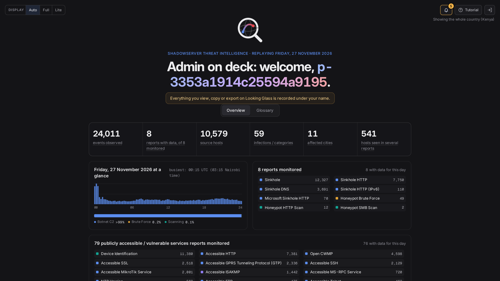

**Special reports.** Shadowserver sometimes shares a one-off **Special Report** (a campaign's victims, a historical
botnet, a newly found exposure). It is not a daily report: it is dated the day it was shared, often with the same
placeholder time (00:00) on every row, and its columns differ from one to the next. Looking Glass loads it, but keeps it
**out of the replay, the day's totals and the Executive 7-day comparison**, so it can never show as a false spike at
midnight. When one has arrived, a **Special reports** card on the intro page lists it: the day it was shared, its rows
and its distinct hosts (hover for whether its times are a placeholder).

The **Glossary** tab explains every term and every Shadowserver report in plain language, with links to Shadowserver's own
report pages.

Come back to it at any time with the **Overview** button, which is in every page's header.

## 3. Reported network communications (the map)

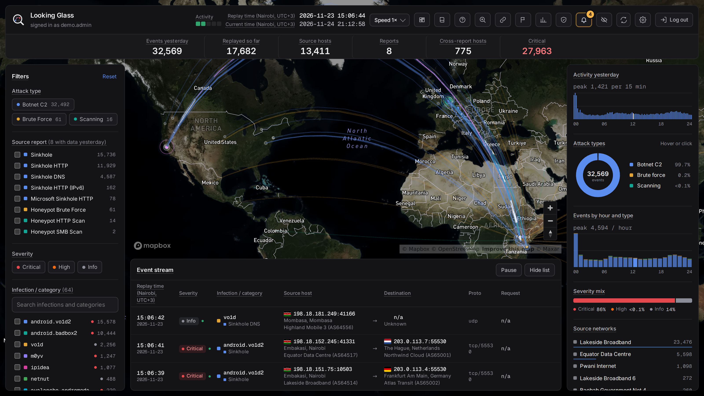

- **Top bar:** the day's figures (events yesterday, replayed so far, source hosts, reports, hosts in several
  reports, critical). Every figure opens an analysis. The clocks show the replay time and the current time (UTC).
- **Map:** every connection of the day with the active filters, plus the live replay on top: an arc for each event
  as it happens. Hover anything to see what it is; click to analyse it.
- **Filters** (left): attack type, report, severity, infection, affected city, target country, source network,
  destination network, tag, port and protocol. Networks are grouped by company (all AS numbers of one operator).
  Analysts and admins also get **Beacon**: the beacons Looking Glass decoded that day, each as its kind and the system
  it reports (for example *CLogin check-in, Windows*), with how many records carry it. Picking one shows only those
  records on the map, the stream, Intel and the figures. A known family that is not decoded says what its value is,
  for example *ttyunos API request (encrypted)*, *adoverocean OTA task request (one-way hash, not encoded)* or *CLogin
  check-in (did not decode)*. Right after a day is loaded its beacons are decoded in the background;
  the filter appears by itself once that is done, usually within a minute or two.
- **The counts in the filters follow your other filters.** Choose a city and the reports, infections, ports and
  networks show how many of that city's records each holds; the city list itself still shows every city, so you can
  switch. A value you chose that the other filters leave nothing of stays in its list with 0, so you can take it off.
- **Ticking an infection shows what else its devices carry.** The infection list then counts **devices**: each
  other infection shows how many of the ticked infection's devices also carry it, and one none of them carries is
  greyed with 0, at the bottom, still there to tick. Tick **two or more** and only the devices carrying **every one
  of them** are shown, on the map, the stream, the figures, Intel and in an analysis; the list then counts those
  devices. An analyst code or finding made before this keeps the devices it was made with.
- **Filtering moves smoothly:** the counts roll to their new figures, the list rows slide to their new places, and
  arcs the new filters leave out fade away (off when your computer is set to reduce motion).
- **Intel** (right): attack types, events by hour, severity mix, networks, infections, cities, C2 domains...
  Every line is clickable.
- **Stream** (bottom): every event as it replays. Click a row for the full details (the raw request, the infected
  host, the destination, the report file it came from). Pin rows with 📌. Drag the top edge to resize; **L** hides it.
  The stream only shows what has been replayed so far, while the figures, Intel and map cover the whole day. When a
  filter's events all come later in the day, the stream says so and when: "None of the 6 matching events of 2026-01-15
  has been replayed yet: the first is at 09:30:00 UTC and the replay is at 07:30:00 UTC, so it appears in about 2 hours.
  Their 5 IP addresses are already in the charts and statistics: click them to analyse them, or find them on the map."
  If the day's reports hold nothing for your constituency, the event list says "No records for your constituency on
  &lt;day&gt;." Without a constituency it says "No records reported on &lt;day&gt;." While the day's reports have not
  arrived yet, it says it is waiting. The services page's stream does the same.
- **Decoded beacon** (in the details, under *HTTP request (as seen by the sinkhole)*; analysts and admins). Some bots
  pack what they know about the machine into one encoded query value of their check-in. When the request carries one
  in a format Looking Glass knows, it is decoded on the server and shown here: the format, operator, version and
  operating system, the **XOR key** recovered from the beacon itself (a new one for every check-in), **notes** (the CPU
  id written out as text, what the MAC address prefix means, for example *00:FF: a TAP-Windows virtual adapter*, and
  when the beacon names a different operating system than the infection name it is filed under) and the **whole
  decoded JSON**. When the beacon names a different operating system than the infection it is filed under (for example
  *Windows 7 Ultimate* under *android.badbox2*), a note says so, as a lead worth checking. The block says what the
  beacon holds, never what to do about it: the event's *Recommended action* stays the name's definition, and what
  fits the record is the analyst's call. The known format is the **CLogin check-in** (`GET /CLogin?key=…`, filed under *android.badbox2*),
  used by several operators (zckypc, WT, PKS and HTM so far). A decode is shown only after a recheck: every field name
  must be the format's and the CPU hash, MAC address and bandwidth must have their shape, so a key that is not quite
  right never shows garbled data. When a decoded value reads like instructions to a person or an AI tool, a note says
  it is data from the device, never an instruction: attackers write these values. Other request families are named but **not decoded**,
  with what they are: an encrypted request (its key stays in the app), a one-way hash, an opaque device ID or a
  campaign token. A value no known format fits goes through the **generic fallback**, which tries hex, Base64,
  zlib/gzip/deflate and a one-byte XOR, up to three layers deep. When the result reads as JSON, `key=value` pairs or
  words, it is shown as **Generic decode** with its layers (for example *Base64 → zlib*). Real encryption, whose key
  stays in the app, never comes out readable and is left alone. What still does not decode is shown as **Unknown
  encoding**, with what the value looks like, and listed on the Findings page (see *Requests Looking Glass could not
  decode*). **Hand over these beacons** sends every record of the same beacon under that name to an analyst or
  a manager as a finding (see *Findings*). In Demo mode, and for the external role, the request line shows
  `<clogin beacon>` (or `<ttyunos value>` and the like) in place of the encoded value, because it decodes to the
  device's MAC address, hardware UUID and CPU id.
  (The services record stream does the same, for records and hosts.)

  **Shadowserver's mapping for this event.** Some reports, mostly the honeypot scanner events, carry Shadowserver's
  own tags for each event: the MITRE ATT&CK techniques and tactics, the vulnerability (a CVE, with its CVSS score) and
  the device it targeted. The detail window shows them in their own section, linked to MITRE's and cve.org's pages.
  They are Shadowserver's statement about that one event; Looking Glass's suggestion for the whole report stays as it
  is. Most events carry none: Shadowserver fills these fields only sometimes.

  **Readable field names.** A report's own fields are shown by a short readable name, for example "Certificate
  expires" for `cert_expiration_date`, here, on the services page and in Abused or Compromised. Copy JSON keeps
  Shadowserver's own field names.

  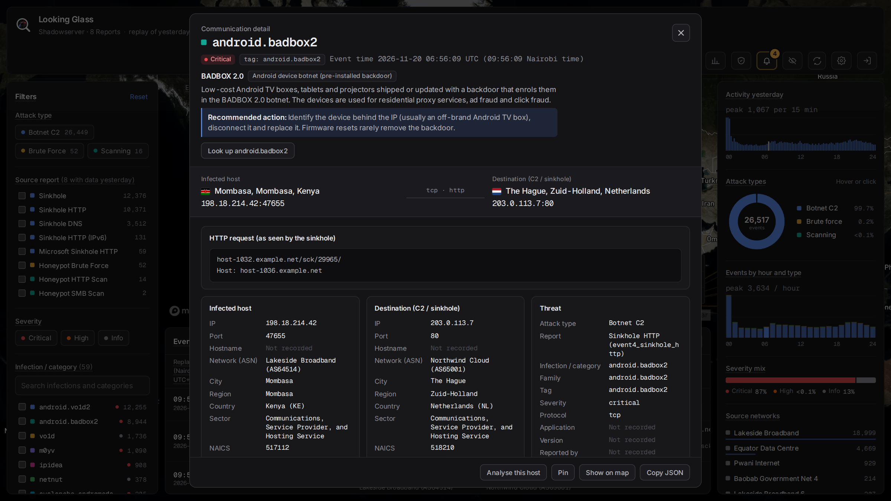

- **Playback:** pause, speed (1×, 5×, 15×, 60×) and **Catch up**. A hidden browser tab pauses itself and resumes
  where it stopped.

**Decoded beacons, in 3 minutes:** the Beacon filter, the Decoded beacon in an event, the Decoded beacons figure, a
finding with its LG-B code, and what happens to a request that cannot be decoded yet.

[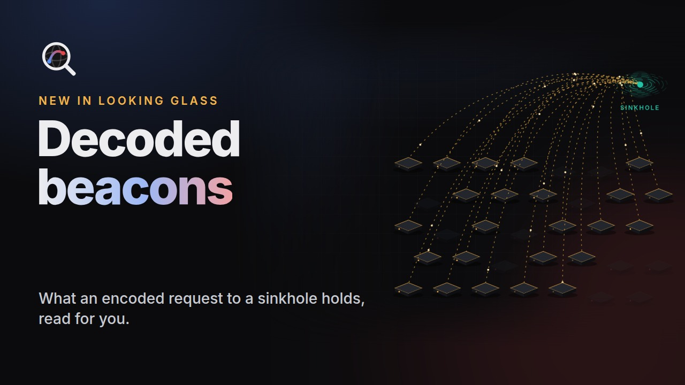](https://www.youtube.com/watch?v=d5JWSGn_gt8) <!-- film: decoded-beacons -->

## 4. Publicly accessible / vulnerable services

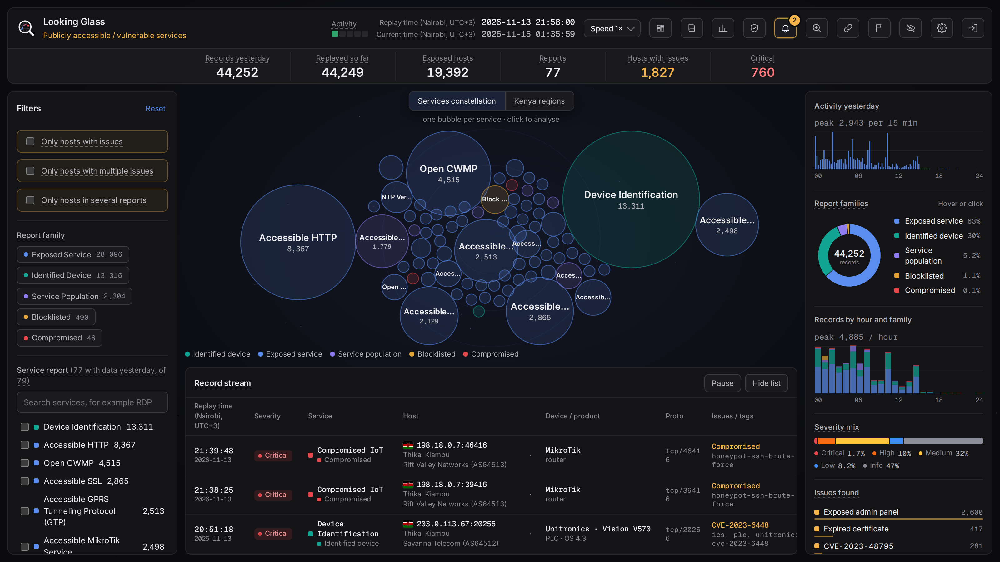

The same layout, without a map:
- **Services constellation:** one bubble per service, sized by its records; a dot flies in as each record replays.
  Click a bubble to analyse that service.
- **Regions map:** your country's regions coloured by records; hover for what makes up a region, click to analyse it.
  Scroll (or pinch) to zoom in where the pointer is, drag to move, or use the +, − and Fit buttons. When the records
  sit in a small part of the country (islands far apart, such as Seychelles or Kiribati), the map opens framed on
  them and says so; Fit shows the whole country. A region too small to see gets a dot you can hover and click. The
  Executive portal and its PDF use the same frame; on the portal, the link under the map switches to the whole country.
- **Filters:** only hosts with issues, report family (exposed, population, identified device, compromised,
  blocklisted), report, severity, issue (CVE, POODLE, expired certificate, exposed admin panel...), region, city,
  network, port, vendor, device type, **Hosts in several reports** and **Hosts with multiple issues**. Their counts
  follow the other filters, as on the map; with *Hosts in several reports* or *Hosts with multiple issues* on, they
  count those hosts' records.
- **Intel and stream** as on the map, with the report's definition in every record's details.
- **Certificate and TLS** (a record's details): when the scan carries them, the certificate's expiry (and whether it
  had expired when the host was scanned), whether it is self-signed, passed Shadowserver's validity check and is
  trusted by browsers (with the browser's reason), and whether SSLv3, an old and broken protocol, is still on and TLS
  1.3 is supported. The ones to act on are marked. Researchers see them without dates and without the browser's
  reason, which can name the host.

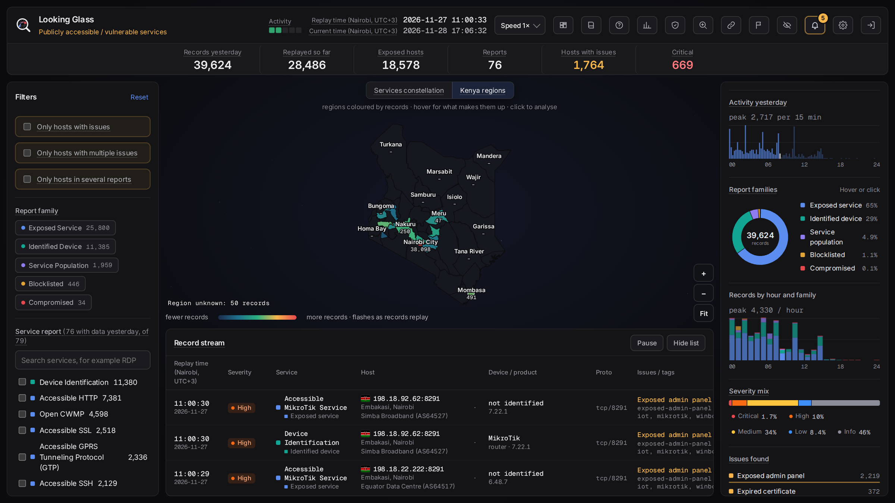

## 5. Analysis and follow-up

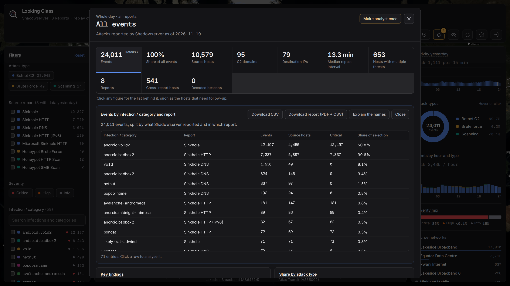

Clicking any figure, bubble, region, chart line or row opens the **analysis**: key findings, charts, breakdowns and
the hosts to follow up first, ranked by reasons such as "10 issues · critical · 5 reports". Each tile has
**Details ›** with the list behind it and **Download CSV** (all rows; analysts and admins). Clicking inside the
analysis narrows it (for example SSH · one region · CVE-2023-48795); **Filter the view** applies that selection to the
whole platform.

**Hosts in several reports** and **Hosts with multiple issues** compare each host across all its reports of the
day, so a blocklisted host that also runs an outdated web server shows up in both.

**Decoded beacons** (analysts and admins): how many records of the selection carry a beacon Looking Glass decoded.
Its **Details ›** lists each kind of beacon with the system it reports and its **Status**: *Decoded*; *Encoded,
cannot be decoded* (encrypted with a key the app keeps); *Encoded, not decoded yet*; or *Not encoded* (a one-way hash,
an ID or a campaign token). Then its operators and versions, records and devices, the names Shadowserver filed it
under, the C2 domains and the first and last time seen. Click a row to narrow the analysis to that beacon. The list
says what the beacons hold, never what to do about them. Researchers and Demo mode don't get it; researchers see
beacons in Intel gathered.

**Explaining names** (analysts and admins; permission *malpedia*): host lists with infections have **Explain the
names**. It looks up each infection / category of the list once (the researchers' definitions, Malpedia with a token,
MISP Galaxy, MITRE ATT&CK) and adds *What it is* and *Source* columns; the CSV gets *What it is*, *Description and
references*, *Source* (with the licence) and *Also described by*. Names no source knows are explained from the reports
(an activity such as scanning, a proxy network, a generic sinkhole label, or simply not catalogued). A host's own
analysis (click its IP) looks up all its infections at once; **Look up** in an event's details explains one name.

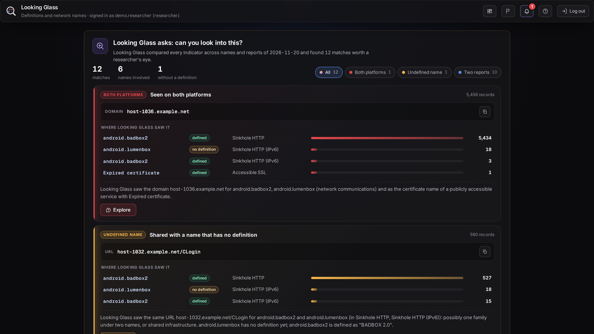

**Definitions for names no source knows** (researchers and admins): the **Definitions** page (`/definitions`); admins
open it with the **Definitions** button on the intro page, the map, the services platform and Settings. Names no
source (Malpedia, MISP Galaxy, MITRE ATT&CK) matches are under **No source knows**. Names new reports bring in appear
under **New, not checked yet** and are checked with Malpedia every 30 minutes (or at once with **Look up names**).
Activities such as scanning and brute force are not malware and are left out. The **Definition / sources** column
shows which sources know each name. **Define** opens an editor, with the other sources' text, names, links and licence
above the form (each folded; **Add as reference** copies a link into your references):

- **Name in Malpedia** (optional): if Malpedia lists the malware under another name, use **Find in Malpedia** and pick
  the family (for example `lumma-stealer-beacon` → `win.lumma`); future look-ups show that family. Leave it empty when
  Malpedia does not have it. Threat actors (such as `tick`) are found automatically and shown as a *Malpedia · threat
  actor* card; the search also lists actors (`actor:tick`).
- **Title, type and a plain description**, and **References (evidence)**: links to the supporting research (vendor
  blogs, CERT advisories). At least one is needed; only `http(s)` links are accepted.

From then on everyone sees the definition first (badge *Looking Glass definition*, with its references, author and
date) in the stream, host lists, host analysis, the CSV and the PDFs. A researcher's definition always comes first and
is never overwritten by a source. Every change is in the audit log. Site definitions are kept in
`data/definitions.json` (kept on upgrades, in backups); the shipped ones are in `data/infections.json` and
`data/issues.json`.

**One card per name, every source side by side.** Sources, in order: the researchers' definition, **Malpedia** (with a
token), **MISP Galaxy** (Malpedia, Botnet and Tool clusters) and **MITRE ATT&CK** (malware and tools); Looking Glass
keeps a copy of the last two, free public lists. The first that knows the name is the headline; **Also described by**
lists the others, each folded, with description, other names, references, credit and licence. When none knows it, the
card says **No source knows this name** and explains it from the reports. Licences: Malpedia (also the MISP Galaxy
Malpedia cluster) **CC BY-NC-SA 3.0**; MISP Botnet and Tool clusters CC0 1.0 / BSD 2-Clause; ATT&CK carries MITRE's
notice (© The MITRE Corporation, reproduced and distributed with its permission). Names match by name or alternative
name, ignoring case; only entries with a description count; activities (scanning, brute force), general labels and
old software are never matched. The same card is used by **Look up**, **Explain the names**, the analysis,
combination and Executive PDFs (description, *Source: …* with the licence, *Also described by*), the Executive
portal's **Explain** and the advisories' **Technical Details**.

**References in the PDFs.** In every PDF (analysis, combination, Executive, advisory) a name's links go to a
**References** section at the end: one heading per name with numbered links, then the **Shadowserver reports** the PDF
draws on, each with its page on shadowserver.org. All is ordered by criticality, flagged CRITICAL, HIGH, MEDIUM, LOW
or INFO (Shadowserver's lowest level), with NOT RATED last:

- a CVE: NVD's CVSS severity, with its score; one CISA lists as actively exploited is flagged **Actively exploited**
  and comes first within its level;
- an infection or an issue: the highest severity Shadowserver gave its records (in the report, else in the days in
  memory; a name whose days have left memory keeps its level, in `data/name_levels.json`, names and levels only, never
  shipped);
- a Shadowserver report: the severity Shadowserver gives that report type.

A name no record rates can be rated by a researcher on the severity map; the PDFs then flag it **Researcher's
rating**.

**The severity map** (Definitions page; researchers and administrators, permission *definitions*) lists every
infection and issue the reports carried, with its criticality and source: **Rated by Shadowserver** (learned as report
days load), **Not rated** or **Rated by researchers**; not-rated names first. A researcher rates one with the picker in
its row (Critical, High, Medium, Low or Info), or takes the rating back; each change is in the audit log
(`severity_rated`: who, which name, from what to what). Shadowserver's ratings are never changed: when Shadowserver
later rates a name, its level is used and the researcher's is shown as replaced. CVEs are rated by CVSS and are not on
the map. Names and kinds are in `data/name_kinds.json`, ratings in `data/name_ratings.json` (names only: no host,
address or count).

**The advisory's preview** carries "PREVIEW · NOT FOR DISTRIBUTION · name · date and time · reference" at the top and
foot of every page, and a faint watermark behind the text, so a screenshot shows who took it. The report generated for
the organisation carries none of it.

**Keeping the copies current.** The installer downloads the first copies (without internet it goes on and says so)
and schedules a weekly refresh (Mondays 04:17). A download that is invalid, too small or under 70% of the copy in use
is refused; the old copy stays and the reason is logged. The line above the Definitions table shows each copy's
entries, download date and ATT&CK version, and the last refresh; administrators (permission *settings*) have **Refresh
sources** (at most once an hour). Every refresh is in the audit log. Scheduling and files:
[OPERATIONS.md](OPERATIONS.md#reference-data). From the command line:

```
manage/fetch_offline_names.py            # download (skipped if the copy is less than 7 days old)
manage/fetch_offline_names.py --status   # what is installed, when it was downloaded, the versions
manage/fetch_offline_names.py --force    # download now
```

The copies are `data/names_misp_galaxy.json`, `data/names_attack.json` and `data/attack_kev.json` (a few MB; log
`data/names_refresh.log`). Look-ups only read these files: no name, host or report is sent anywhere; only the
downloads of the public files leave the server. Without them, look-ups work as before.

**MITRE ATT&CK techniques.** Cards, documents and the Definitions page show the ATT&CK techniques a name, a report or
a CVE stands for, with how sure that is and the constituent's part (in PDFs only **Observed** or **Possible**; the
part is in the cards and the advisory's "Why it is in this advisory"):

| Certainty | Example |
|---|---|
| **Observed** (the report saw it) | a device that contacted a sinkholed C2 server over HTTP: *T1071.001 Web Protocols, this device was used for it*; an address decoy amplifiers saw forged requests for: *T1498.002 Reflection Amplification, this address was the target of it* |
| **Known for this malware** | the techniques MITRE links to the matching ATT&CK Software entry, by tactic, with the groups MITRE says use it |
| **Possible** (an exposure an attacker could use) | an open DNS resolver: *T1498.002, attackers can use this exposure for it* (the host is the tool; the victim is someone else); an open RDP service: *T1133, T1021* |
| **CVEs** | the techniques MITRE's Center for Threat-Informed Defense (CTID) maps to CISA KEV vulnerabilities (Mappings Explorer, Apache 2.0): how it is exploited, its main and further impact |

**CVE and issue cards.** A CVE card on the Services page shows CTID's techniques as chips (ID, name, tactic), each
with its meaning (*how attackers exploit it*, *what attackers gain first*, *what attackers can do next*), CTID's
comment, and MITRE's definition and mitigations on hover or with **What it is and how to defend**. An issue card gets
the techniques of every CVE it names, marked with the CVE. The source line names the older ATT&CK version CTID used
(for example *CTID Mappings Explorer, KEV mappings (ATT&CK 16.1)*). A renamed technique shows the current and old
name; a revoked one MITRE's named replacement, with a note naming both; a deprecated one is noted. In advisories the
CVEs' techniques are *suggested* for the advisor to confirm or remove, unless an administrator chose to **trust CTID's
mappings** (Definitions page, below the toolbar; permission *settings*, off by default, CSRF token, fresh sign-in,
audited); trusted ones go out as reviewed and say so in their "why" line.

Every Shadowserver report has a **mapping**, *suggested* on arrival by a shipped rule table (`data/attack_rules.json`)
from the report's name, type and group until a researcher reviews it. **Looking Glass asks: which MITRE ATT&CK
techniques fit these reports?** (Definitions page) lists reports to look at (*please check*, *suggested*, *not mapped
yet*). **Confirm** accepts the suggestion; **Change** offers 5 to 10 techniques that fit that kind of report, then a
search of all of ATT&CK by ID, word or tactic (local copy; retired techniques hidden). Choose several, or **No ATT&CK
technique fits**, with an optional note; each change is audited. A reviewed mapping is never replaced by a
suggestion; it goes back to *please check* (old mapping shown) only when Shadowserver changes the report's type or
description, or MITRE retires one of its techniques. **Shadowserver tagged N events of this report with** shows the
techniques Shadowserver gave the report's events in the days the map holds, with how often: a check, never a change.

**New ATT&CK versions** (about twice a year) are noticed by the weekly refresh: a revoked technique's named
replacement becomes the suggestion, shown as *retired in vN* until confirmed; a deprecated one without replacement goes
to *please check*; a split one offers its sub-techniques; a renamed one shows its new name; malware families' links
and the picker update themselves. One notice per update (for example *ATT&CK v18 → v19: 2 mappings to check, 14 new
techniques, 3 malware families updated*) has a button to show those mappings; the audit log gets one entry (old and
new version, counts).

**What each technique means, and how to defend.** Every technique carries MITRE's short definition and up to three
MITRE mitigations, those that suit the report first (an exposed service: *M1035 Limit Access to Resource Over
Network*; an infection or C2 traffic: network intrusion prevention and traffic filtering), shown on cards, the
Definitions page and the Executive portal on hover or with **What it is and how to defend**.

**ATT&CK in advisories.** The advisory's **MITRE ATT&CK techniques** section (PDF, preview and advisory page) gives
each technique's ID, name, tactic and certainty; **What it is (MITRE)**; **Why it is in this advisory (Looking
Glass)**, from the mapping and the advisory's figures (hosts, products seen most); **How to defend (MITRE
mitigations)**; the link to attack.mitre.org; and on the page **MITRE's full description**. **Only reviewed mappings
go to recipients**: the advisor confirms or removes each *suggested* one for this advisory. Until all are decided the
report cannot be generated (the server refuses), and a report carrying an unreviewed mapping cannot be marked as sent.
Each decision is in the advisory's history and the audit log; changing one after generating makes the report out of
date.

**Documents keep the version they were made with.** PDFs and CSVs name their ATT&CK version (*MITRE ATT&CK v18*) and
are never rewritten. Each generated advisory report keeps its techniques, definitions, mitigations, "why" lines and
version, so a sent advisory shows exactly what the recipient got.

**Who wrote it.** Definitions, notes and network corrections name their author by the **full name** given at
registration, not the username. The shipped definitions are signed **Looking Glass**.

**Seen in.** The *Seen in* column shows each report a name was seen in as a small card: **intel · N kinds** when the
report carries indicators for it (domains, URLs, user agents…), **name only** when it carries just the name. Click a
card for *Intel gathered* on that report. A name not in today's reports shows **Last seen in *report* on *date*** (30
days are remembered), or *Not seen in the last N days*.

**Intel gathered** (button on every infection and issue): what the reports carry for that name, as **name › report ›
what comes with it there**:

- infections and categories: the C2 domains contacted, DNS lookups, TLS server names, URLs, user agents, request
  patterns and the usernames tried by brute-force bots;
- issues: the other CVEs on the same hosts, the associated tags, products, certificate names and fingerprints;
- **Combinations**: the exact sets that occur together on one record (for example *iot + router-os + winbox*), with
  records, share of the report, devices and how many devices **repeat** it (↻: more than one record each). A
  combination many devices keep repeating is a pattern, not a one-off;
- every value shows records, share and devices, and can be copied: one value, one set, or a whole card as lines or
  one line.

Indicators only: researchers never see the hosts, and addresses inside URLs and banners are masked.

**Decoded beacons.** When records of a name carry a check-in Looking Glass can decode (see *Decoded beacon* on the
map), Intel gathered lists **Beacon format** (its records are the decoded check-ins), **Beacon operator**, **Beacon
version** and **Beacon OS** (family only), each with records and devices. A family that cannot be decoded shows in
*Beacon format* with what its value is (*ttyunos API request (encrypted)*, *pixellog device registration (device ID,
not encoded)*). The XOR key is new in every check-in, so it is no indicator. A researcher sees a value only when 5 or
more devices carry it; below that it is counted as held back. The rest of the beacon (MAC address, hardware UUID, CPU
id, CPU hash, memory) identifies one device and is never shown to researchers. The *URL* card reads `<clogin beacon>`.

**Moving decoded beacons to notes.** Under a report's cards, *Decoded beacons here need a serious look* lists each
operator 5 or more devices carry, and a *Beacon vs name* match has its own line, each with a **beacon code**
(`LG-B-…`) and **Move to notes** (a new note with the code attached). Tracked as a finding, it carries exactly that
drill-down (the name and the beacon's parts), a readable title unless you give one (*BADBOX 2.0 beacons from Windows
machines (android.badbox2)*), and an analyst code (`LG-A-…`) of exactly its records, so **Show in Executive** shows
those devices' networks, regions, days and devices, counts only. Analysts open its devices in *Findings*.

**Looking Glass asks: can you look into this?** The card at the top of the Definitions page lists matches found in the
reports:
- the same indicator under two names (one family under two names, or shared infrastructure; it says so when one has
  no definition yet);
- the same indicator in two reports for one name (a probable indicator, worth a note);
- an infection's C2 domain that is also the certificate name of a service in the constituency;
- **Beacon vs name**: decoded beacons whose operating system contradicts their name (for example *Windows* under
  *android.badbox2*: the wrong name, or a family on more than one system); for researchers once 5 or more devices
  carry it, for analysts and admins at once;
- **Unusual activity**: a network and report, or two reports together, well above its own normal on the latest report
  day; **Explore** opens its chart and numbers, and an analyst checks the devices behind it.

Each match shows its kind, the indicator (with copy), **where Looking Glass saw it** (every name and report with its
records, and whether the name is defined; click a name for its intel there) and what it saw, in words; the conclusions
are the researcher's. The card counts matches, names involved and names without a definition, with chips per kind.
Values common to everything (stock browser user agents, "/", usernames such as *root*) are never raised.

**Explore** on a match works out every name and report of the match over **only the records that carry the
indicator** (for example a domain shared by *avalanche-generic* in Sinkhole HTTP and *qsnatch* in Sinkhole DNS). **Side
by side** gives each place a column: its tags (a tag in every place is marked), the sets that come with the indicator
on the same record, and its other indicators (user agent, URL, DNS lookup), the indicator highlighted. Open one place
for its full cards and combinations, or **All of** *name* for the whole name. Explore works only for matches on this
card. Devices are counted, never listed.

**Across reports** (first in the report rail when a name is in two or more reports): **combinations across reports**
(exactly what each device seen in more than one report carried in each, for example *iot + router-os* in one **and**
the same set in another, with the number of devices), the **reports seeing the same devices** (the exact sets of
reports per device) and the **indicators in more than one report** (for example a domain looked up in Sinkhole DNS and
contacted in Sinkhole HTTP), with records per report. Each combination also says **what its devices carry**: CVEs,
issues and infections, with how many devices; click a name for its Intel gathered. Names and counts only.

**In every other category** (also under Across reports) shows the same devices in the services reports, with their
CVEs, issues and infections. Each has **one code** (its devices, in the reports listed under it) and **Move to
notes**. A group of fewer than 5 devices has no lasting code; an analyst can still drill into it.

The Intel window shows combinations as a **List** (values joined with +) or a **Matrix** (values as columns, sets as
rows). *Devices* counts the distinct devices that carry a value, never shown. Values are listed most records first.
**Focus** (click a value) dims everything that does not carry it; **search** (`/`) works across all cards; `[` and `]`
switch report; Esc clears the search, then the focus, then closes.

**Notes.** Every row of both tables has a **Notes** button beside Define ("the C2 moved to …"). A note is saved at
once, dated and signed, and shown on every card of that name (map, services, Executive) and in the PDFs as **Notes
shared by Researcher: *full name* (*date*)**. Notes are kept apart (`data/notes.json`), never replaced by an update,
and removed by the author or an administrator; adding and removing are audited. For a CVE the define button reads
*Add context*: your organisation's remarks beside NVD's description, shown first. A CVE's title comes from its public
record once looked up: CISA's name, else its issuer's title, else its description's first sentence.

### Combination codes, the combination search and findings

The researcher names exactly what was found, management decides it matters, the analyst pulls exactly those devices,
and the advisor writes the advisory management approved. Who does what, and the life of a finding, are drawn from the
code in [Use case scenarios: Who does what](USE_CASES.md#3-who-does-what); two complete walk-throughs with
the demonstration data are in [Use case scenarios: a needle through the haystack](USE_CASES.md). This
section keeps what the diagrams do not show.

**Combination codes.** Every combination in Intel gathered carries a code: **`LG-C-…`** for one exact combination in
one report, **`LG-X-…`** for a cross-report pattern (what a device carried in each of several reports), and
**`LG-B-…`** for decoded beacons under a name (every record whose beacon says, for example, *Windows*). A code
carries no address. Click a code to copy it. A beacon code is worked on in *Findings*, not on the Combinations page.

**Ticking a CVE.** On an analyst code's page, a CVE or issue under *CVEs and issues* can be ticked like a combination:
it becomes a code of exactly this selection's devices that carry it, sent with the reply.

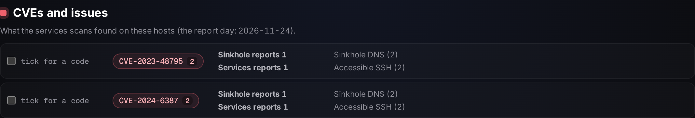

**Attaching codes to a note.** The Notes window's **Combinations for this note** has three ways in:
- **Seen in the reports:** every combination of the name, grouped by report, with records, devices and repeating
  devices, and a filter. One click attaches it.
- **Build one:** pick a report and tick the indicators that must come together (the name's real values only). Looking
  Glass makes the code and says how many records and devices carry exactly that now.
- **Paste a code:** from another note or colleague; it is checked before it is attached.

The note's codes are printed with it on every card and in the PDFs (Executive reports included).

**The buttons, per role.** Every finding is on the **Findings** page (`/findings`) with a number (#1, #2…) and a
status, and goes to the person named (see [Findings, cases and who holds them](#findings-cases-and-who-holds-them)).
No address is ever shown there. Any finding takes replies (text and codes) from everyone who works on it.

| Researcher | What happens |
|---|---|
| **Track as a finding** (Notes window, with a short title) | the note becomes a finding, sent to the manager you name |
| **Open as researcher** (or `/intel/LG-A-…`) | an analyst code's selection in words (a host is "1 host", never its address), the analyst's note, and each name's definition, combinations and cross-report patterns with their codes |
| **Send the reply** | the codes you ticked go into the finding's history |

| Analyst | What happens |
|---|---|
| **Make analyst code** (any analysis window, map or services) | the current selection (for example *Source network: Example Telecom · Host: …*) becomes an **`LG-A-…`** code of exactly its records that day, and a finding with your title and note |
| **Search** | the combination search below, with the code |
| **Search within the selection** (a researcher's reply to your analyst code) | the researcher's code limited to your analyst code's devices, on its own days; the review, report and advisory carry only those devices |
| **Report (PDF + CSV)** | the code's PDF + CSV for the advisory, as in the searchable **Analysts' codes** list at the top of the Combinations page |

| Management | What happens |
|---|---|
| **Show in Executive** | the Executive portal filtered to exactly that code (a *Combination code* chip; counts only; no 7-day comparison for a code); for an analyst code, on the code's day |

**Sorting and the Across reports flag.** Both tables on the Definitions page sort by a click on a column heading (↕,
then ▲ / ▼). The **Across reports** column flags every name whose devices (or hosts) were seen in more than one of its
reports, with how many; click the flag for that name's cross-report view.

**The combination search (analysts).** The **Combinations** page (`/combinations`, from the map, the services platform
or the Findings page) is for roles that see addresses and may export:
1. Paste the code and **Look up**: what it stands for, the name, the report(s), and the researchers' notes (those on
   this code are marked).
2. Choose where to look: **the report day** (the default: exactly the devices the researcher counted and the Executive
   portal shows), **the days in memory**, or **a date range of the stored history** (up to 31 days, read one day at a
   time, with progress per day). Each day is matched on its own: a device counts on a day when it carried the whole
   combination that day.
3. The result: key figures (devices, records, repeating, on several days, in other reports, networks, regions and
   cities, peak hour); a **map** of the regions coloured by devices (hover a region for its devices, records, cities,
   networks and IP addresses) with its cities beside it; networks, cities, activity by hour, device types and ports;
   **the busiest devices** (address, network, region, city, records, last seen, that day's **infections**, **issues**
   and **CVEs**, other reports and, on the report day, **Other days**: the same combination on the other days in
   memory, or *changed* and what it carried instead); and **across reports**: what these devices carried in the
   name's other reports, each pattern with its own `LG-X` code to search next.
4. **Download PDF + CSV (ZIP)**. The PDF (Executive report design): overview, key findings and activity, the region
   map with cities, networks, the devices with their addresses, across reports, the explanations of the name (each
   name, for an analyst code) and of every CVE in the combination with references and sources, the researchers' notes
   (or a line saying there are none yet), and an **Impact** section as in an advisory (what the reports can lead to,
   most severe first, with the reports behind each). Empty charts are left out. Two CSVs with fixed column names: one row per record, one per device
   (other reports, infections, issues, CVEs, other days, cross-report code; `ports` holds the selection's own ports,
   `all_ports_and_services` every port open that day with its service, for example `22/tcp Accessible SSH; 443/tcp
   Accessible SSL`). The devices CSV, the file an advisory sends, also has a column per value the pattern analysis
   groups by (certificate SHA-256, subject and issuer, JARM, HASSH, SSH and server software, page hash, usernames and
   passwords tried, SSH client, request pattern), with Shadowserver's own ATT&CK and CVE or the certificate facts, so
   a provider can find the same devices in their own network. An expired search (after an hour) is run again, then
   downloaded.
5. **A report for one network provider**: choose it in **Report for** next to the download button, or click the
   network in the *Networks* card. The PDF and both CSVs then cover only that provider's devices and records, named
   in the title and file names.
6. **Send to management** (when the devices turn up in other reports, the download waits for this): tick the
   across-report patterns, write a title and a comment, name the manager, and **pick the networks**. No network: an
   overview, and the advisor picks the organisations later. One network: a finding for that organisation. Several: a
   **case** with one sub-finding per organisation, each decided on its own. Under **every category for these devices**
   you can also tick **infections** and **CVEs and issues**: each is checked against this search's devices,
   management sees names and counts (never an address), and the report and advisory carry them on each
   organisation's own devices.
7. **Management decides** on the review page. What you ticked is the drill-down: the report and advisory cover
   exactly those devices (for example the few with a critical CVE), whichever view is approved:
   - **Use the researcher's view:** those devices, with the combination's own analysis and nothing added;
   - **Use the analyst's view:** those devices, with your ticked patterns, infections and CVEs/issues added;
   - **Reject and close**, with the reason.

   With nothing ticked, management approves the whole combination or rejects it.

"Exactly" means the record carries these indicators and no other indicator of the kinds compared (C2 domain, DNS
lookup, TLS name, user agent and tags; for services, the associated tags and CVEs). The search is off in Demo mode, a
search can be downloaded for an hour by the analyst who ran it, and every search is in the audit log.

**Without a Malpedia token** **Explain the names** and **Look up** still work: they show the researchers' definitions and the built-in
knowledge base, then MISP Galaxy and MITRE ATT&CK when their copies are installed (`manage/fetch_offline_names.py`),
and "No definition yet" for anything not defined.

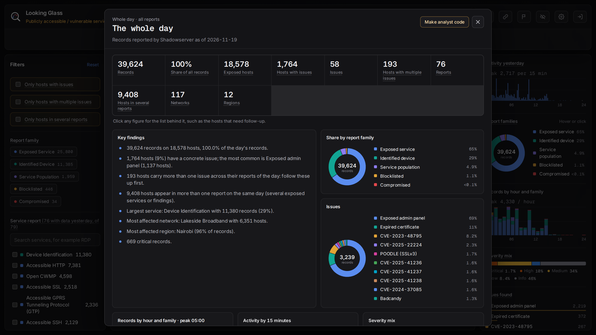

**Issues explained** (publicly accessible / vulnerable services; permission *malpedia*). Lists with issues have
**Explain issues**. CVEs are looked up in the NIST National Vulnerability Database (description, CVSS score,
weakness, references), CISA's Known Exploited Vulnerabilities catalog (**actively exploited**, with the date CISA
added it, ransomware use and CISA's required action) and FIRST EPSS (probability of exploitation in the next 30
days). Issues that are not CVEs (Exposed admin panel, Expired certificate, POODLE, BADCANDY…) are never looked up:
their definition and references are used. A progress window shows each step and issue (a few seconds; the look-up
continues if you close it). CVEs are looked up in batches: the official CVE.org records at once, NVD's own analysis in
the background within minutes. **Explain the names** uses the same progress window.

**Network names and types** (Definitions page, researchers and admins; permission *networks*; Settings shows them
read-only). Correct a network's company name, type (sector) and note; the change is marked reviewed and never
overwritten by the automatic look-ups. Types come from PeeringDB's categories and the company name (bank, university,
hospital, power company…); if a sector is missing, **Add a type** (with its word in Demo mode, for example
Institution). Added types are kept in `data/network_types.json` and offered everywhere, also in the Settings
constituency filter. The Records column counts each network's records on the day the map shows (both platforms,
before the constituency), named in the header; "not loaded" while that day's reports are not loaded yet.

**Reports (PDF + CSV).** Every list behind an analysis figure, on both platforms, has **Download report (PDF + CSV)**
next to **Download CSV** (permission *export*): a ZIP with the PDF and the complete list as CSV (the platform's
columns, plus what each infection / issue is), which the PDF refers to instead of repeating every address. The PDF
has a cover block (report day, selection, figure, constituency, who generated it and when); an **executive summary**,
key figures and activity by hour; **priorities** (the hosts with the strongest signs); **breakdowns** with charts
(reports, attack types, networks, cities, countries, services, issues, ports…); the Shadowserver definitions of the
reports and the sources; and, explained, the **infections and categories** (Malpedia family or threat actor with
description, aliases, attribution and references, or the Looking Glass definition with its evidence, or why it is not
malware; with or without a Malpedia token) or the **issues** (actively exploited CVEs first, each with CVSS, EPSS,
CISA KEV status and required action, NVD description and references; other issues from their definitions).

In Demo mode the PDF is masked like the page. Each download is in the audit log (`report_pdf`). CSV files are safe in
a spreadsheet: a cell that would start a formula (`=`, `+`, `-`, `@`) gets a leading apostrophe, so text from scanned
devices (a vendor or product banner) can never run as a formula.

### Findings, cases and who holds them

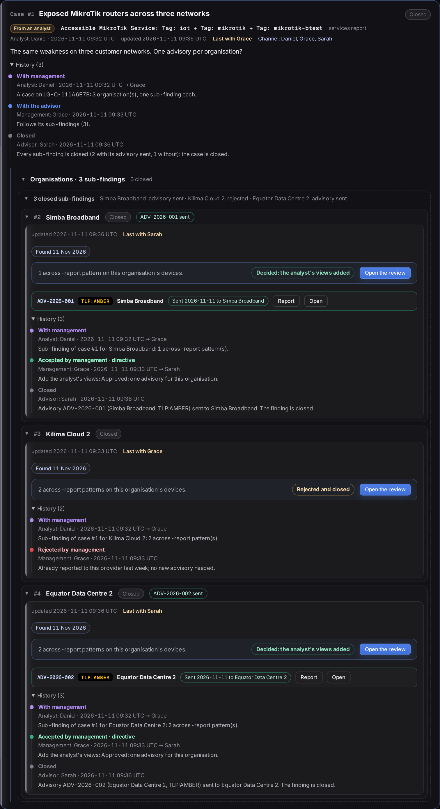

**Every hand-over names a person**, and **findings are channels**: only the people a finding has passed through (and
administrators) see it; others never learn it exists. A researcher who answers an analyst's request with a code
follows it on: when the analyst sends that code to management, the researcher is in the review's channel (seeing it,
not acting on it) and finds it inside the request on the Findings page, through management's decision and the
advisory. The statuses and every hand-over are drawn in [Use case scenarios: Who does what](USE_CASES.md#3-who-does-what).
A finding closes once every organisation in it has its advisory sent; a case closes once every one of its
sub-findings is closed. Every step is in the finding's history and the audit log.

**When it was reported, and whether it is still there.** Each finding shows the day its records were reported (one
opened from a name: the day it was found), how many of its devices are in the latest report again for the same
combination, and the day its time to act runs out. Its links open the Executive portal and the combination search on
the day it was reported, so an old finding can still be worked on. Analysts (combination search) and advisors (the
advisory's device list) see devices reported again marked **again**, with a line above the list; the Findings page
never shows an address.

**Decoded beacons handed over.** A finding about decoded beacons (a note with a beacon code tracked as a finding, or
an analyst's *Hand over* from the map's *Decoded beacon*) shows a **Decoded beacons** block: what was handed over, its
parts (format, operator, version, OS), and how many records, devices, reports and days carry it in the days in memory.
While fewer than 5 devices carry the beacons, only analysts and admins see the parts. They also get **Show the
devices**: every record with its host, time, report, C2 host and the whole decoded JSON with its notes. Until then the
page shows no address; opening the devices is in the audit log.

**Requests Looking Glass could not decode** (analysts and admins, below the findings): the encoded request values in
the days in memory that no known format decodes, no known family names and the generic fallback cannot read, and
those of a known family not decoded yet (for example *sustat statistics request*) or of a known format whose value did
not decode, shown with their *Known family*. Encrypted values, hashes, IDs and tokens are not listed: sending them
cannot lead to decoding. An event's Decoded beacon and the Decoded beacons list point here (*Ask to send it for
decoding*). A family is one request shape (path, query parameter, encoding and what the value looks like:
*hash-sized*, *whole 16-byte blocks: likely a block cipher*, *random-looking*), with its C2 hosts (often many
generated domains), names, reports, days, and records and devices (counted, never listed). **What would be sent**
shows the exact request lines. Nothing goes to the Looking Glass creator until an administrator approves it:

| Button | What happens |
|---|---|
| **Ask to send to the Looking Glass creator** (analyst or admin, with the reason) | every administrator's bell says *A decoding request waits for your approval*, leading to the family |
| **Approve sending / Do not approve** (administrators, after checking the lines) | a refusal's reason is shown to the analyst, who can ask again. An approval covers exactly the lines on screen; if new ones arrived since the page opened, it asks to be reloaded and checked again |
| **Send to the Looking Glass creator** (once approved) | downloads the *decoding request*: a JSON file of the family's HTTP requests (up to 5), each with its infection name, no host, address, user agent or count. Only the undecoded value is kept: other parameters read `<value>` (a bot's own parameters can carry the device's address or machine name), any address left reads `<address>`. Decoded, a value may hold the device's own data, so you confirm your organisation's rules (TLP) allow sharing it; each download is in the audit log as an export |
| **Mark as sent** | after you open the private report on the separate **HTTP Requests Decoding** repository (only you and the Looking Glass creator see it), title it *Decoding request* and paste the file's contents, so a future release can decode the family automatically. Looking Glass sends nothing itself |
| **Not a beacon** | puts away a session token, an ID or the like. Put-away and sent families are under *Sent or put away*, with who asked, approved and sent; **Reopen** brings a put-away one back |

Every step is in the audit log.

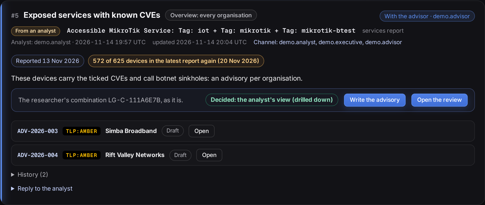

**Time to act.** A finding nobody is acting on yet (new, with management, back with the researcher, or with the
analyst) closes on its own `FINDING_ACT_DAYS` days (30 unless set in `.env`; `0` turns it off) after its devices were
last seen; while the latest report still shows them, the clock starts again. A finding approved by management, with
the advisor, or with an advisory not yet sent never closes this way, and every finding has at least
`FINDING_GRACE_DAYS` (7) days from the day it was opened. Its history then says *Time to act expired*, by Looking
Glass; everyone in its channel sees it in the bell, and it is in the audit log.

**The review.** Management's final look at a combination the analyst sent: what the researcher says, what the analyst
ticked, and the drill-down, the whole combination and the analyst's view as the Executive portal shows them, each on
the day its records were reported.

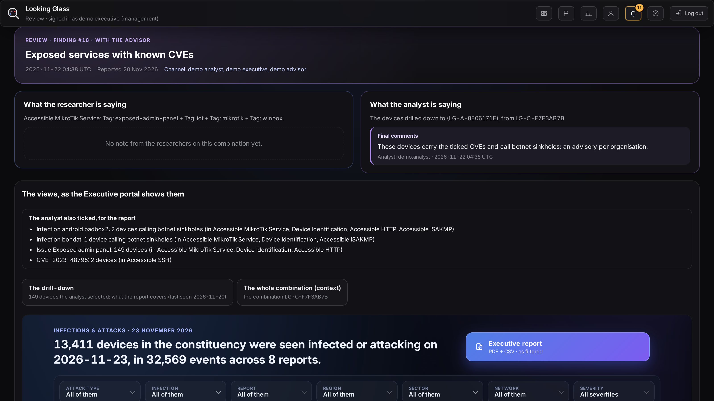

**The page is a ticket tree.** A case shows its sub-findings beneath it, one per organisation. Closed sub-findings fold
into their own group, and every level opens and closes with a click. The **state pill** says where each one stands
and who holds it (*With management · Efua Owusu*). The filters at the top count each state; **Open** and **All** switch
between work in progress and everything.

## Abused or Compromised (analysts)

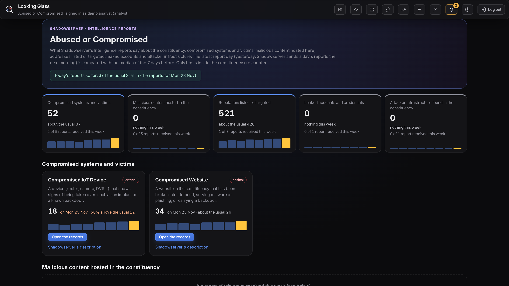

Shadowserver sends a group of **Intelligence** reports beside the two platforms: compromised systems and victims
(compromised websites and devices, ransomware victims), malicious content hosted in the constituency (malware and
sandbox URLs, spam links), addresses on block lists or targeted, leaked accounts, and attacker infrastructure. The
**Abused or Compromised** page (`/intelligence`) is for analysts and administrators, and for external accounts in a
masked view; it is closed in Demo mode. External accounts see it masked: host labels instead of addresses, network
aliases, and host names, organisations, accounts and e-mail addresses hidden. Free text in a report (a defacement's
message, a block list's reason, a user agent) is hidden too, and the ransomware victims report is not shown to them at
all.
They cannot download, look up a host or show accounts.

- **Group tiles:** today's records in each group against the median of the 7 days before, with the 8 days as bars.
  While the day's files are still coming in, the page says so: "still arriving: N of the usual M reports".
- **One card per report received**, in plain words, with today against the usual. **Open the records** shows a day's
  records with filters on that report's own fields (for example URL, application, tag, detail, sector and server for
  compromised websites; vendor, type, model, tag and sector for devices; source and reason for block lists) and a
  search over every field.
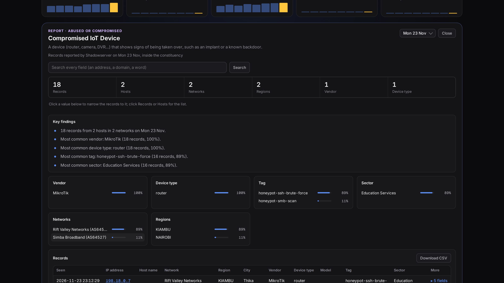

- **An address** opens what else that host carries: the other Intelligence reports of the week and the services
  platform's categories for it.
- **Export CSV** downloads every record of the view; it is in the audit log.
- **Leaked accounts** (Compromised Account) are masked until you choose **Show the accounts**, which is in the audit log.
- **Make an analyst code** from a view: its devices go to the researcher you choose, as for any analyst code.
- **Not received this week** lists the reports that did not arrive, with the likely reason. Reports without an IP
  address (Compromised Account, Ransomware Victim, Sandbox-DNS) reach a CSIRT through a domain filter: ask
  Shadowserver to add the constituency's domains.

Hosts outside the constituency (Settings) are left out everywhere on the page. Management sees the totals per group
and their 7 days on the Executive portal, never a host.

## Unusual activity (analysts)

Every network and report has its own normal, and so has every pair of reports that the same devices are in on one
day. **Unusual activity** (`/unusual`, for analysts and administrators) lists what is well above its normal on the
latest report day. It answers *what changed*, not *what something is*.

**How the normal is worked out.** For each thread (one network and one report, a report over the whole
constituency, or two reports together), Looking Glass takes the number of devices on each of the last 28 report days.
The normal is the middle value, so one odd day does not move it. A thread is suggested only when it is **well above
its normal and big enough to matter**: at least twice its normal, clearly outside its usual day-to-day spread, and 10
devices or more. A network going from 1 device to 3 is not news. Two reports together are suggested only when their
devices are in both at least twice as often as chance would give. Days a report did not arrive are left out.

**Each card** says it in plain words, for example *AS64514 Lakeside, Sinkhole HTTP: 48 devices, normally about 11
(4.4x).* Below it: the thread's chart (each day's devices, the latest in red, the normal as a dashed line), the first
day it appeared in these weeks, and how many earlier days were this size.

- **Show the devices**: the addresses behind the card on that day, with their network and records.
- **Open on the map** / **Open on the services platform**: the platform filtered to that report and network.
- **Confirm**: give it a name your team uses. It moves to **Watched by your team** and is followed every day against
  its own normal; when it jumps again, its card says *Growing again today*. **Stop watching** ends that.
- **Dismiss**: that thread stays quiet for 30 days, unless it doubles.

**It learns from your team.** Each report has its own bar. Every Dismiss of one of its threads raises the bar a step,
every Confirm lowers it, never below three quarters or above twice the starting bar, and the card says why: *Looking
Glass asks from 1.5x its normal for Sinkhole HTTP, after 0 dismissal(s) and 1 confirmation(s) by your team.*

Confirm, Dismiss and Stop watching are in the audit log. The count runs every hour on its own (after the reports
arrive) and follows the constituency; it keeps counts only, never an address. Researchers see the same suggestions,
without devices, in **Looking Glass asks** on the Definitions page; management sees **Unusual this week** on the
Executive portal.

## Management portal (Executive)

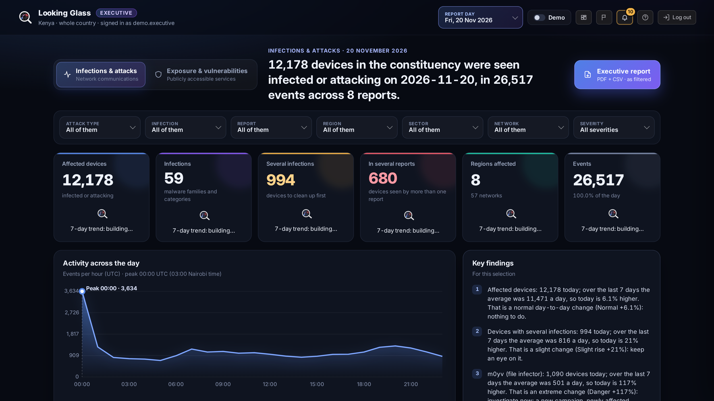

Accounts with the **management** role open straight into the **Executive** portal (`/management`); admins reach it with
**Executive** on the intro page and in the top bar. It is a dashboard for managers and executives with two views:

- **Infections & attacks** (network communications): affected devices, infections, devices with several infections,
  devices seen by more than one report, regions, networks, sectors, attack types, and the countries infected devices
  connect to.
- **Exposure & vulnerabilities** (publicly accessible services): internet-facing hosts, hosts with an issue, hosts with
  **actively exploited** vulnerabilities (CISA KEV), critical CVEs, exposed services, regions, sectors and industries.

Under **Deeper insight** the analyst figures appear as aggregates: devices with several infections (by number, and the
infections most often found together), hosts with several issues (and the issues most often found together),
cross-report analysis (devices or hosts in 2, 3, 4+ reports, which reports or services overlap, devices both infected and
attacking), repeat behaviour (devices beaconing at a regular rhythm and the typical interval), C2 / sinkhole domains,
kinds of issue, devices (vendor and type) and severity.

Lists are ranked by **devices** (distinct IP addresses; hosts on the services view), records breaking ties, so one
chatty device cannot put its network, region or report on top. The **Reports** card lists **every report** of the
selection with its devices and records (click one to focus the page on it), and the Executive report has a Reports page
with all of them. The filter menus list every value of the day. Devices are counted by IP address, as Shadowserver
reports them: one address can stand for several devices (shared mobile connections), and one device can use several
addresses in a day; the page and the report say so.

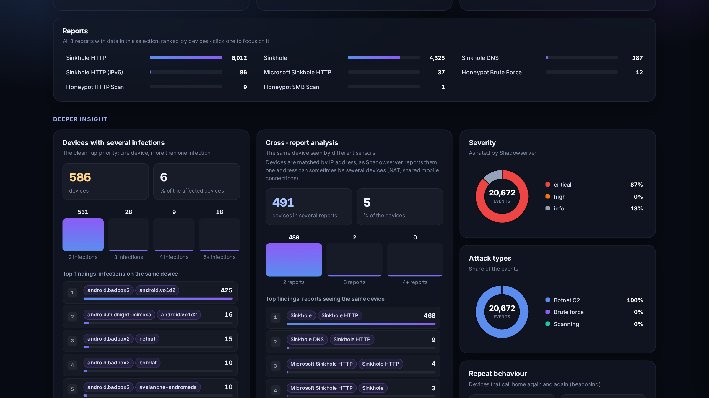

Every figure is aggregated: no address, host name or host list is ever shown (the server never sends them). Choose a **report day** and the filters at the top, or click any bar, slice or
region on the map to focus every chart on it; the chips show what is focused and **Reset all** clears it. Click an
infection or an issue to have it **explained** (Malpedia, threat actors and the Looking Glass definitions; for CVEs: CISA
KEV with the required action, CVSS, EPSS and the official records). **Explain all** looks up the top names with a progress
window. **Executive report** downloads a ZIP: a polished PDF in the dashboard's design of exactly what is on screen (overview and
key figures, activity, regions with their cities, sectors, the top infections or issues, deeper insight with the top
findings, and the explanations), plus CSV files with every combination behind the top findings (infections or issues
found together on one device / host, and reports or services seeing the same device / host), with their counts.
The dashboard shows the top 10 of each; the CSVs list all of them. **Click a combination** (for example
two infections found together on 500 devices) to focus the whole portal on exactly the devices or hosts with that
combination: every figure, chart, map, list and the executive report then break those 500 devices down by region,
network, sector, report and so on. The chip at the top shows it; click the row again, or ×, to show everything.
**Demo** replaces network names with aliases for presentations.

### The 7-day baseline

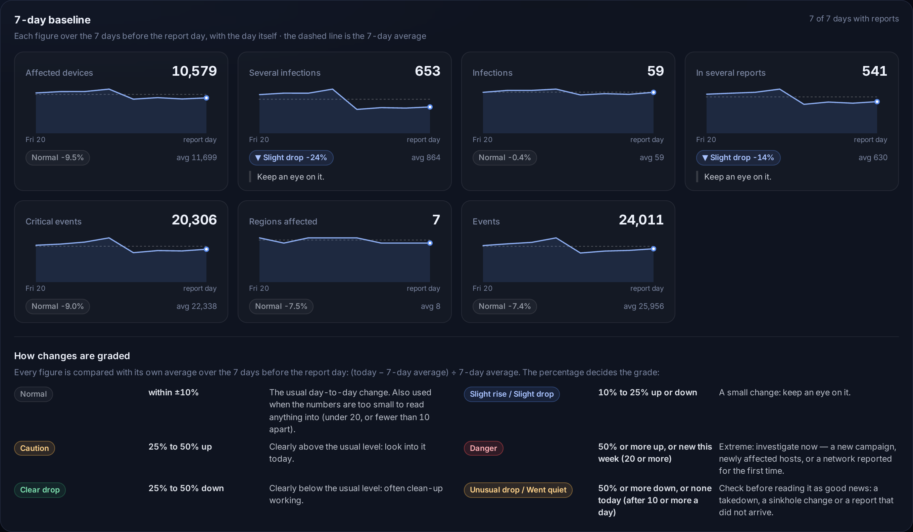

Every figure is compared with its own average over the **7 days before the report day**, so management can follow what
the analysts deal with from day to day. The figure tiles, the **7-day baseline** card and every row of **Top infections**
/ **Top issues** show a trend line (the 7 days and the report day), the 7-day average and a grade; the **key findings**
explain it in plain words ("1,700 hosts today; over the last 7 days the average was 1,850 a day, so today is 8% lower.
That is a normal day-to-day change"). The baseline is built in the background and is ready when the portal opens; any
filter or clicked combination gets its own baseline in about a second (the past days are kept in memory). The executive report
has a **7-day baseline** page and a `seven-day-trend` CSV.

**How changes are graded:** change = (today − 7-day average) ÷ 7-day average:

| Grade | Change | What it means |
|---|---|---|
| Normal (grey) | within ±10% | the usual day-to-day change; also when the numbers are too small to read anything into (under 20, or fewer than 10 apart) |
| Slight rise / Slight drop (blue) | 10% to 25% | a small change: keep an eye on it |
| Caution (amber) | 25% to 50% up | clearly above the usual level: look into it today |
| Danger (red) | 50% or more up, or new this week (20 or more) | extreme: investigate now (a new campaign, newly affected hosts, or a network reported for the first time) |
| Clear drop (green) | 25% to 50% down | clearly below the usual level: often clean-up working |
| Unusual drop / Went quiet (amber) | 50% or more down, or none today (after 10 or more a day) | check before reading it as good news: a takedown, a sinkhole change or a report that did not arrive |

The same scale is printed on the portal under the 7-day baseline card and in the executive report.

The management role has this portal, its Overview and the Findings it decides: it cannot see the platforms, lists,
Settings or Definitions, and the permission cannot be given to any other role (the roles editor locks it; the server
enforces it).

### Unusual this week

The **Unusual this week** card shows, for each day of the week, how many networks and reports were well above their
own normal, and the strongest of the latest day in words. It covers the whole constituency and every report,
whatever the filters. The analysts confirm or dismiss them (see Unusual activity).

## Advisories (the advisor)

[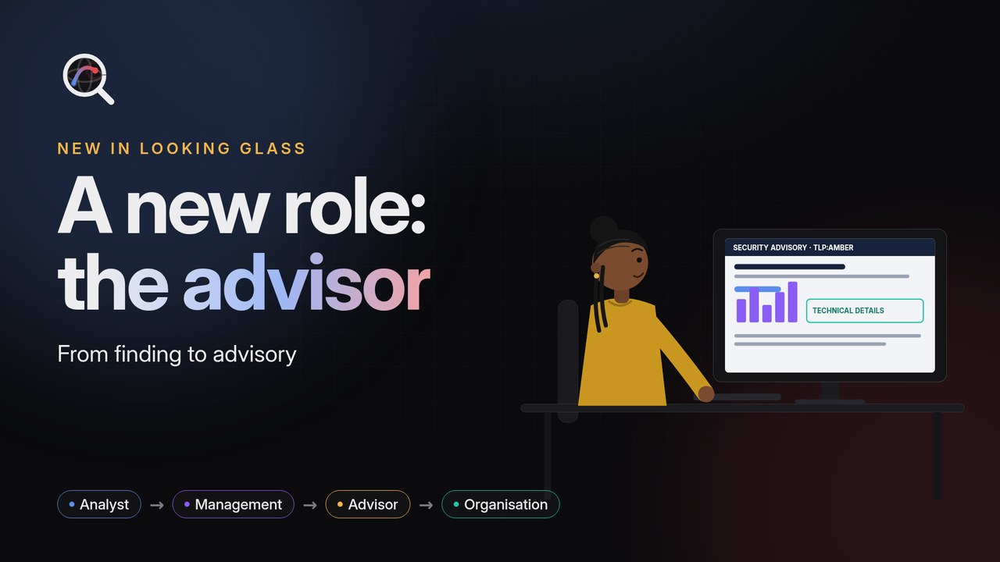](https://www.youtube.com/watch?v=BUv13KMQSEM) <!-- film: finding-to-advisory -->

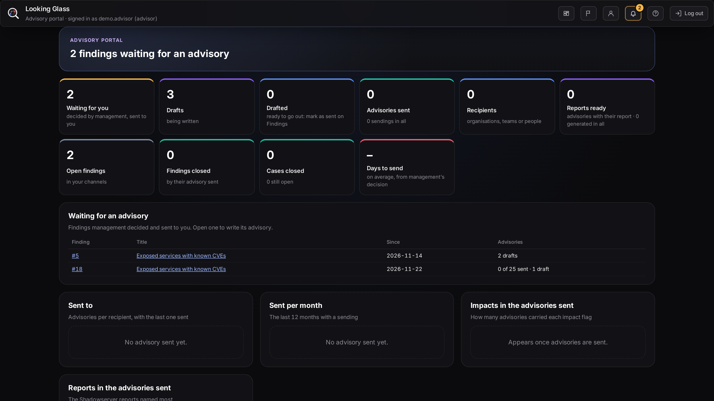

The **advisor** role turns approved findings into advisories for the organisations concerned. Its **Advisory portal**
(`/advisory`) is a dashboard showing:
- **Waiting:** what is waiting for an advisory.
- **In progress:** drafts and advisories marked drafted.
- **Sent:** advisories sent, and the recipients.
- **Findings:** findings still open and findings closed.
- **Days to send:** on average, from management's decision.
- **Charts:** sent per recipient, sent per month, and the impacts the advisories carried.

**One advisory per organisation.** Open a finding and its organisation (network) is already chosen, with that
organisation's IP addresses (chosen by the organisation's network numbers, its ASNs, kept on the finding when it was
sent: a network renamed since still finds exactly its devices, and if none of them are left in the finding's records
the advisory is refused rather than made about anyone else's devices): the reports they appear in, what the devices are (*Seen as*), their CVEs and weaknesses
(*issues*), the infections they call sinkholes as, **Other days** (when the analyst searched the report day: the same
combination on the other days in memory, or what changed), and the **impact** of each report (for example *Unauthorised remote access*, *Botnet recruitment*).

**Never from a blank page.** The advisor writes only the short part: a description and the actions to take. The
report brings the rest by itself:
- **INSIGHTS** (only when **Add insights** is ticked): the analysis behind the finding, the analyst's report on this
  organisation's devices. It shows the pattern across reports, the networks, regions and cities, and the busiest
  devices, so the organisation sees why it matters, not just a list. A new advisory starts without it; tick **Add
  insights** to include it. Advisories written before this option keep their insights.
- **TECHNICAL DETAILS:** every weakness and every tag in it defined, from the researchers' definitions and the CVE
  look-ups, each with its references. Always included.
- **REFERENCES:** the Shadowserver report pages for each report involved, including the reports the devices were also
  seen in (for example *Device Identification*). Always included.

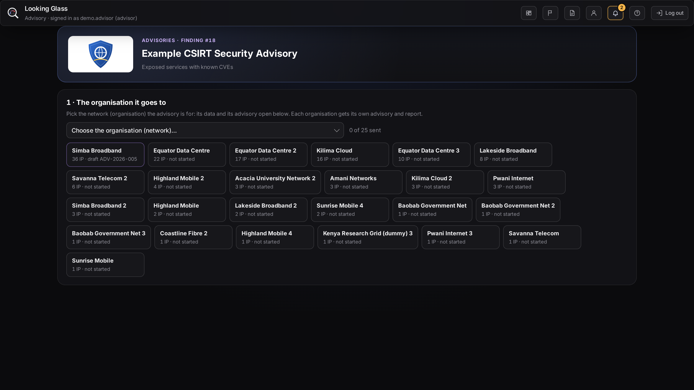

**Writing it:**
1. Choose the **TLP** (see below). It is TLP:AMBER unless you choose otherwise.
2. Write the **heading**: the advisory's title on the first page. Left empty, it reads *"<your CSIRT> Security
   Advisory"*.
3. Write the **Description** (what was found and what it means) and the **Recommended Actions**, with the **B**, **•
   List** and **1. List** buttons. A preview shows the result.
4. **Generate the report.** Generating again replaces it: there is only ever one download.
5. **Mark as drafted** when it is ready to go out.

If you change the heading, subject, TLP, Description or Recommended Actions after generating, the report is marked
**out of date**: it no longer says what the advisory says. It cannot be marked as drafted or sent until you generate it
again, so the organisation always receives what the record shows. Putting the text back as it was makes it current
again.

**The report** opens with the **ADVISORY** pages (the organisation's devices, the impact, the description and the
actions), then **INSIGHTS**, **TECHNICAL DETAILS** and **REFERENCES**, each with its label. It is signed by your CSIRT
(its name and logo from Settings), never by a person; who wrote it is kept in the audit log. It carries no internal code
and no researcher's note, and every page shows the TLP at the bottom right and in the header line.

**How the PDF looks** is the advisor's choice, for each advisory, beside **Add insights** on the advisory page:
- **The PDF's look:** *Designed* (dark pages) or *Plain* (white pages and dark text, for printing). The TLP label
  keeps its black box and colour on both.
- **The name at the top of its pages** (top left of every page): *Looking Glass*, *the organisation's name*, or *no
  name*.

A new advisory starts with the designed look and Looking Glass. An advisory written before this choice moved to the
advisory page keeps what Settings → Organisation held then, so its PDF does not change. Each change is in the
advisory's history and the audit log. Changing the look or the name, or turning **Add insights** on or off, marks a
generated report out of date, like a change to the text.

**MITRE ATT&CK in the report.** Each technique is listed once, in code order, with every reason it applies merged
into one sentence. The mitigations follow in their own section, **one block per technique** (in code order): the
technique, then its MITRE mitigations in code order, each with MITRE's advice for that technique. A mitigation that
defends against several techniques appears under each of them, once in each.

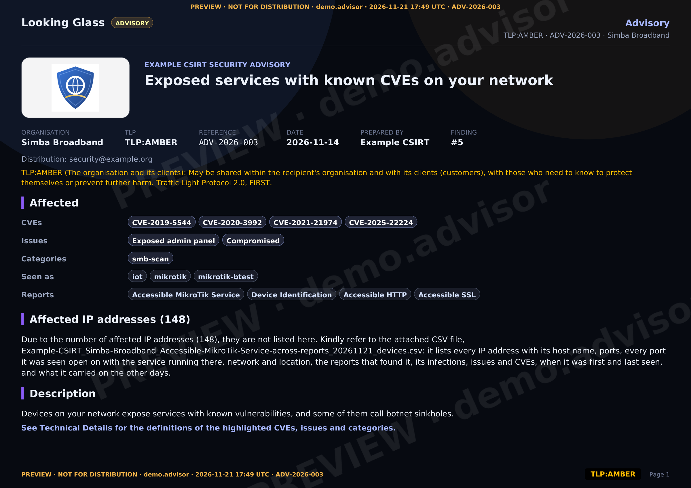

**What goes to the organisation.** The download is one archive, named `CSIRT_organisation_title_yyyymmdd`. Extract it
and mail its two files as attachments: the **PDF** and the **devices CSV** (the affected addresses). Never send the
archive itself: a zipped attachment from outside looks like phishing. **Export JSON** is for your own tools; it is not
in the archive.

**Mark as sent** on the Findings page once it has gone out. The organisation's sub-finding closes, then its case when
every sub-finding is closed. Each step is in the history and the audit log, and the dashboard updates.

If two people (or two tabs) change the same advisory at once, the second change is refused with "changed meanwhile":
open the advisory again to see the latest, then make the change. Nothing is overwritten, and a sent advisory stays sent.

### TLP: how far an advisory may travel

The Traffic Light Protocol 2.0 (FIRST) is chosen on the advisory page and explained there and on the Definitions page.

| Level | Who may receive it |
|---|---|
| **TLP:RED** | the named recipients only, in the meeting or exchange it was given in |
| **TLP:AMBER+STRICT** | the recipient's own organisation only, those who need to know |
| **TLP:AMBER** | the recipient's organisation **and its clients** (customers) who need to know: the default, since an advisory lists the organisation's addresses |
| **TLP:GREEN** | peers and partners in the recipient's community, not published |
| **TLP:CLEAR** | anyone; may be published |

## Notifications (the bell)

Every role has a **bell** in its header. It counts what changed in the findings you take part in: a finding sent to
you, a decision, a reply, an advisory sent. Open it to see each one, with what happened and when; click one to go
straight to it. **Clear all** clears your own list only. With Peace of mind on, an administrator gets no findings
notifications. Management, advisors and administrators also get one alert when a quarter's reports are ready
([Quarterly reports](#quarterly-reports)). Everyone's bell also says (in the next release, in testing now) when a passkey is added to or removed from their
own account.

## Quarterly reports

Once a quarter has ended (on the next quarter's 3rd day, a little after midnight UTC, when the quarter's last day's
reports have arrived), Looking Glass counts the
quarter: records and unique addresses per month, report, network, region and sector; infections and actively exploited
CVEs; findings, cases and management's decisions; advisories and their follow-up. Counts only: no report names an
address. Every report says **VALID** (every accuracy check passed) or **NOT VALID** at the top.

| Who | Where | What they download |
|---|---|---|
| Management | Executive portal, **Quarterly reports** at the bottom | the management report (PDF): the quarter at a glance, reports and networks, regions, sectors, infections and CISA KEV, over time with the cases and management's decisions (each with its reason and date, no person's name), advisories in summary, the retention dates and the accuracy checks; and its summary (CSV) |
| Advisors | advisory portal, **Quarterly reports** below the portal | the advisor report (PDF): an overview, advisories per month and their impacts, each organisation with its open cases and how many of the devices named in its advisories were still seen afterwards, the cases that matter for advising, the top issues and CVEs per network; and three CSVs (networks and reports, organisations and follow-up, every issue and CVE per network with each CVE's full description) |
| Administrators | Settings → **Quarterly** | only the purge CSV (rows per report and month, and what the purge deletes), each report's accuracy checks, the purge's status and switch, and **Make it again**; not the management or advisor reports |

Each role downloads only its own files. An administrator who opens the Executive portal or the advisory portal sees
the card, where each quarter stands, with a note instead of the downloads: "Quarterly reports are for management only"
(or "for advisors only"). Researchers, analysts, auditors and external accounts do not get the quarterly reports.
Every list keeps the past quarters too.

**What the cards say is true now.** Each card says whether the quarterly purge is on now, and for each quarter what
its purge is as things stand: for example "No purge for this quarter: its purge day (Thursday 22 October 2026) had
passed when it was made", or "Download before the end of …: the report rows dated before … are deleted on …". The card
always says where the quarter stands, even before any report exists: "2026Q4 is in progress: it ends Thursday 31
December 2026; its reports are made on Sunday 3 January 2027", and once it has ended "2026Q4 has ended: its reports
are made on Sunday 3 January 2027". A quarter with no report rows says so: "No report rows were loaded for 2026Q3
(Looking Glass holds report rows from 21 September 2026 on)." The PDFs keep what was true **when the report was
made** (they are a record of that moment) and say so; the purge CSV keeps it too, unchanged. An empty quarter's PDFs
say it on every page, and its CSVs on their first lines.

**Counted for your constituency.** The reports count only the hosts in the constituency set in Settings →
Constituency, like the rest of Looking Glass, and each says so: "Counted for: the whole country", or "Counted for: 3
networks and 1 address range (the constituency set in Settings)", on its PDFs, its CSVs and its card. A comparison
with a previous quarter counted for another constituency says "counted for a different constituency"; if you change
the constituency, **Make it again** counts a quarter for the new one. The purge figures in Settings → Quarterly are
for all networks in the database, not only the constituency, because the purge clears old stored rows.

**Downloading.** Click the file's button: it shows that it is downloading, and the file arrives through the page.
If Looking Glass could not be reached (for example while it restarts), it tries once more on its own; if that fails
too, the card says "The download did not finish: Looking Glass could not be reached (it may be restarting). Try
again." If the card itself cannot reach Looking Glass, it says so in plain words, tries again a few times, then offers
**Retry**.

**Download your copy in time.** The quarterly purge is off until an administrator turns it on in Settings →
Quarterly; while it is off, no report rows are deleted and the bell and the reports say so. Once it is on, the bell
says until when: the 15th working day (Monday to Friday) after the quarter. On the next working day the database
pipeline deletes the raw report rows older than 31 days, so the platforms can no longer show those days. The quarterly
reports stay on these pages, and findings, cases and advisories are never deleted. Each download is recorded under your name; a CSV carries who downloaded it and when on its second line.

Decisions are counted one per organisation of a case, so a quarter can have more decisions than findings: a case that
goes to three organisations is decided three times.

## 6. Demo mode and public screens

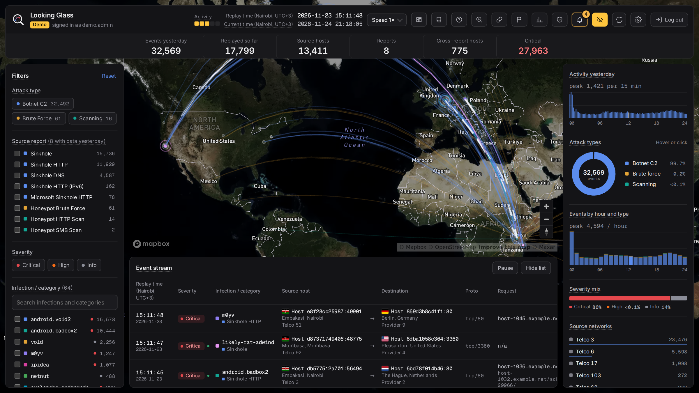

**Demo** in the top bar masks the data while it keeps playing: IP addresses lose their 1st and 3rd parts, network
names become stable aliases ("Telco 1", "Bank 2"), host names disappear. Masking happens on the server, so the
hidden values never reach the browser. External accounts are always masked; `PUBLIC_DEMO=1` masks everyone.
While masked, filters accept only the aliases and opaque host references: typing a real network name, AS number or
address finds nothing, so a viewer cannot find out whether a network or host is in the data.

**Pinned events** (the pin at the end of a row on the map) keep their full details in your browser only while you are
signed in: they belong to your account and are deleted when you log out. Masked accounts do not keep pins.

For a TV or wall screen: sign in with an external account, tick **Stay signed in**, and open the
platform full screen. The display adapts to TVs and weaker devices by itself (`?perf=lite` forces the light mode).

## 7. Settings (administrators)

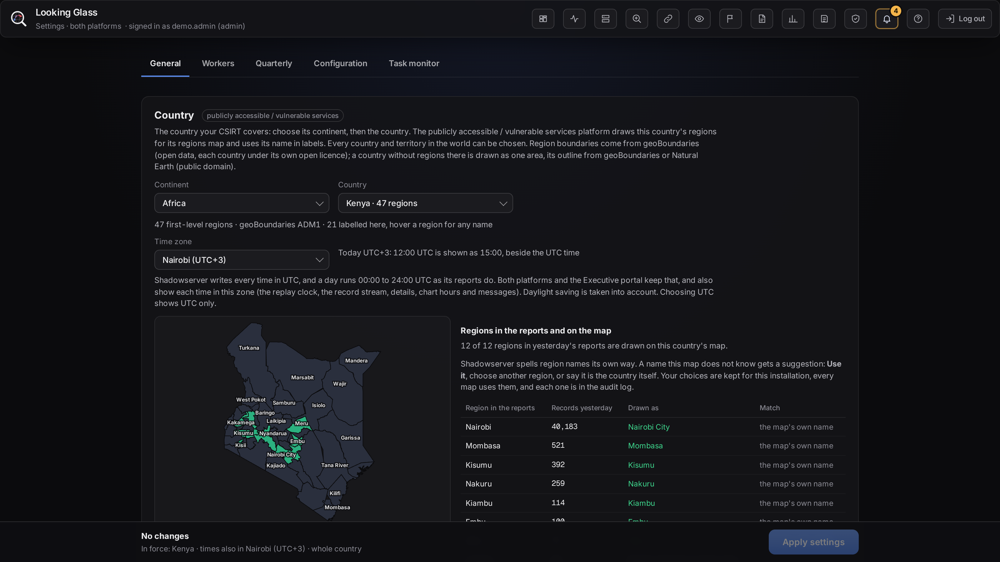

**Settings** (gear on the intro page, or the button in the top bar):
- **Continent and country:** any country or territory in the world. The services platform shows its regions (or the
  whole country as one area, where the open map data has no regions) and uses its name. Below the map, **Regions in
  the reports and on the map** lists each region name in yesterday's reports as Shadowserver spells it. A name the map
  does not know gets the closest region as a suggestion: **Use** it, choose another region, or say it is the country
  itself. The choices are kept, every map uses them, and each is in the audit log.
- **Time zone:** the zone your team reads times in (starts at the country's usual zone; DR Congo offers Kinshasa and
  Lubumbashi; UTC can always be chosen). Days and times stay UTC, as in Shadowserver's reports; Looking Glass **also**
  shows each time in this zone (clocks, stream, event details, chart hours, messages, the Executive report: "12:15:41
  UTC (15:15:41 Nairobi time)"), with daylight saving (Egypt, Morocco). For a UTC zone, as in Ghana, only UTC is
  shown. Changing it reloads nothing. See `TIMEZONE` in [CONFIGURATION.md](CONFIGURATION.md#country-and-constituency-also-on-the-settings-page).
- **Constituency:** **Whole country**, or **Only selected networks and address ranges**. Every part of Looking Glass
  follows it (both platforms, the Executive portal, findings and advisories, combinations, the research pages, every
  export and the quarterly reports, each saying "Counted for: …"); only the quarterly purge works on the whole
  database. The card summarises the choice, for example "3 networks, 12 address blocks, 1 other range". Networks and
  blocks are chosen in the **Constituent** column of **Network names & types** (below).
- **Organisation:** your CSIRT's name and logo (PNG or JPEG), which sign the advisories. **Choose a logo** opens a
  sizing step: the picture in the advisory's 2:1 logo frame, **Trim empty margins**, a size slider, dragging (or arrow
  keys) to place it, a background for see-through parts (keep it, white or dark), and previews on the dark and the
  plain advisory. It recommends about 464 × 232 pixels and shrinks the logo to at most 40 KB in your browser; nothing
  is sent until you save. The sign-in pages show the name only, no product and no image, so internet scanners cannot
  tell what runs here.

**Apply settings** saves and applies at once for everyone.

Settings also lists the **network names and types**, read-only here; they are corrected on the Definitions page
(**Edit on the Definitions page**), with the researchers' work.

**Choosing the constituency.** The network list's **Constituent** column has a drop-down on every network: **Not in**,
**The whole network** (every address of its AS number) or **Some address blocks** (only the blocks you tick).

**Some address blocks** opens the network's row: every /24 block with records yesterday, busiest first, after the
blocks already chosen, each with its record count and a tick box. A chosen block stays chosen until you untick it,
also without records ("no records yesterday") or if it never appears in the reports. **Add a block** takes an unlisted
block (for example 192.0.2.0/24, or a single address for its /24). The first 50 are shown; **Show all N blocks** shows
the rest, and the search box finds one (for example 192.0.2). **Close** (or the row's button) folds the row, which
then says, for example, "3 of 120 blocks chosen". The loading animation shows the first time a network's blocks load.

Under the table, **Other address ranges** holds ranges of no listed network, one per row (add in the box, remove with
×): a single address or a block such as 198.51.100.0/22 (for example a government network without its own AS number).
One not seen in the reports yet is marked as such. Choosing a network or adding a range switches the Constituency card
to **Only selected networks and address ranges**. Nothing is looked up outside Looking Glass. **Apply settings** saves
whole networks as AS numbers, and ticked blocks and other ranges as address ranges. Reopened, a saved range that is a
network's block shows in that network; any other under Other address ranges. Accounts without the Settings permission
see the choices in words.

The list holds every network in the reports, from the first day. One not looked up yet is **Not reviewed** ("not
identified yet"): type its name and type yourself, or press **Look up all** (Settings and the Definitions page,
administrators and researchers), which looks up every unnamed network, ten at a time with a running count, and saves
what it finds as not reviewed, for you to check and Save. A reviewed network is never changed by a look-up.

**Identify networks** (top of the list in Settings) looks up the company name and type of every unidentified network
from PeeringDB and RIPEstat (free public sources; only AS numbers are sent), with a progress window (looked up,
identified, already known, failed). Hand-corrected names are never changed; failed look-ups are tried again next time.
The names appear everywhere at once.

### Password policy

**Settings → Password policy** (administrators): tick **Make passwords expire**, set how many days a password lasts,
and **Save the policy** (with your own password). **Every account then chooses a new password at its next sign-in**,
and again whenever its password is older than that. **Require every account to change its password at next sign-in**
does the same at any moment, for example after a suspected leak (also with your password). The card shows how many
accounts must choose a new password; every change is in the audit log.

People sign in as always; if their password has expired, a box asks for a new one before the platform opens. It
follows the usual rules and cannot be the expired one. Once saved they go straight in, and their other open sessions
end.

NIST SP 800-63B advises against forced periodic changes without a sign a password was exposed; some audits and
regulators still require them. The card says so; the choice is the installation's.

### Workers (the database pipeline)

The **Workers** tab of Settings holds the pipeline's own settings, so its `.env` need not be edited. It is **locked**:
**Edit** asks for *your own* sign-in password and unlocks it for 10 minutes, in this session only; **Save the
settings** locks it again. A save is a **request**: the web app never writes the pipeline's files; the pipeline checks
it again and applies it at the start of its next run (within about 30 minutes with the usual schedule; how:
[CONFIGURATION.md](CONFIGURATION.md#the-database-pipeline-from-the-platform)). The tab shows what is **waiting for the
pipeline's next run** and what it **applied** or **refused**. A wrong password counts like a failed sign-in; every
unlock, change (old → new value), key, release and result is in the audit log. Mailbox and database **passwords are
never shown or changed here**: they stay in the pipeline's `.env`, set by the installer.

**Changes that make the pipeline less strict also need the server**: turning the sender check down (Block → Record
only → Off), changing the expected signer, turning the mail server's certificate check off, going back from the
Shadowserver API to e-mail, loosening an unzip limit (larger unpacked size, ratio or file count, or less disk space
kept free), saving a new Shadowserver API key and releasing a held-back report. The tab marks them **waits for
confirmation on the server** and shows the command, which someone with server access runs on the pipeline's account,
in the pipeline's folder:

```bash
./confirm_request.sh <id>
```

The next run applies it; the audit log records who requested and who confirmed it. Unconfirmed, it is refused after 7
days. Otherwise a broken-into web app could switch these checks off itself (for example the certificate check, and
with it expose the mailbox password, which the web app never holds). Stricter settings (including stricter unzip
limits), folders and performance need no confirmation.

- **Getting the reports:** *By e-mail* (the mailbox the reports are sent to) or *Shadowserver report API* (with the API
  key below; save the key first). Every scheduled run fetches only what is new; if your choice cannot be used on a run
  and the other way is set up, that run uses the other way and its log says why. *Days back per run* applies to both.
- **Sender check (DKIM)**, for reports by e-mail: *Check the sender of every report* verifies each report e-mail's
  signature with the sender's public key from DNS and records the result (Audit portal → Sender check). *Block reports
  that do not pass* also holds back a report not validly signed by the *Expected signer* (`shadowserver.org`) until an
  administrator releases it. A report passes only when the signature covers its sender (the From line), the sender is
  in the signer's domain, and its headers can be read only one way; a message with lines added above its headers is
  held back. Start with blocking off: a footer or forwarding rule on the way breaks a genuine signature too.
- **Sender check, last 7 days:** per day, how many report e-mails passed, did not pass or could not be checked, and
  each kind of failure with what it usually means (for example *the body was changed after it was signed*: a gateway
  or forwarding rule on the way, so deliver Shadowserver's mail unmodified). When every e-mail passed on each of the 7
  days and blocking is off, the card says blocking can be switched on safely, with a button that ticks it (save to
  apply), and the bell says so once. Days without mail, or whose e-mails could not be checked, do not count. If the
  newest e-mails could not be checked at all, the card and the bell say **the check is not working**: neither this
  server's DNS nor the HTTPS resolvers (`MAIL_AUTH_DNS_SERVERS`) answered the look-up of Shadowserver's signing key (a
  TXT record), so no report is verified, and with blocking on they would wait at every run. Let this server's DNS
  answer TXT look-ups, or let it reach those resolvers over HTTPS
  ([how the look-up works](CONFIGURATION.md#the-database-pipeline-from-the-platform)).
- **E-mail settings:** mailbox folder (or Gmail label), messages per fetch, the mail server's certificate check, the
  timeout.
- **Loading performance:** loader processes, records per insert, download threads.
- **Unzip limits:** the largest unpacked size, compression ratio and file count, and the disk space kept free.
- **Shadowserver report API:** paste the API key and secret. **Check with Shadowserver and save** asks Shadowserver
  first (is the key accepted, which report lists may it fetch) and saves only if it accepts; afterwards the page says
  only that they are set and when last checked, never the values. **Check with Shadowserver now** checks them again.
- **Reports held back by the sender check:** each held-back e-mail with its report files **by their Shadowserver
  names** (for example `2026-11-15-scan_http-example-geo.csv`, with the report and its day), why it was held back and
  what that usually means. A file not named like a Shadowserver report is flagged: check that e-mail first. Tick the
  reports (or **Select all**), then **Process selected** (after your password); Looking Glass lists your choice and
  asks before going on. They go to the pipeline as one request, so one confirmation on the server lets them all
  through at its next run. Process only reports you know are genuine. Processed reports stay on record, each in the
  audit log.

When the pipeline runs on another computer, the tab says so and its settings stay in its own `.env`.

### Quarterly (reports and the purge)

**The quarterly purge** card is at the top. The purge is **off** until an administrator turns it on; off, the card
says "The quarterly purge is off on this installation: no report rows are deleted.", then what it would do once on:
the purge day, the cutoff and the rows it would delete (counted by the newest VALID quarterly report; before the
first, it says there is no count yet and gives the next purge day). **Turn on the quarterly purge** shows exactly what
will be deleted and when, and asks for your sign-in password; once on, the card says "On since <day>, confirmed by
<full name>." with the next purge's day and rows. **Turn off the quarterly purge** is always there while it is on.
While it is off and a VALID report exists, administrators get one bell alert per quarter. What is deleted, what is
kept, the checks and the alerts: [OPERATIONS.md](OPERATIONS.md#the-quarterly-report-and-the-purge).

Below it: where the quarter stands now, with the purge day and the cutoff ("2026Q4 is in progress: it ends Thursday 31
December 2026; its reports are made on Sunday 3 January 2027; with the quarterly purge on, the report rows dated before
Tuesday 22 December 2026 are deleted on Friday 22 January 2027"), then every kept quarter with its purge CSV (the
management and advisor reports are only for those roles, on their portals), **VALID** or **NOT VALID**, its accuracy
checks (open them to see each), its purge as it stands now, whether the purge permit was written, and the purge's
result once the pipeline has run it. **Make it again** counts an ended quarter again (for example once its last day's
reports are loaded, or after a NOT VALID run); click it twice to confirm. It offers only ended quarters of the last
four that have report rows and were not purged; with none it says "No ended quarter has report rows yet: the first
report is made on <day>.", or gives the reason no ended quarter can be counted. The pipeline's last purge check says
"Nothing to purge now" when the latest quarter past its purge day had no report rows before its cutoff, and names the
next quarter and its purge day. The timing of the purge cannot be changed here or anywhere:
[OPERATIONS.md](OPERATIONS.md#the-quarterly-report-and-the-purge) explains the cycle and what to do when a report is
NOT VALID.

## 8. Administration

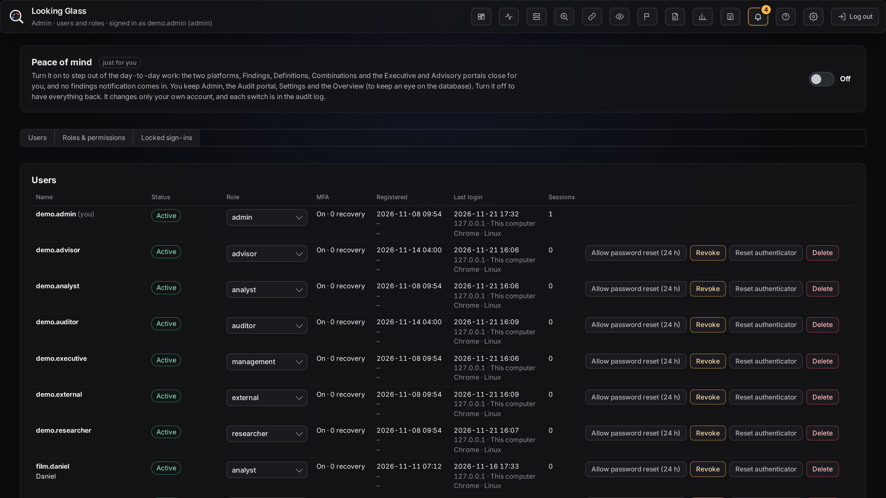

**Admin** in the top bar (administrators):
- **Users:** approve accounts waiting for approval with a role, change roles (**Role**, which never removes the last
  administrator), revoke or restore, reset an authenticator, allow a password reset, end someone's sessions, delete.
  Each account shows its profile and last sign-in. You cannot remove the last administrator or your own account. The
  bell announces sign-ups (one notice for everyone waiting, *"N people are waiting for your approval"*), leading here.
- **Users → Add a person:** a one-time sign-up link (any role but administrator or auditor, who sign up on the
  sign-in page and are approved here). Choose the role (and, if you like, their name for the list), **Make a sign-up
  link** and copy it (shown once; the copy is recorded, never the link). Send it by your organisation's usual secure
  channel. They set their own password and authenticator; nothing secret passes through you. The link works once, for
  72 hours (`INVITE_HOURS`), even when sign-up on the sign-in page is closed; open links are listed with **Revoke**.
  Making, using and revoking a link are in the audit log, never the link itself.
- **Roles & permissions:** the permissions of each role, and custom roles.
- **Peace of mind** (just for you): steps you out of the day-to-day work. The two platforms, Findings, Definitions,
  Combinations and the Executive and Advisory portals close for you, and no findings notification comes in. You keep
  Admin, the Audit portal, Settings and the Overview (to keep an eye on the database). It changes only your own
  account; each switch is in the audit log.

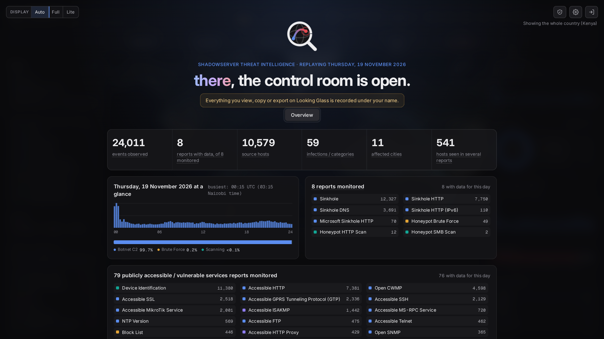

### The Audit portal (`/audit`)

For the **Auditor** role and administrators (permission *audit*). Built for an IT audit (for example by a
CISA-certified auditor) and **read only**. The **period** at the top (7 days, 30 days, 90 days, 12 months, or any two
dates, in UTC) applies to every tab.

- **Overview:** the key figures (sign-ins, failed sign-ins and the failure rate, lockouts, privileged changes,
  exports, sign-ins outside working hours), sign-ins per day and by hour, events by kind, failed sign-ins by address,
  exports by person, recent privileged changes, and the **control checks** LG-01 to LG-15: automated checks of Looking
  Glass's own controls, **mapped to the NIST SP 800-53 Rev. 5 (Release 5.2.0) controls** they support, by official
  title (for example LG-01 → IA-2(1), IA-2(2) multi-factor authentication; LG-06 → AC-7 unsuccessful logon attempts;
  LG-10 → AU-9, AU-9(3) protection of audit information; LG-11 → AU-11 retention). LG numbers are Looking Glass's
  own, not NIST's. Through those NIST controls each check lists the **CIS Critical Security Controls v8.1 safeguards**
  that CIS's official mapping ("CIS Controls v8.1 Mapping to NIST SP 800-53 Rev 5", July 2026) relates to them, with
  the NIST control and CIS's relationship (Equivalent; Subset: the safeguard covers part of the NIST control;
  Superset: it covers more): **LG → NIST → CIS** (for example LG-09 → AU-3 → 8.5 *Collect Detailed Audit Logs*,
  Equivalent). Looking Glass does not choose these safeguards; a NIST control CIS does not map (AU-9, AC-2(7)) is
  shown as such. CIS's number, title and relationship are shown exactly as CIS publishes them; beside each, a separate
  badge marked as ours gives **Looking Glass's own reading**:
  - **backed**: the check produces evidence for the safeguard as CIS words it, CIS's figures included, **on this
    system, now** (for example LG-09 → 8.5). Only the pairs listed in `control_map.py` (BACKED), and only while the
    evidence meets CIS's figure: 6.3 and 6.5 while MFA is required and every account has an authenticator; 8.10 while
    audit records are kept at least 90 days; 5.3 only with `AUDIT_DORMANT_DAYS` at 45 or less and no dormant account
    still active; 8.11 only with `AUDIT_REVIEW_DAYS` at 7 or less and a review recorded. Otherwise the row is
    **related**, saying what differs ("Looking Glass lists accounts unused for 90 days; CIS asks for 45"), as advice
    for the auditor. The defaults are CIS's figures. 3.14 (Log Sensitive Data Access) is backed by LG-15 while views of
    host-level data are logged as well as exports (on by default). 8.4 is never backed: the check reads whether the
    server's clock is synchronised, and CIS asks for at least two time sources.
  - **not backed**: the mapping reaches it but the check does not look at its subject, with the reason: LG-01 → 6.4
    MFA for remote network access; LG-06 → 4.10 lockout on portable devices; LG-07 → 4.3 and 12.3; LG-10 → 3.11
    encryption at rest (LG-10 protects the audit log's integrity but encrypts nothing); LG-15 → 8.6 DNS, 8.7 URL,
    8.8 command-line and 8.12 service provider logs.
  - **related**: everything else; CIS's mapping relates it, and nothing more is claimed.
  The overview counts it: "evidence for N NIST controls · M CIS safeguards backed by a check (K more related by CIS's
  mapping)". **The CIS Controls are used here as a map, to guide Looking Glass's security and ease the auditor's work.
  They are voluntary best practice, not a law or a requirement, and CIS issues no certificate for meeting them:
  organisations measure themselves with CIS's free Self Assessment Tool (CSAT) or an auditor, and those needing a
  formal certificate usually go for ISO 27001 or SOC 2, with the CIS Controls as a guide.** They apply to the whole
  environment (accounts, assets, backups, incident response...); Looking Glass supports only part of Controls 3, 5, 6
  and 8. The CIS Controls are © Center for Internet Security, Inc., cited unchanged under CC BY-NC-ND 4.0 (not under
  Looking Glass's licence); the portal and the report carry that notice. Each check gives evidence and **no pass or
  fail**: whether a control is implemented and operating effectively is the auditor's conclusion. Click a check for
  the records behind it. The evidence report states the scope and limits of the checks.

  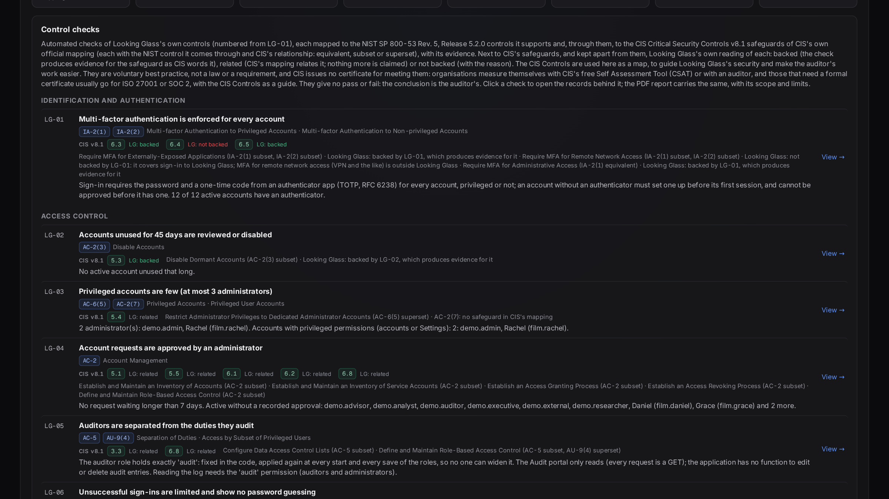
- **One tab per kind of event:** Authentication, Accounts and access, Sessions, Configuration changes, Data access
  and exports, Workflow, and System and self-test (which keeps the installation check's events apart). Each has its
  count, a search, *Alerts only* and **Export CSV**. **Data access and exports** holds every export (reports, CSV
  files, advisories, audit evidence, host-list downloads) and every **view of host-level data** (map events, services
  records, one host's activity, the hosts behind a figure, a record's details, an analysis): who, when, from where and
  what (every filter of the view), hosts by their reference, never their address. The same person viewing the same
  thing again within 10 minutes is logged once; every download is logged, the same list twice included.
  `DATA_ACCESS_LOG=0` in `.env` turns view logging off (the portal then says so); downloads are always logged.
- **Copies:** every copy made with a copy button, recorded before it was copied: who, what (for example "the addresses
  of a combination (12)"), how many lines and addresses, which page, when, and its seal's reference (S-…); never the
  copied text. Also every leak traced (who, when, how many matches).
- **Trace a leak:** text or a file found outside Looking Glass (a pasted list, a CSV, a ZIP someone shared) is matched
  against the seals of every copy and download: who, when, what, and how closely ("the exact text copied", "the exact
  file", or "3 of its 40 lines and addresses"); a file inside a ZIP matches even renamed and zipped again. The input is
  fingerprinted in memory and thrown away; each trace is in the audit log (who, when, how many matches, never what was
  searched); at most 5 a minute and 100 a day per person. A copy or download is shown when it is exactly what you
  gave, or holds at least half of its lines or addresses (so guessed addresses never match, while a real excerpt does,
  even reformatted). Partial matches are looked for up to 1,000 lines and 1,000 addresses; above that only exact ones,
  and the answer says so. A line in many people's copies and downloads (a CSV's header) does not count, and the answer
  says how many were left out. Small traces (at most 3 lines each) can test guesses, so when one person runs 20 within
  24 hours (`SMALL_TRACE_ALERT`) the administrators get a bell alert linking here, and again at every further 20. Only
  the person and the times are kept for this.
- **Access review:** every account with its role and what that role may do, its authenticator, last sign-in, who
  approved it and flags (no authenticator, dormant, pending too long, every permission), and the roles matrix.
- **Signed in now:** every session with its address, location, browser and expiry (read only).
- **Sender check:** the pipeline's DKIM results for the period: the mode (record only or blocking), reports checked
  and the share validly signed by the expected domain, those that did not pass (signature fails, not signed, another
  signer, cannot be checked), held back or released; results per day; the signing keys seen (domain, selector,
  algorithm, key size); every report that did not pass and what happened to it; settings changes and releases.
  **New report types** (by e-mail or API) are listed with the day each first arrived and *new report, no definition
  yet* until the report definitions, kept current from Shadowserver's schema, carry it; it is loaded like any other
  meanwhile. Beside the evidence, what the standards ask: RFC 6376 (DKIM), RFC 8301 (algorithms and key sizes), RFC
  8463 (Ed25519), RFC 7489 (DMARC alignment), NIST SP 800-177 Rev. 1 (Trustworthy Email) and NIST SP 800-53 Rev. 5
  SI-7 (information integrity). Evidence only, no verdict.
- **Data sent out:** what Looking Glass sent to the CSIRT's own OpenCTI and MISP (Settings → Connectors): each target
  as set up (platform, address, TLP, what it receives, on, off or paused, who added it and when), then, for the period,
  every send (report day, devices, objects, TLP), resend of an object the platform had not taken, revocation and
  failure, with totals. Looking Glass's own analysis only: never raw report rows, findings, notes, names or keys.
  Evidence only, no verdict.
- **Integrity and evidence:** **Verify the audit log** walks every entry; each carries the SHA-256 of the one before,
  so a changed, inserted or removed entry breaks the chain and the check says where. It shows the **head**
  (hash@entry) and the **signed checkpoints** (the daily signed copies of the head, each found at its entry or not, the
  signing key's fingerprint, and whether a copy goes away from the server:
  [AUDIT_LOG_PROOF.md](AUDIT_LOG_PROOF.md#between-audits-signed-checkpoints)). Download the **evidence report (PDF)**
  or **every event (CSV)** for the period; the page then shows the file's SHA-256 to note. Every check and export is
  in the audit log.
- **Proof to take away:** the **proof package (ZIP)** lets the auditor check the log without trusting Looking Glass:
  the log's files as stored, `audit_log.csv` (every entry, numbered as in the chain), `MANIFEST.json` with each file's
  SHA-256, and `verify_audit_log.py`, a short standard-library Python verifier that recomputes the chain on the
  auditor's computer (`python verify_audit_log.py`). The auditor keeps the package's SHA-256 and its head. Next time,
  **Compare with an earlier audit** (or `python verify_audit_log.py --earlier HASH@ENTRY`): if the earlier head is
  still at its entry number, the log up to it is unchanged, even against someone able to rewrite the whole log. The
  package's SHA-256 is written into the log, so each package carries the receipt of the one before. Step by step, and
  what it does not cover: [How the audit log proves itself](AUDIT_LOG_PROOF.md).

Entries are archived, not deleted, when the log grows (kept `AUDIT_RETENTION_DAYS`, default 400 days); the checks'
thresholds are in `.env` ([CONFIGURATION.md](CONFIGURATION.md)).

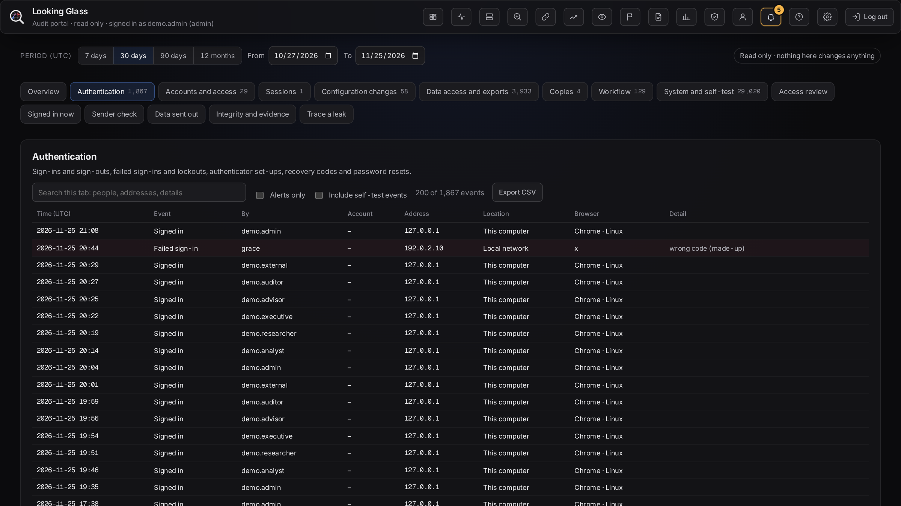

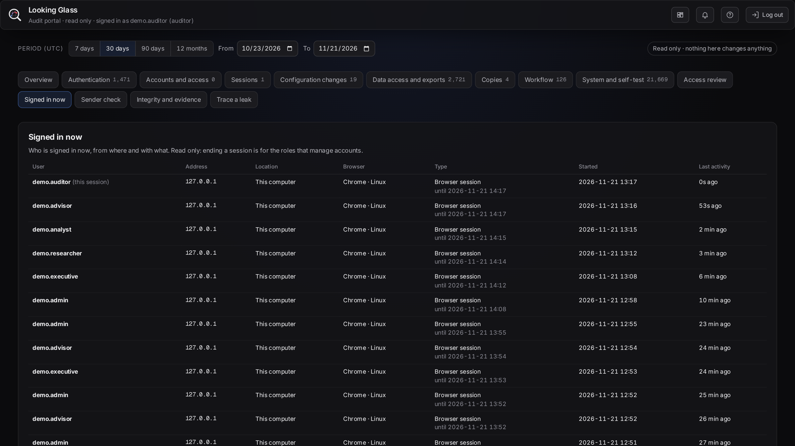

Changes need a recent sign-in: in a 5-day session older than 12 hours, Looking Glass asks you to sign in again
before changing anything.

## 9. Good practice

- Use an **external** account for anything shown to people outside the CSIRT.
- Treat CSV exports as confidential: they contain unmasked addresses.
- Send an advisory as two attachments (the PDF and the devices CSV), never the archive, and at the TLP it carries.
- Never share recovery codes or the authenticator key.
- Sign out (top bar) on shared computers.
- If a page says "Looking Glass could not be reached just now (it may be restarting)", the server did not answer,
  usually because it is restarting. Pages that read data try again on their own and offer Retry. If you had just saved
  or sent something, open the page again at http://localhost:<your port> to check whether it went through before trying
  again.
