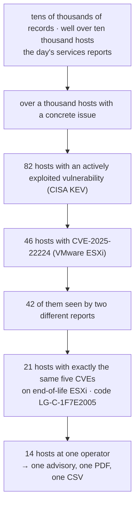
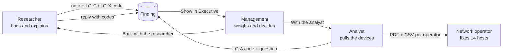

# Use case scenarios: a needle through the haystack

How a CSIRT team uses Looking Glass to turn a day of Shadowserver reports into a few advisories that a network operator
can act on, instead of forwarding a spreadsheet of thousands of addresses.

> All figures and network names on this page come from the **demonstration data** shipped for testing (fictional
> networks, documentation address ranges, real public CVEs). Your own figures will differ.

## Contents

1. [The problem: a full dump is not an advisory](#1-the-problem-a-full-dump-is-not-an-advisory)
2. [The approach: most probable first, then the next](#2-the-approach-most-probable-first-then-the-next)
3. [Who does what](#3-who-does-what)
4. [Scenario one: the researcher finds the needle](#4-scenario-one-the-researcher-finds-the-needle)
5. [Scenario two: the analyst asks first](#5-scenario-two-the-analyst-asks-first)
6. [The next days: watching the numbers fall](#6-the-next-days-watching-the-numbers-fall)
7. [Writing the advisory](#7-writing-the-advisory)
8. [Checklists](#8-checklists)
9. [The codes at a glance](#9-the-codes-at-a-glance)

---

## 1. The problem: a full dump is not an advisory

One day of Shadowserver reports for a country is large. In the demonstration data, the publicly accessible services
alone are **tens of thousands of records on well over ten thousand hosts, in dozens of networks**; the sinkholes and
honeypots add tens of thousands of events more.

The usual reflex is to export each operator's share and send it: one network alone has **thousands of affected
addresses**.
The engineer who receives that file has no way to tell which ten addresses are tomorrow's ransomware incident and
which eight thousand are old, low-risk exposure. The file sits in a mailbox; nothing is fixed; next week another file
arrives. The constituency learns to ignore CSIRT mail.

**The cost of a dump**

| What the operator receives | What happens |
|---|---|
| Thousands of addresses, every report type mixed | No starting point, so no start |
| No explanation of what each finding means | The risk is not understood, so it is not prioritised |
| The same addresses again next week | The CSIRT's mail is filtered out |
| No way to see progress | Nobody knows whether anything improved |

## 2. The approach: most probable first, then the next

Looking Glass narrows the haystack in steps, each one dropping the numbers, until what is left is a short list the
operator can act on today:

The signals that make a finding *probable* rather than noise:

| Signal | Where Looking Glass shows it | Why it matters |
|---|---|---|
| **Actively exploited** (CISA KEV), high CVSS, high EPSS | badges on every CVE; Definitions table; Executive | attackers are using it now |
| **Across reports** (⇄) | the Definitions tables' *Across reports* column; Intel gathered's *Across reports* view | two independent sensors see the same device: not a one-off |
| **Exact combinations** | Intel gathered's *Combinations* (with codes) | the same set of flaws or indicators on many devices is a pattern: one campaign, one product line, one fix |
| **Repeating devices** (↻) | combinations and values | a device that keeps carrying the set is not a scanning artefact |
| **Severity and peak hour** | the analysis windows, the Executive portal | what is critical, and when it is active |
| **Trend** (7-day baseline) | the Executive portal | rising problems first; a falling one shows the advisories work |

Handle the top of the list first. Next day, the next one. Each advisory is small, explained, and specific to one
operator, so it gets done, and the next day's numbers show it.

## 3. Who does what

| Role | Sees | Does |
|---|---|---|
| **Researcher** | names, definitions, indicators, combinations; **never an address** | finds patterns, writes notes, makes combination codes (LG-C, LG-X), answers analysts |
| **Management** | aggregated figures, trends, regions; **never an address** | weighs a finding against the trends, decides, moves it on |
| **Analyst** | everything, with addresses | pulls exactly the devices behind a code, makes analyst codes (LG-A), writes the advisory |

All three meet on the **Findings** page (`/findings`), where every finding has a number, a status
(*New → With management → Back with the researcher → With the analyst → Advisory sent → Closed*) and a history of
moves and replies. The e-mails between them can stay; the state lives in one place.

## 4. Scenario one: the researcher finds the needle

**1. Researcher: spot it.** On the **Definitions** page, sort the issues by **Hosts** (click the heading: ▲ ▼).
*Exposed admin panel* tops the list with thousands of records: real, but broad. Sort by **Across reports** instead:
**CVE-2025-22224** carries the ⇄ flag (42 hosts in two reports) and the badges *Actively exploited · CISA KEV*.

**2. Researcher: look closer.** **Intel gathered** on CVE-2025-22224 shows the combinations: 21 hosts carry exactly
*CVE-2024-22252 + CVE-2024-37085 + CVE-2025-41236 + CVE-2025-41237 + CVE-2025-41238 + end-of-life VMware ESXi*, 12 of
them in more than one record; the *Across reports* view shows 19 hosts with the same set in both reports
(`LG-X-C5CDB416`). Five flaws on unsupported hypervisors: one door to every server behind it.

**3. Researcher: write it down.** Open **Notes** on the row. In *Combinations for this note*, pick the combination
from *Seen in the reports* (nothing to type, so no typos): `LG-C-1F7E2005`. Write what it means, tick **Track as a
finding**, give it a title (*Exploited ESXi hypervisors, end of life*). It becomes **Finding #1**, *New*.

**4. Management: weigh it.** On the Findings page, **Show in Executive**: the portal filters itself to the code:
21 hosts, Nairobi and Mombasa, the networks, the severity. Management moves it to **With the analyst**, with a
comment (*Prioritise: ransomware exposure*).

**5. Analyst: pull the devices.** **Search** on the finding opens the **Combinations** page with the code: the
devices, records, the region map (hover a region for its addresses), networks, ports, the busiest hosts. In
**Report for**, choose the operator with most of them: **Tsavo Wireless, 14 hosts**. Download the PDF + CSV.

**6. Analyst: send and close the loop.** The advisory goes to Tsavo Wireless with 14 hosts, not thousands. The finding
moves to **Advisory sent**; the other operators get their own short reports the same way.

## 5. Scenario two: the analyst asks first

**1. Analyst: notice something.** On the map, an analysis of one network and one infection (*Lakeside Broadband ·
android.badbox2*) shows devices calling several sinkholes. Before sending anything, the analyst wants a researcher's
view.

**2. Analyst: ask with a code.** **Make analyst code** in the analysis window. Title and question (*Which of these
share a C2? Check before I send*). Looking Glass keeps exactly those records and makes `LG-A-…` and **Finding #2**.

**3. Researcher: answer without seeing an address.** **Open as researcher** on the finding: the selection in words
(the host is "1 host, address held back"), the names in it, their definitions, combinations and cross-report patterns
with their codes. Tick the codes that answer the question and **Send the reply**: it lands in the finding's history.

**4. Management: read both sides.** **Show in Executive** works with the analyst's code too (that day, counts only).

**5. Analyst: report.** The analyst's codes are listed on the Combinations page (*Analysts' codes*, searchable):
pick it, download its PDF + CSV, or search the researcher's code from the reply for exactly the devices that share
the C2, then report per operator.

## 6. The next days: watching the numbers fall

- Search a code again over **a date range of the stored history** (up to 31 days) on the Combinations page: devices
  per day show whether the operator has fixed them.
- The **Executive portal** compares every figure with its own 7-day average; filtered by the code, the drop is visible
  to management.
- Close the finding when the devices are gone; open the next one from the top of the list.

## 7. Writing the advisory

The PDF from the Combinations page is the advisory's attachment. It already holds what the operator needs:

- **Overview**: how many devices, the activity across the day, the key findings in plain words;
- **Where**: the region map with its cities, networks and cities;
- **The devices**: each address with network, region, city, records, last seen and the other reports it was seen in;
- **Explained**: what each vulnerability or infection is (NVD, CISA KEV with the required action and deadline, EPSS,
  Malpedia, the Looking Glass definitions) and the researchers' notes;
- two **CSV** files: one row per device, one per record.

Add one paragraph on top: what you ask the operator to do (patch, isolate, replace end-of-life systems) and by when.

## 8. Checklists

**Researcher, every day**
- [ ] Sort by *Across reports* and by *Hosts*; read the *Looking Glass asks* card
- [ ] Open Intel gathered on the top names; note exact combinations that repeat
- [ ] Write a note with the combination's code; track the strongest as a finding
- [ ] Answer analysts' codes on the Findings page

**Management**
- [ ] Open new findings; **Show in Executive**; check the trend and the regions
- [ ] Move each finding on with a short comment

**Analyst**
- [ ] Search the code; report per operator; send short advisories
- [ ] Make an analyst code when a selection needs a researcher's eye
- [ ] Re-search after a few days; close what is fixed

## 9. The codes at a glance

| Code | Made by | Stands for | Carries an address? |
|---|---|---|---|
| `LG-C-…` | researcher (Intel gathered, Notes) | one exact combination in one report | no |
| `LG-X-…` | researcher | one exact pattern across reports | no |
| `LG-A-…` | analyst (analysis window) | exactly the records of an analysis selection on one day | no |

See also: [User guide](USER_GUIDE.md#combination-codes-the-combination-search-and-findings) ·
[What is new](FEATURES.md) · [Glossary](GLOSSARY.md)
