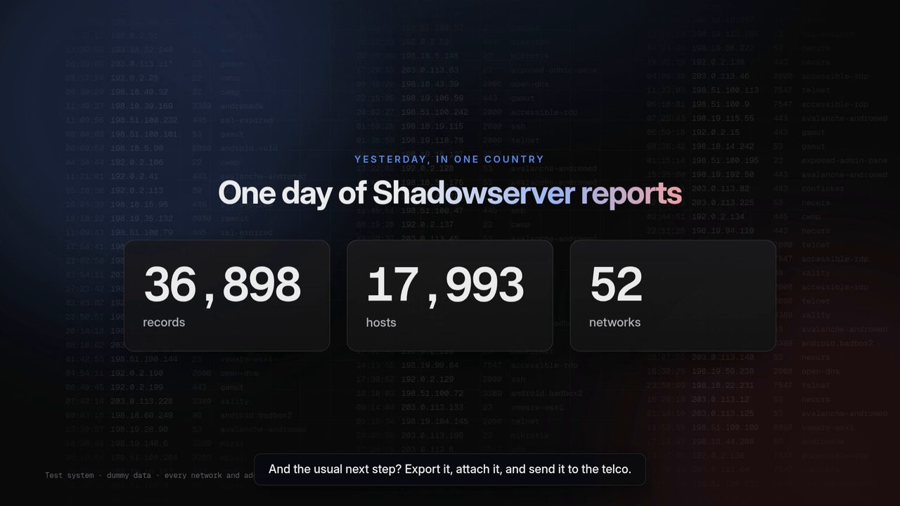
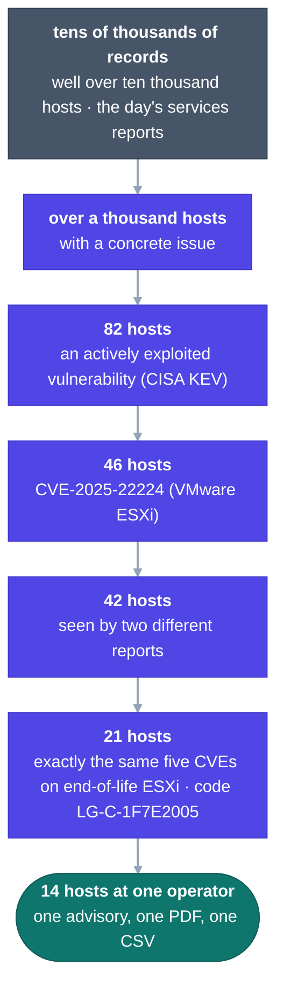
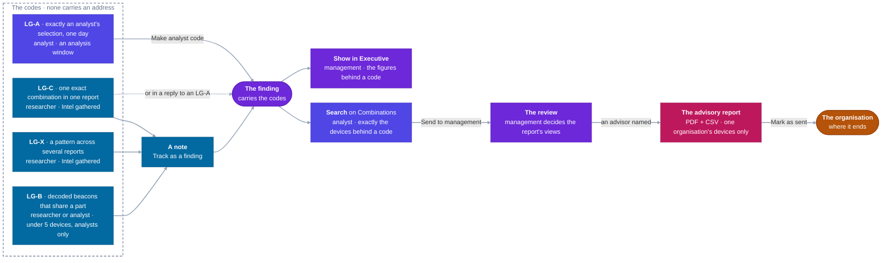
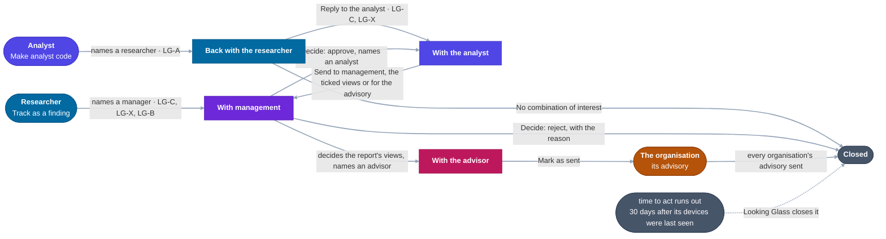
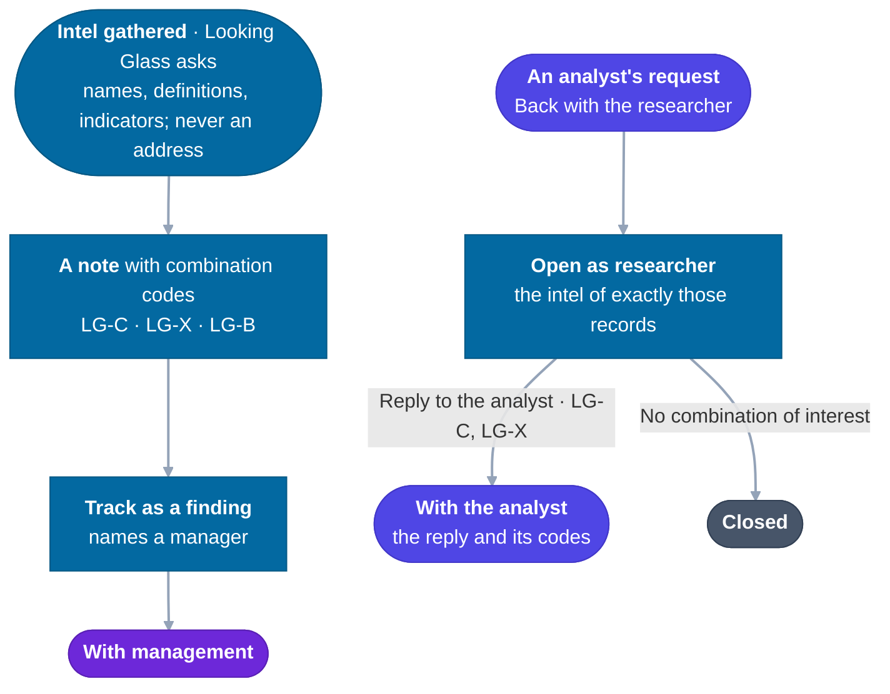
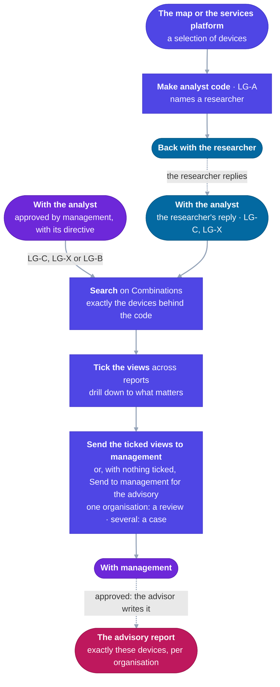
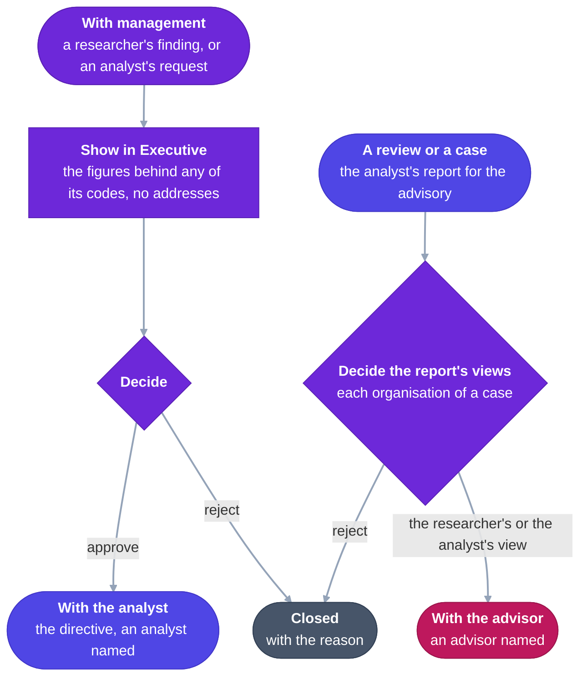
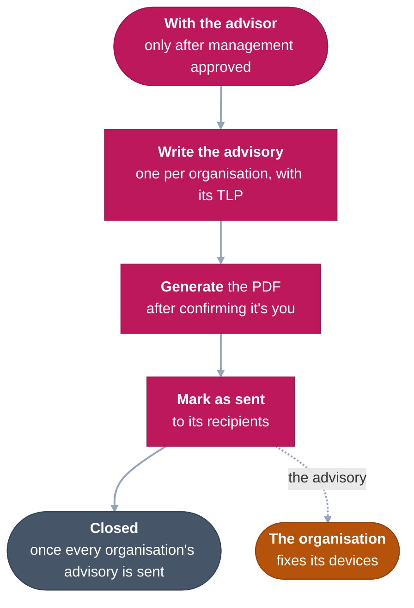

# Use case scenarios: a needle through the haystack

How a CSIRT team uses Looking Glass to turn a day of Shadowserver reports into a few advisories that a network operator
can act on, instead of forwarding a spreadsheet of thousands of addresses.

> All figures and network names on this page come from the **demonstration data** shipped with Looking Glass (fictional
> networks, documentation address ranges, real public CVEs). Your own figures will differ.

**Watch first:** the three stories on this page, told on screen in 11 minutes, narrated, with captions.

 <!-- film: use-cases -->

## Contents

1. [The problem: a full dump is not an advisory](#1-the-problem-a-full-dump-is-not-an-advisory)
2. [The approach: most probable first, then the next](#2-the-approach-most-probable-first-then-the-next)
3. [Who does what](#3-who-does-what)
4. [Scenario one: the researcher finds the needle](#4-scenario-one-the-researcher-finds-the-needle)
5. [Scenario two: the analyst asks first](#5-scenario-two-the-analyst-asks-first)
6. [The next days: watching the numbers fall](#6-the-next-days-watching-the-numbers-fall)
7. [Writing the advisory](#7-writing-the-advisory)
8. [Checklists](#8-checklists)
9. [The codes at a glance](#9-the-codes-at-a-glance)

---

## 1. The problem: a full dump is not an advisory

One day of Shadowserver reports for a country is large. In the demonstration data, the publicly accessible services
alone are **tens of thousands of records on well over ten thousand hosts, in dozens of networks**; the sinkholes and
honeypots add tens of thousands of events more.

The usual reflex is to export each operator's share and send it: one network alone has **thousands of affected
addresses**.
The engineer who receives that file has no way to tell which ten addresses are tomorrow's ransomware incident and
which eight thousand are old, low-risk exposure. The file sits in a mailbox; nothing is fixed; next week another file
arrives. The constituency learns to ignore CSIRT mail.

**The cost of a dump**

| What the operator receives | What happens |
|---|---|
| Thousands of addresses, every report type mixed | No starting point, so no start |
| No explanation of what each finding means | The risk is not understood, so it is not prioritised |
| The same addresses again next week | The CSIRT's mail is filtered out |
| No way to see progress | Nobody knows whether anything improved |

## 2. The approach: most probable first, then the next

Looking Glass narrows the haystack in steps, each one dropping the numbers, until what is left is a short list the
operator can act on today:

The signals that make a finding *probable* rather than noise:

| Signal | Where Looking Glass shows it | Why it matters |
|---|---|---|
| **Actively exploited** (CISA KEV), high CVSS, high EPSS | badges on every CVE; Definitions table; Executive | attackers are using it now |
| **Across reports** (⇄) | the Definitions tables' *Across reports* column; Intel gathered's *Across reports* view | two independent sensors see the same device: not a one-off |
| **Exact combinations** | Intel gathered's *Combinations* (with codes) | the same set of flaws or indicators on many devices is a pattern: one campaign, one product line, one fix |
| **Repeating devices** (↻) | combinations and values | a device that keeps carrying the set is not a scanning artefact |
| **Severity and peak hour** | the analysis windows, the Executive portal | what is critical, and when it is active |
| **Trend** (7-day baseline) | the Executive portal | rising problems first; a falling one shows the advisories work |

Handle the top of the list first. Next day, the next one. Each advisory is small, explained, and specific to one
operator, so it gets done, and the next day's numbers show it.

## 3. Who does what

| Role | Sees | Does |
|---|---|---|
| **Researcher** | names, definitions, indicators, combinations; **never an address** | finds patterns, writes notes, makes combination codes (LG-C, LG-X), tracks a note as a finding, answers analysts |
| **Analyst** | everything, with addresses | makes analyst codes (LG-A), pulls exactly the devices behind a code, sends the report to management for the advisory |
| **Management** | aggregated figures, trends, regions; **never an address** | weighs a finding against the trends, decides, names who takes it next |
| **Advisor** | the findings management approved for them, and their organisations | writes each organisation's advisory, generates the PDF, marks it as sent |

They meet on the **Findings** page (`/findings`). Every finding has a number, a status (*With management, Back with
the researcher, With the analyst, With the advisor, Closed*) and a history of every move and reply. Each hand-over
names the person it goes to, and only the people in a finding see it. The e-mails between them can stay; the state
lives in one place.

### The codes, and where they go

A code names exactly a set of records and never an address, so researchers and management can pass it on; only the
analyst's **Search** turns it into devices, and only the advisory report sends devices out, to their own organisation.

### The life of a finding

Management can also use **Move it on** to send any open finding to a manager, a researcher, an analyst or an advisor,
or close it. An administrator can do every role's work; the history shows which role they played.

### A researcher's view

### An analyst's view

Another way in: an analyst can ask management for analysis across reports on the devices of a code; it goes to the
manager they name.

### Management's view

### An advisor's view

## 4. Scenario one: the researcher finds the needle

**1. Researcher: spot it.** On the **Definitions** page, sort the issues by **Hosts** (click the heading: ▲ ▼).
*Exposed admin panel* tops the list with thousands of records: real, but broad. Sort by **Across reports** instead:
**CVE-2025-22224** carries the ⇄ flag (42 hosts in two reports) and the badges *Actively exploited · CISA KEV*.

**2. Researcher: look closer.** **Intel gathered** on CVE-2025-22224 shows the combinations: 21 hosts carry exactly
*CVE-2024-22252 + CVE-2024-37085 + CVE-2025-41236 + CVE-2025-41237 + CVE-2025-41238 + end-of-life VMware ESXi*, 12 of
them in more than one record; the *Across reports* view shows 19 hosts with the same set in both reports
(`LG-X-C5CDB416`). Five flaws on unsupported hypervisors: one door to every server behind it.

**3. Researcher: write it down.** Open **Notes** on the row. In *Combinations for this note*, pick the combination
from *Seen in the reports* (nothing to type, so no typos): `LG-C-1F7E2005`. Write what it means, tick **Track as a
finding**, give it a title (*Exploited ESXi hypervisors, end of life*), and name the manager it goes to. It becomes
**Finding #1**, *With management*.

**4. Management: weigh it.** On the Findings page, **Show in Executive**: the portal filters itself to the code:
21 hosts, Nairobi and Mombasa, the networks, the severity. Management uses **Decide**: approve, with the directive
(*Prioritise: ransomware exposure*), and names the analyst. It is now *With the analyst*.

**5. Analyst: pull the devices.** **Search** on the finding opens the **Combinations** page with the code: the
devices, records, the region map (hover a region for its addresses), networks, ports, the busiest hosts. In
**Report for**, choose the operator with most of them: **Tsavo Wireless, 14 hosts**. Download the PDF + CSV.

**6. Analyst: send it for the advisory.** Tick the views that matter and **Send the ticked views to management**: a
review of exactly those 14 hosts.

**7. Management: decide the report.** On the review, keep the analyst's view and name an advisor. It is now *With the
advisor*.

**8. Advisor: write and send.** **Write the advisory** for Tsavo Wireless, **Generate the report** and **Mark as
sent**: 14 hosts, not thousands. The finding closes once every organisation's advisory is sent; the other operators
get theirs the same way.

## 5. Scenario two: the analyst asks first

**1. Analyst: notice something.** On the map, an analysis of one network and one infection (*Lakeside Broadband ·
android.badbox2*) shows devices calling several sinkholes. Before sending anything, the analyst wants a researcher's
view.

**2. Analyst: ask with a code.** **Make analyst code** in the analysis window. Title and question (*Which of these
call the same sinkholed C2 domains? Check before I send*). Looking Glass keeps exactly those records and makes `LG-A-…` and **Finding #2**.

**3. Researcher: answer without seeing an address.** **Open as researcher** on the finding: the selection in words
(the host is "1 host, address held back"), the names in it, their definitions, combinations and cross-report patterns
with their codes. Tick the codes that answer the question and **Send the reply**: it lands in the finding's history.

**4. Management: read both sides.** **Show in Executive** works with the analyst's code too (that day, counts only).

**5. Analyst: send it on.** Search the researcher's code from the reply for exactly the devices that call the same
sinkholed domain, then send it to management for the advisory, as in scenario one.

## 6. The next days: watching the numbers fall

- Search a code again over **a date range of the stored history** (up to 31 days) on the Combinations page: devices
  per day show whether the operator has fixed them.
- The **Executive portal** compares every figure with its own 7-day average; filtered by the code, the drop is visible
  to management.
- A finding closes when every organisation's advisory is sent, or by itself when its time to act runs out (30 days
  after its devices were last seen).

## 7. Writing the advisory

The advisor writes it on the finding's advisory page (`/advisory/<number>`), once management has approved the finding,
one organisation at a time:

1. **Pick the organisation**: a network in the finding's search, with how many of its devices and records are in it.
2. **See its data**: its addresses with their ports, reports, CVEs and issues, and the impact of those reports, so the
   advisory is written from what the PDF will carry.
3. **Write** the subject, the **Description** (the impact) and the **Recommended Actions**: what the organisation
   should do (patch, isolate, replace end-of-life systems) and by when. Bold, bullets and numbering are kept in the PDF.
4. **Generate the report**, after confirming it's you. It holds:
    - the advisory's pages: your organisation's name and logo, the organisation's affected addresses, CVEs and issues,
      the reports with their impact, and your Description and Recommended Actions;
    - the analyst's report on that organisation's devices only, with the definitions under Technical Details;
    - the Shadowserver report references.

    Every generated report is kept, with its download.
5. **Mark as sent** to its recipients, and go on to the next organisation. The finding closes once every
   organisation's advisory is sent.

## 8. Checklists

**Researcher, every day**
- [ ] Sort by *Across reports* and by *Hosts*; read the *Looking Glass asks* card
- [ ] Open Intel gathered on the top names; note exact combinations that repeat
- [ ] Write a note with the combination's code; track the strongest as a finding
- [ ] Answer analysts' codes on the Findings page

**Management**
- [ ] Open new findings; **Show in Executive**; check the trend and the regions
- [ ] Move each finding on with a short comment

**Analyst**
- [ ] Search the code; report per operator; send short advisories
- [ ] Make an analyst code when a selection needs a researcher's eye
- [ ] Re-search after a few days; close what is fixed

## 9. The codes at a glance

| Code | Made by | Stands for | Carries an address? |
|---|---|---|---|
| `LG-C-…` | researcher (Intel gathered, Notes) | one exact combination in one report | no |
| `LG-X-…` | researcher | one exact pattern across reports | no |
| `LG-A-…` | analyst (analysis window) | exactly the records of an analysis selection on one day | no |

See also: [User guide](USER_GUIDE.md#combination-codes-the-combination-search-and-findings) ·
[What is new](FEATURES.md) · [Glossary](GLOSSARY.md)
