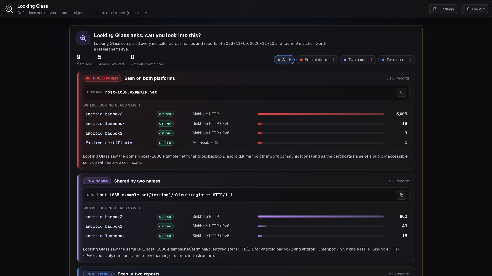
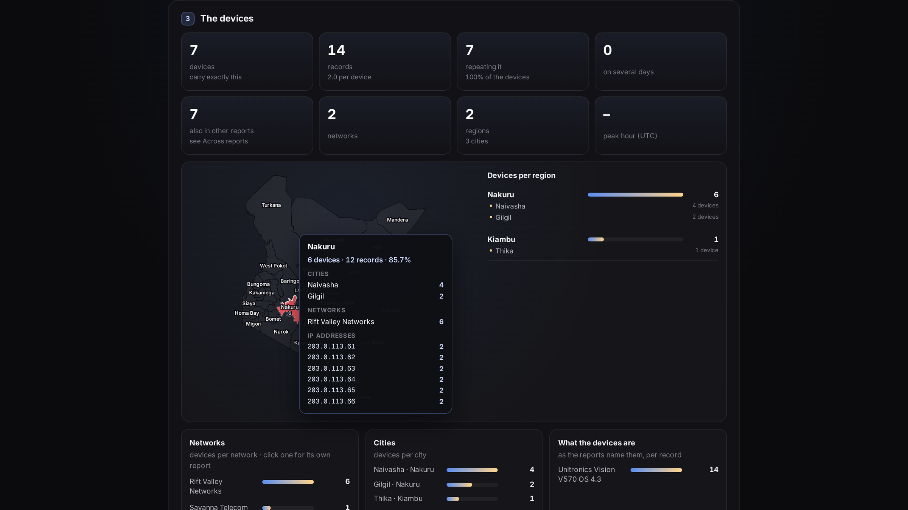

<svg class="lgh-logo" viewBox="0 0 32 32" width="88" height="88">
<defs><linearGradient id="lgh-arc" x1="8" y1="18" x2="20" y2="11" gradientUnits="userSpaceOnUse"><stop offset="0" stop-color="#5b8def"/><stop offset="1" stop-color="#e5484d"/></linearGradient><clipPath id="lgh-lens"><circle cx="14" cy="14" r="8.9"/></clipPath></defs>
<circle class="lgh-glass" cx="14" cy="14" r="8.9" fill="#141417"/>
<g class="lgh-grid" clip-path="url(#lgh-lens)" fill="none" stroke="#ededef" stroke-opacity=".18" stroke-width=".8"><ellipse cx="14" cy="14" rx="9" ry="3.4"/><ellipse cx="14" cy="14" rx="3.6" ry="9"/></g>
<path class="lgh-arc" d="M8.4 18.2 Q12.4 6.6 19.4 11.6" fill="none" stroke="url(#lgh-arc)" stroke-width="1.7" stroke-linecap="round" pathLength="100"/>
<circle class="lgh-src" cx="8.4" cy="18.2" r="1.5" fill="#5b8def"/>
<circle class="lgh-ring" cx="19.4" cy="11.6" r="2.7" fill="none" stroke="#e5484d" stroke-width=".8"/>
<circle class="lgh-hit" cx="19.4" cy="11.6" r="1.5" fill="#e5484d"/>
<circle class="lgh-rim" cx="14" cy="14" r="10" fill="none" stroke="#ededef" stroke-width="2" pathLength="100"/>
<path class="lgh-handle" d="M21.4 21.4 L27.6 27.6" stroke="#ededef" stroke-width="3" stroke-linecap="round" pathLength="100"/>
</svg>

Free and open source · built in Africa, for African CSIRTs

# Your Shadowserver reports, replayed as a living picture of your country

Looking Glass turns the daily Shadowserver reports into two live platforms, analysis that finds
the few devices that matter, and reports you can send. One modest server and a guided installer: useful on day one.

[Install it](INSTALLATION.md){ .md-button .md-button--primary }
[Read the user guide](USER_GUIDE.md){ .md-button }
[See it used](USE_CASES.md){ .md-button }

<!-- film: overview compact -->

## Where to start

-   :material-download-circle-outline:{ .lg-ic .blue } **Install**

    ---

    Ubuntu 24.04 or later, on a server, a virtual machine or WSL 2. The installer asks, checks every answer on the
    spot, and installs everything.

    [Installation](INSTALLATION.md) · [Connecting the mailbox](MAIL_SETUP.md)

-   :material-radar:{ .lg-ic .violet } **Analysts**

    ---

    The two platforms, one-click analysis, the hosts to follow up first, and a report per network provider to
    attach to an advisory.

    [User guide](USER_GUIDE.md) · [Use cases](USE_CASES.md)

-   :material-flask-outline:{ .lg-ic .amber } **Researchers**

    ---

    The Definitions page: what the reports carry for every name, the exact combinations, notes with codes, and
    what Looking Glass asks you to look into.

    [Use cases](USE_CASES.md) · [Glossary](GLOSSARY.md)

-   :material-chart-box-outline:{ .lg-ic .teal } **Management**

    ---

    The Executive portal: aggregated figures only, never an address, compared with a 7-day baseline, with a
    one-click executive report.

    [User guide](USER_GUIDE.md) · [Features](FEATURES.md)

-   :material-shield-lock-outline:{ .lg-ic .red } **Administrators**

    ---

    Accounts, roles, two-factor sign-in, sessions, the audit log, backups and the checks that prove each
    protection on your own installation.

    [Operations](OPERATIONS.md) · [Security](SECURITY.md)

-   :material-scale-balance:{ .lg-ic .slate } **Comparing tools**

    ---

    Looking Glass complements IntelMQ and the Elastic Stack: IntelMQ notifies, Elastic searches, Looking Glass
    shows.

    [The honest comparison](COMPARISON.md)

## See it working

<!-- film: use-cases compact -->
<!-- film: finding-to-advisory compact -->

The chapters of each film are on its page: the use cases at the top of [Use cases](USE_CASES.md), and From finding
to advisory under
[Advisories](USER_GUIDE.md#advisories-the-advisor) in the user guide.

## How it works

1. **Collect.** The database pipeline fetches your Shadowserver reports with your Shadowserver API key, or reads the
   mailbox that receives them (Gmail / Google Workspace, Microsoft 365 or any IMAP server), falling back from one to
   the other when needed. It skips what it already has.
2. **Load.** Each report goes into MongoDB, one collection per report type, without duplicates.
3. **Replay.** Shadowserver sends a day's reports during the next day; Looking Glass replays that day in full, at
   the same time of day, so a wall screen always shows a living picture.
4. **Analyse and share.** Analysts drill down and export; researchers define and explain; executives get
   aggregates; partners see masked views.

## A needle through the haystack

Instead of forwarding a network operator thousands of reported addresses, narrow the day's reports step by step
(actively exploited, seen by several reports, the same exact combination on many devices, repeating) to the few
devices most likely to matter, send that operator a short, explained report, then take the next.

[Follow the use cases step by step](USE_CASES.md){ .md-button .md-button--primary }

Every screenshot uses dummy data: documentation IP ranges (RFC 5737 / RFC 2544 / RFC 3849), private AS
numbers and fictional network names. Looking Glass is free software under the
<a href="https://github.com/anonghosty/looking-glass/blob/main/LICENSE">GNU AGPL-3.0</a>.

